# Game compatibility fixes

These cases exercise the standalone content loader and the shared emulator core.
The local corpus is not distributed with the repository. Set `LAVAX_GAME_ROOT`
to its `lavax_game` directory, then run:

```powershell
cargo test --release -p lavaxemu --test game_compatibility -- --ignored
```

Only games with a completed display and input regression appear below. Startup
without an execution error alone does not establish playability.

## Dark Chess (暗子象棋)

- Content: `LAVA1 暗子象棋/未打包/暗子象棋.lav` and `LAVA1 暗子象棋/暗子象棋.pac`.
- Problem: the game opens `/LavaData/SCC.dat`, but its unpacked companion
  `SCC.dat` sits beside the program. The missing-file screen exits on a key press.
- Fix: when an exact `/LavaData/...` file is missing, resolve an existing
  companion at the content root. Actual device directory files take priority.
  Reads and writes use the same file entry, preserving write-back to the
  original companion rather than making a divergent copy.
- Validation: title, player-name prompts, board, cursor movement, piece flipping,
  and continued execution; 1,800-frame scripted replay and an opt-in regression. Both
  distribution entry points now run the same board/cursor/flip regression.
  The package loads its embedded data and reveals a pawn after confirmation.

| Packaged board | Packaged flipped piece |
| --- | --- |
| 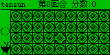 | 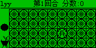 |


| Before | Board after input |
| --- | --- |
|  |  |

## Pet World 3H (宠物世界3H)

- Content: `LAVA1 宠物世界/GVmaker/NC3000/宠物世界3H.lav`.
- Problems: opcode `0x00` was rejected at `0x72`, although the reference VM
  treats it as a no-op. Importing only `GVmaker/NC3000` also omitted the sibling
  `LavaData/宠世图片.dat` directory.
- Fix: accept zero padding as a no-op; recognize `GVmaker` and `LAVA` device
  layouts with a sibling `LavaData` directory in both frontends. Standalone
  write-back uses the same root. Flat bundles retain their own content root.
- Validation: pet sprites, status information, pet management, detail pages,
  menu navigation and continued execution. Unit tests cover padding and
  nested resource/write-back paths, including unrelated ancestor directories.
  Write-back preserves existing on-disk path casing on case-sensitive systems.
  External multiplayer is outside this basic-control check.


## Princess Maker 4 (美少女梦工场4)

- Content: `LAVA2 美少女梦工场/非pac/PM4.lav`.
- Problem: `/LavaData/pm_data*.dat` and `PM4_cfg.dat` could not be opened in
  the flat bundle, leaving a blank screen and exiting in the first frame.
- Fix: the shared flat-companion resolution above restores all four data
  files. This game's separate regression covers the complete introduction,
  character confirmation, main room, and opening the status screen with Enter.
- Validation: 6,666 scripted frames without an error or exit, a 15,000-frame
  exploratory replay, and visual inspection of the room and status pages.

| Main room | Status screen after Enter |
| --- | --- |
|  |  |

## Puzzled Sheep

- Content: `LAVA1 Puzzled Sheep/Psheep.lav`.
- Problem: starting the game opens `/GVMdata/Psheep.dat`, while the bundle
  places `Psheep.dat` beside the program; the game displayed `Error!` and exited.
- Fix: recognize the legacy `/GVMdata` resource prefix for existing flat
  companions, with the same exact-path priority as `/LavaData`.
- Validation: first-level loading, cursor movement, simulation animation,
  Escape to leave simulation, and 1,200 exploratory frames. Checked the
  supplied game source to verify the expected controls and resource name.

| Level selection | Simulation running |
| --- | --- |
|  |  |

## Hit (打地鼠)

- Content: `LAVA2 打地鼠/LAVA2/Hit.lav`.
- Problem: the `LAVA2` program folder was not recognized as part of a device
  layout, so `/LavaData/MULogo.dat` could not be loaded and `Read Error` appeared.
- Fix: recognize `LAVA2` alongside `LAVA` and `GVmaker` in both frontends.
- Validation: logo, playfield, nine TYUGHJBNM hit controls, P to pause and
  Enter to resume. The regression checks the framebuffer stays frozen during
  a 120-frame pause and changes again after resuming. Also replayed 1,800 frames.
- Timer follow-up: `GetTime` now advances with the deterministic 60 Hz clock,
  including calendar rollovers. Previously it always returned the initial
  timestamp, preventing the game's countdown from advancing. The regression
  checks the game's time buffer changes over two seconds; clock tests cover
  leap years, year rollover, SetTime/GetTime, and save-state phase restoration.


## Counter-Strike 1.3 (CS 1.3)

- Content: `LAVA1 CS 1.3/非pac/Cs(lav)1_3.lav` and `LAVA1 CS 1.3/Cs(lav)1_3.pac`.
- Problem: the flat bundle's `Csgun.dat` and other resources could not be
  opened through `/LavaData`, preventing normal startup.
- Fix: shared resource resolution restores startup, animation and mission
  assets. This game's separate regression exercises the title, setup menu,
  mission loading and direction controls after the calendar-clock fix.
- Validation: the replay selects Start, confirms Ready, and reaches combat.
  Direction input changes the actual camera coordinate, and the mission
  framebuffer changes as well. Stage checks follow guest execution rather
  than assuming a fixed animation duration.
  Both entry points run the same mission workflow. Wait for the first scene
  to render after the loading loop, then open B, choose the pistol category
  with B and confirm USP with Enter. Holding Z consumes ammunition (12 to 7)
  and renders the firing animation. Menu transition animations are allowed
  to finish before the next selection. Reserve-ammunition purchasing is not
  covered by this regression.

| Packaged mission | Pistol selection | After firing |
| --- | --- | --- |
| 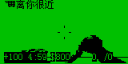 | 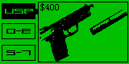 | 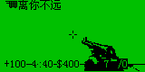 |


| Title | Mission |
| --- | --- |
|  |  |

## Crazy F2 (疯狂F2)

- Content: `LAVA1 疯狂F2/F2.lav`.
- Problem: its five-second F2-press round polls the seconds returned by
  `GetTime`; the fixed timestamp previously prevented completion.
- Fix: the advancing guest calendar restores the round timer. This game's
  regression selects a platform, starts with F2, presses F2 five times, and
  waits for the score screen without injecting further input.
- Validation: the round completes and reports a positive press count. The
  initial title intentionally waits for F2, rather than Enter, to begin.


## Lost Fantasy

- Content: `LAVA1 lost fantasy/LF_demo.lav` and `LF_demo(PC).lav`.
- Problem: the device version continuously captures and redraws the full
  monochrome screen. Per-pixel buffer access made its 1,800-frame corpus
  replay exceed the 45-second scan limit. The PC version adds a 30 ms delay.
- Fix: copy in-bounds monochrome bitmaps in groups of eight pixels, and pack
  captured rows directly. Clipped, mirrored, inverted, and other color modes
  retain their existing paths. The bitmap fast paths preserve pixel results;
  presentation pacing is handled separately below.
- Validation: the same 1,800-frame replay completes in about 2.9 seconds when
  run individually on the development machine; frame 1,199 is identical to the
  previous capture. Both versions respond to D movement, with horizontal
  position and framebuffer differences checked against an idle clone.
  Bitmap tests exercise all 256 byte patterns and neighboring-pixel boundaries.


## Speed Racing corpus variant (极速狂飙 / 生死时速II)

- Content: `LAVA1 极速狂飙/极速狂飙.lav`, whose in-game title is 生死时速II.
- Problem: `Refresh` copied the framebuffer but kept executing guest code in
  the same host frame. Unthrottled draw loops consumed CPU and advanced past
  the moment when the frontend could deliver steering input.
- Fix: `Refresh` now returns `Presented`, yielding to the host after each
  visible frame. Unit tests check that successive presented frames remain
  distinct. The instruction budget remains unchanged.
- Validation: enter the main menu, select a difficulty, and start the game.
  Right steering changes horizontal position and the rendered track compared
  with an idle clone. All previously completed game regressions are rerun;
  the CS 1.3 replay now explicitly handles its Ready confirmation.


## Modified Speed Racing II (生死时速Ⅱ修改版)

- Content: `LAVA1 生死时速II/生死时速Ⅱ（修改版）.lav`.
- Problem: its score loop repeatedly calls Locate, printf and Inkey without
  Refresh. Profiling found 6,250 identical score prints in one host frame,
  making the full replay exceed the 45-second scan limit.
- Fix: printf yields `Presented` after rendering its console output, giving
  the frontend a display/input boundary for console-driven loops as well.
- Validation: choose easy mode, steer right, reach a stable score screen, and
  return to the mode menu with Escape. Steering position is checked against
  an idle clone. A 3,600-frame replay completes in about 0.4 seconds locally.
  A core test confirms console output is presented before the next input poll.

| Score | Menu after Escape |
| --- | --- |
|  |  |

## Resource Manager (文件夹助手 3.7)

- Content: `LAVA1 百战天虫即时版/资源管理器.lav`.
- Problem: FileList returned cancellation immediately, so the program exited
  without showing its directory picker.
- Fix: implement the blocking file picker, GBK names, cursor and page navigation,
  selection/scroll return values, cancellation, and SetList help/delete flags.
  The caller handles directory changes and file operations, as in the reference VM.
- Validation: dismiss the splash, move the selection, open the file action menu,
  restore a pending picker save state, cancel, and confirm normal exit. Core tests
  cover Chinese names, paging, special keys, reset, and version 2 state migration.
  This introduced save-state version 3; current states retain version 2 loading support.

| Directory picker | File actions |
| --- | --- |
|  |  |

## Pet World legacy and L variants (宠物世界)

- Content: NC2600, NC3000, TC1000, TC1000S, and TC808 pairs under
  `LAVA1 宠物世界/GVmaker`.
- Initial finding: the five `宠世L_*.lav` variants exit immediately when
  `/LavaData/宠世存档.sav` does not exist. The main variants can start a new game.
- Validation: start each matching main variant, open the left/right menu,
  move right four times to 存档, and confirm. Transfer the actual written save
  into its L variant, then verify the sprite, pet management, and details controls.
  All five pairs pass without modifying their game binaries or synthesizing saves.
  This closes the earlier startup-only scan gap for these variants; the existing
  device-resource loading fixes are sufficient.


## Magic / 神州

- Content: `LAVA1 神州/神州.pac` and `非pac/Magic.lav`.
- Problem: the loose `非pac/Magic.lav` cannot open `GameSource.dat`, which is
  only present inside the PAC.
- Fix: both frontends can load the complete PAC. For a loose LAV, they also check
  PAC files beside it and in its parent directory. A package must contain the exact
  same program bytes before its missing resources are mounted in memory. Existing
  files, including loose saves resolved through LavaData aliases, take priority.
  The search stops at the nearest matching package and does not unpack onto disk.
- Validation: both the complete package and the loose LAV open `GameSource.dat`, display the intro,
  advances through dialogue, and reaches the map. Right input changes the rendered
  player position compared with an idle clone. Unit tests cover multiple entries,
  Chinese paths, truncated records, invalid paths, and the libretro load lifecycle.
  Additional regressions reject mismatched/incomplete companion packages and verify
  that an existing loose save remains authoritative and writes back to its original file.
  A filename-only CLI launch from the loose game's working directory is covered as
  well: relative paths are resolved before companion lookup and write-back. The
  earlier empty parent path caused even `lavaxemu --info Magic.lav` to fail.

| Map | After right movement |
| --- | --- |
|  |  |


## Super Robot Wars (超级机器人大战)

- Content: `LAVA1 超级机器人大战/Setup/SRWDate.lav`, `Setup/SRW.lav`,
  and `Download/SRW.pac`.
- Initial finding: opening `Setup/SRW.lav` before running its data installer
  displays an installation error. `SRWDate.lav` finishes quickly because it is
  the installer, rather than a standalone game.
- Validation: execute the installer to completion, transfer its actual written
  data files into the setup game, start a new game, and advance into the tactical
  map. Right input moves the cursor compared with an idle clone. The complete PAC
  also loads its data and point tables and reaches the map and unit information.
  The PAC loader fixes the complete-package entry point; the setup pair works
  with the existing virtual file write-back workflow.

| Tactical map | Cursor after right input |
| --- | --- |
|  |  |

## Magic Era (魔法纪元)

- Content: `LAVA2 魔法纪元/魔法纪元.lav`.
- Problem: after the title prompt, the game checks that GetPID's high byte is
  `L` and exits when the previous zero-valued implementation fails this check.
  The reference PC VM also deliberately returns zero, so matching its exit alone
  would not satisfy compatibility with a Lava device.
- Fix: return the stable virtual Lava device identifier `0x4c000001`, following
  the device identifier layout shown in the original VM source. It remains
  consistent across resets and does not use a physical device's identity.
- Validation: pass the title/menu, start a new game, advance the opening story,
  and reach the castle map. Right input changes the player's rendered position
  against an idle replay. The regression covers 18,120 frames; the identifier
  test checks the value before and after reset. All 16 content/layout regressions
  pass, and a fresh scan of 267 LAV programs plus 57 PAC packages reports no
  loading errors, runtime errors, or timeouts. The scan does not certify every
  game's complete interaction flow.

| Castle map | After movement |
| --- | --- |
|  |  |

## New Hero (新英雄坛说)

- Content: `LAVA1 新英雄坛说/非pac/Hero.lav`.
- Validation gap: the short batch replay only reached the long introductory
  dialogue and could not establish that the map accepted input.
- Validation: advance 7,200 frames through the startup sequence into the village,
  then compare separate up/down branches with an equal-duration idle replay.
  Up moves the player; down moves the player and scrolls the village map.
  The existing core and resource fixes suffice; this adds a gameplay regression
  rather than changing the game or emulator behavior.

| Village | Map after down input |
| --- | --- |
|  |  |

## Tokimeki (心跳回忆)

- Content: `LAVA2 心跳回忆/心跳回忆.lav`.
- Validation gap: the initial short replay remained in the story; a later room
  capture alone did not prove the activity controls worked.
- Validation: advance into the room, change the selected bottom icon with Right,
  open the club/work menu, select its ESC item with Enter to return to the room,
  and open Help (guest key 25 / F5) to display the icon descriptions. The menu's
  ESC item is selected with Enter; the physical Escape key does not close it.
  Several study activities update attributes without replacing the room image.
  No additional emulator behavior changes were needed for this workflow.

| Room | Club/work menu | Help |
| --- | --- | --- |
|  |  |  |

## Gamble (先赌为快)

- Content: `LAVA1 先赌为快/先赌★为快.lav`.
- Problem: the board's device-specific heart, snail, and other icons use F8–FD
  codes outside GB2312. The existing font rejected these pairs and interpreted
  subsequent bytes as unrelated Chinese characters, making the board unreadable.
- Fix: add the 527 built-in 16×16 NC/TC device icon glyphs and decode their
  documented two-byte range. The unchanged bitmap asset comes from the MIT-licensed
  WQX toolbox; its pinned source and retained license are in the assets directory.
- Validation: register a local account through 新手上路, acknowledge its restart
  request, reload the actual account file, and log in through 再续赌缘. The full
  board now displays its icons. Q adds a bet, Enter advances the round, the result
  prompt appears, and another bet can be placed afterward. The core regression
  checks the heart bitmap and the following ASCII character's position.

| Before | Correct board | Completed round |
| --- | --- | --- |
|  |  |  |

## Shushan (蜀山群侠传)

- Content: `LAVA1 蜀山群侠传/蜀山注册.lav` and `蜀山群侠传.lav`.
- Validation gap: the main game needs a local character account created by its
  separate registration program. Sending generic menu keys without that account
  never verified actual gameplay.
- Validation: follow the bundled manual, create an account and confirm with Y,
  transfer the registration program's actual `M-lava.dat` file, then log in with
  the main game after its splash finishes. Advance the story to the first map,
  compare upward movement with an idle branch, and open/close F3 character status.
  This verifies the existing shared file workflow without synthesizing a character
  save or changing the game binary.

| First map | Character status |
| --- | --- |
|  |  |

## My World corpus variant (我的世界～霸王屎)

- Content: `LAVA1 我的世界~霸王屎/我的世界.lav`.
- Validation gap: the generic direction sequence selected Exit from the main menu;
  an early halt therefore did not determine whether the game itself was playable.
- Validation: wait for the introductory animation, start a new character, enter a
  name, and confirm the character setup. The program loads `mine_SC.dat` and enters
  its tile map. Up input changes the player's rendered position compared with an
  equal-duration idle replay. No emulator behavior change was needed for this path.

| Map | After movement |
| --- | --- |
|  |  |

## Holiday Island (假日神秘岛)

- Content: `LAVA1 假日神秘岛/假日神秘岛 abcdef.lav`.
- Validation gap: the earlier replay sampled the lengthy opening sequence, during
  which the candidate movement keys did not affect the scene.
- Validation: advance 18,000 frames into the island map. Right input triggers the
  nearby conversation; further right presses finish it and walk along the path.
  A subsequent left branch changes the player/camera position relative to an
  equal-duration idle replay. Map tiles, characters, and dialogue render correctly.
  This closes the sampling gap without changing the program's original intro.

| Island map | Conversation | After walking along the path |
| --- | --- | --- |
|  |  |  |

## Crazy Ball updated corpus version (疯狂弹球)

- Content: `LAVA1 疯狂弹球/疯狂弹球.pac` and `非pac/crazyball.lav`.
- Problem: the loose program could display its setup screens but failed to load
  `/CBMap/stagepack.dat`, reporting a stage-pack error instead of starting play.
- Fix: the matching-package loader supplies the missing CBMap files from the PAC,
  whose embedded program is byte-for-byte identical to the loose LAV.
- Validation: both entry points complete the initial player/control setup and
  display the first stage. Enter launches the ball; it hits bricks and scores.
  Left input changes the paddle position relative to an idle clone executing
  the same number of frames. This is a separate version from `LAVA1 Crazy_ball`.

| Missing stage pack | Loose LAV after loading | Paddle after left input |
| --- | --- | --- |
|  |  |  |

## Planting Gold (种金币)

- Content: `LAVA1 种金币/种金币.lav`.
- Validation gap: a small final-frame thumbnail showed the stage chooser rather
  than the playing board, leaving its coin controls unverified.
- Validation: dismiss the logo, choose level one, and use D (the documented WASD
  controls) to move a coin and increment the step counter. F1 replays the level;
  after its wipe transition, the entire board and zero step count exactly match
  the initial state. No additional emulator behavior changes were required.

| Level one | Coin after D |
| --- | --- |
|  |  |

## Sky & Land (幕天席地 1.1)

- Content: `LAVA1 幕天席地1.1/幕天席地.lav`.
- Validation gap: the generic replay entered existing-account login without first
  creating a character, so its missing-account message did not validate gameplay.
- Validation: hold Enter briefly to leave the animated credit/title screens,
  choose a new game, confirm, and enter a local account and password. Up moves
  the character against an idle replay. F5 (guest key 25) opens the system menu;
  saving writes an 88-byte `LavaData/lava.sls` character file. Start a new emulator,
  provide that actual file, and log in: the saved map viewport and character
  position are restored exactly. The independently scrolling footer is excluded
  from the map comparison. No additional emulator behavior changes were needed.

| Map | System menu | Reloaded character |
| --- | --- | --- |
|  |  |  |

## Star Legend (星剑传奇)

- Content: `LAVA1 星剑传奇/未打包的[星剑传奇]/星剑注册.lav` and
  `星剑传奇.lav`; the PAC starts its embedded registration program.
- Validation gap: generic input stopped at account setup rather than proving
  that a registered character could enter the game. Both account and password
  must exceed five characters; the confirmation explicitly requires Y.
- Validation: enter a six-character account/password, confirm with Y, select a
  character, and enter a name. Registration writes a real 194-byte
  `LavaData/S-lavaxx.dat`. A fresh main-game instance reads that file, accepts
  the credentials, and displays the character summary. Enter opens the map;
  Up moves the character relative to an equal-duration idle replay. The PAC
  registration flow also reaches the success screen and writes the same file.
  No additional emulator behavior changes were required.

| Registration | Loaded character | Map movement |
| --- | --- | --- |
|  |  |  |

## Flat Cube (平面魔方)

- Content: `LAVA1 平面魔方/平面魔方.pac` and `非pac/平面魔方.lav`.
- Validation gap: the default menu selection opens instructions, so repeated
  Enter input never established whether the puzzle itself worked.
- Validation: Right then Enter starts the challenge. Direction keys select a
  tile; M then Right shifts a row and increments the move count. C, Right, Enter
  exchanges two tiles and reduces the exchange allowance from three to two.
  Esc opens the exit confirmation, and Y returns to the main menu. Both entry
  points render the full 5-by-5 icon grid and perform these operations. No
  additional emulator behavior changes were required.

| Starting board | Row shifted | Tiles exchanged |
| --- | --- | --- |
|  |  |  |

## Rocket Car (火箭车)

- Content: `LAVA1 火箭车/火箭车.lav`.
- Problem: menus and sprites rendered, but most track traffic disappeared once
  the initial screen scrolled away. The program accesses `_GRAPH` directly;
  address zero was returned without actually mapping the packed front buffer.
- Fix: lazily map GVmaker 1.0's 160-by-80 monochrome front/back buffers at
  addresses 0 and 1600. Keep guest assignments, memory-copy calls, and drawing
  calls coherent. Track RAM writes and synchronize small point/rectangle updates
  by region so repeated cursor drawing does not copy the entire screen.
  The layout is corroborated by
  [GVmakerSE RamManager](https://github.com/arucil/GVmakerSE/blob/f87166975bebfb3672c69de89838765a7106dde0/src/main/java/eastsun/jgvm/module/RamManager.java)
  and [its packed screen buffers](https://github.com/arucil/GVmakerSE/blob/f87166975bebfb3672c69de89838765a7106dde0/src/main/java/eastsun/jgvm/module/DefaultScreenModel.java).
  Save-state version 4 preserves activation and continues to load versions 2/3.
  Larger/color displays retain their existing unsupported direct-buffer behavior.
- Validation: start play and advance beyond the initial traffic. The track
  continues to render; Up changes the player position against an idle branch.
  Esc opens the score/name screen; entering a driver name returns to the title.
  Unit tests cover direct writes, drawing across packed-byte boundaries, bulk
  copies, and save-state restoration.

| Before | Track after the fix | Steering |
| --- | --- | --- |
|  |  |  |

## Lazy YY Milk Battle (Lazy YY 牛奶大战)

- Content: the loose LAV and PAC in `LAVA1 Lazy YY牛奶大战/Ver1.2`, and the
  PAC in `Ver1.5 For TC800 Only`.
- Validation gap: the generic input sequence did not use the game's feeding
  keys. The empty dashed slots are the item inventory, not an account prompt.
  Version 1.2 creates `CatUser.dat` automatically when needed.
- Validation: enter challenge mode and start the first stage. Version 1.2 uses
  G/J to feed left/right; version 1.5 uses Left/Right. Feeding changes the
  milk/target state relative to an idle branch; the grey version's remaining
  target count drops from 150 to 149. Space pauses each version and the scene
  remains identical over another 60 frames. Space resumes 1.2; Enter selects
  Continue in 1.5's pause menu. Esc returns to the menu. Monochrome and grey
  sprites, counters, and menus render correctly.
- Frontend fix: the window previously translated physical Space to B, so actual
  keyboard users could not trigger the pause tested with guest key 32. Space now
  sends 32, and the regression drives the actual window keyboard translator.
  B/1 retain the B action. RetroArch now polls keyboard input alongside joypad
  input, exposing the game's Space/G/J keys as well as Enter, letters, page keys,
  Shift, and F1–F6 needed by other games. Both hosts also accept 0 and period.
  Keyboard IDs follow the official
  [libretro keyboard API](https://github.com/libretro/libretro-common/blob/master/include/libretro.h).
  A libretro lifecycle test delivers physical Space through `retro_run` to a
  guest GetChar call and checks that it receives 32.

| Monochrome play | Monochrome pause | Grey feeding | Grey pause menu |
| --- | --- | --- | --- |
|  |  |  |  |

## Extreme Landlord 3.2 (极限斗地主)

- Content: `LAVA1 极限斗地主/极限斗地主.lav` and all three LAVs in
  `LAVA1 极限斗地主3.2` (standard, NC1020, TC800).
- Validation gap: fresh installations wait for Down to page through the first-run
  notice and Y to accept it. Enter does not advance that notice. The TC800
  version also starts its built-in name editor in pinyin mode; Shift switches
  to English entry. The original folder includes an existing player save.
- Validation: complete first-run setup where needed, enter a player name,
  choose a game, deal the cards, and bid. Right moves the cursor; Up raises a
  card and Down cancels that selection, restoring the exact prior frame. P
  suggests a legal play and Enter plays it, reducing the hand. F4 then Y ends
  the round with the game's stated score penalty; Enter returns to the scores.
  This writes the updated `jxddzsave*.dat` file automatically. All four versions
  execute these flows with correctly rendered hands, card backs, and scores.
  No additional emulator behavior changes were required.

| Dealt hand | Card selected | Card played | Updated scores |
| --- | --- | --- | --- |
| 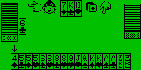 | 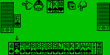 | 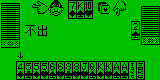 | 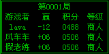 |

## Champion Football Manager (冠军足球经理 05–06 v0.7)

- Content: `LAVA1 冠军足球经理05-06赛季0.7/CFM.lav` with `CFMdata.dat`.
- Validation gap: startup input did not complete the two password entries or
  obtain a coaching appointment. As the supplied readme explains, new coaches
  must approach weaker second-division clubs; stronger clubs reject them.
- Validation: create a coach, enter and confirm a password, and apply to Venezia
  in Italy's second division. Accept the appointment, keep the default budget
  allocation, and finish the season introduction. Training menus open correctly.
  Start and complete the first fixture; results and standings show Venezia's
  loss and the manager advances to round two. Save and leave exits normally and
  writes the 4014-byte `mdata0.sav` plus the manager index. A fresh instance loads
  that career with the password and restores the next-fixture menu and record
  pixel-for-pixel. No additional emulator behavior changes were required.

| First fixture | League standings | Reloaded career |
| --- | --- | --- |
| 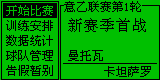 | 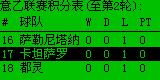 | 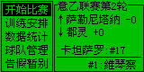 |

## Princess Maker 2 monochrome (美少女梦工厂 2 黑白版)

- Content: `LAVA1 美少女梦工厂2黑白版/PM2.lav`, `head.DAT`, and `pic.DAT`.
- Validation gap: the generic replay stopped at the name confirmation or opening
  story. The main screen uses letter hotkeys, so arrow/Enter sampling did not
  establish whether its actions worked.
- Validation: enter a name, confirm with Y, choose the birthday, and finish the
  opening story. Z opens the attributes; C schedules work. Choose housekeeping
  and execute the first ten days: the date advances from January 1 to January 11
  and attributes/fatigue change. X then Enter chooses Time Stop and writes
  `LavaData/save.dat`. Import that actual file into a fresh instance and choose
  Read Progress at the title: the saved character screen is restored exactly.
  Portraits, dialogue, attributes, and daily work results render correctly.
  No additional emulator behavior changes were required.

| Character | Attributes | Housework results | Reloaded character |
| --- | --- | --- | --- |
|  | 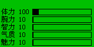 | 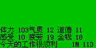 | 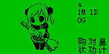 |

## Dream World (梦中世界，更新 6)

- Content: `LAVA1 梦中世界（更新6）/梦中世界.lav`, `GameSave.dat`, and `GameNpc.dat`.
- Validation gap: account forms use Up/Down to choose fields; Enter submits the
  whole form. Generic Enter input therefore left the required fields empty.
- Validation: choose Apply for Account, fill the account/password/confirmation
  fields, name the character, and select a gender. Import the actual generated
  files into a fresh instance and log in. Down moves the player and scrolls the
  town map relative to an idle clone. F1 shows the created character and stats.
  Space opens the system menu; C exits normally and writes the updated
  11,357-byte character file. Town tiles, sprites, character data, and menus
  render correctly. No additional emulator behavior changes were required.

| Town map | After movement | Character record | System menu |
| --- | --- | --- | --- |
| 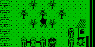 | 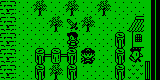 | 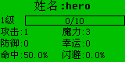 | 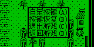 |

## Dragon Legend (龙之传说 v1.5)

- Content: `LAVA1 龙之传说/非pac/longX.lav` and `DatLong.dat`.
- Validation gap: Enter-only input stopped at class selection. Each party member
  needs a Q/W/E/R class selection and a Y confirmation before the opening story.
- Validation: choose a swordsman and mage, finish the opening, walk through the
  town, and use C plus Enter to view the first character's attributes. Leave by
  the western town exit and walk outside until a battle starts. B selects an
  ordinary attack and Enter confirms the target; the attack animation resolves
  (the recorded roll is MISS). Repeated H/Enter attempts eventually escape;
  movement changes the world-coordinate bytes again after returning to the map.
  Enemy sprites, party HP/MP, the time gauge, and battle commands render correctly.
- Persistence: B opens the menu; System → Save writes `LSav.dat`. A fresh
  instance chooses Continue (C) and confirms the save preview with Enter.
  The town viewport is restored exactly; the independently advancing footer clock
  is excluded from the comparison. No additional emulator changes were required.

| Character | Battle | Attack resolution | After escaping |
| --- | --- | --- | --- |
| 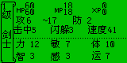 | 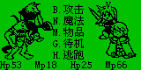 | 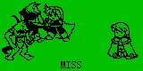 | 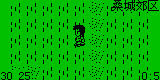 |


## Dragon Kiss demo (龙之吻体验版)

- Content: `LAVA1 龙之吻体验版/l2体验版.lav`, `DatL2.dat`, and the
  supplied `pinyin.dic`.
- Validation gap: the animated title needs N to start. That key also appears in
  the name editor, so delete it with Left before entering a Chinese name.
  Type `wen`, press Space to show candidates, then Enter to choose 问 and
  Enter again to finish. Q/W class choices require Y confirmations.
- Validation: finish the opening dialogue, walk through the town, and use C
  followed by Enter to view the named swordsman's attributes. B opens a six-row
  menu; five Down presses select System. Save writes `L2Sav.dat`. Import that
  actual file into a fresh instance, press C and Enter at the title, and open
  the character record again: the name, class and attributes match exactly.
  Town tiles, sprites, pinyin candidates and character menus render correctly.
  No additional emulator changes were required; combat is not covered here.

| Pinyin candidates | Town | Character | Reloaded character |
| --- | --- | --- | --- |
| 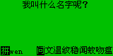 | 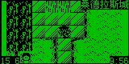 |  | 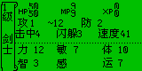 |


## 3D Maze (3D 迷宫)

- Content: `LAVA1 3D迷宫/3D迷宫.lav` and `maze.dat`.
- Validation gap: the opening logo needs a later key press, and Enter in the
  playable scene opens the satellite map. Repeating Enter therefore obscured
  movement checks by keeping the overview open.
- Validation: finish the introduction and dismiss the overview with Escape.
  Up changes the first-person corridor geometry. Page Up turns the direction
  indicator from north to west; Page Down turns the other way. Enter opens
  the satellite maze, and Escape restores the original corridor exactly.
  Regression comparisons exclude the advancing timer. No additional emulator
  changes were required.

| First-person corridor | After walking | After turning | Satellite map |
| --- | --- | --- | --- |
| 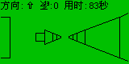 | 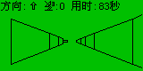 | 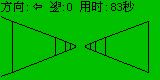 | 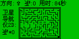 |


## PACMAN 2.30

- Content: both `LAVA1 PACMAN/非pac/PACMAN.lav` and `PACMAN.pac`, with
  `stagepac.dat` and the supplied three-byte `sysinfo.dat`.
- Validation gap: starting requires Enter at the title and another Enter at
  the stage selector. The supplied progress file unlocks only stage one;
  unchanged stage selection with Left/Right is not an input failure.
- Validation: launch both distributions, enter stage one, and compare Left,
  Right and Down with an idle clone over the same 18-frame ghost simulation.
  The player moves through the maze and clears pellets along the chosen route.
  Continued idle play reaches the visible `You Lost!` result and exits with
  code zero. Bricks, pellets, player and ghosts render correctly. No additional
  emulator changes were required.

| Stage selector | Maze | Right movement | Round result |
| --- | --- | --- | --- |
| 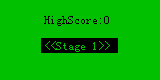 | 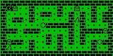 | 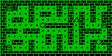 | 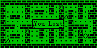 |


## Cloud / 疾龙云飞

- Content: the `LAVA1 Cloud` and `LAVA1 疾龙云飞` folders each contain the
  same loose `cloud_all.lav`/`cbo_cloud.dat` and `bobo_cloud.pac` package.
  All four entry points are exercised independently.
- Validation gap: generic Enter input misses the first cliff and reaches a
  zero-score result. Actual play needs a jump near the cliff and another
  confirmation when the rotating character approaches the landing angle.
- Validation: open Options, assign Enter to confirmation/jumping and B to
  acceleration, and finish the speed settings. This writes `cloud_cfg.dat`.
  Start a round and time Enter near the cliff: the character jumps, the
  completed attempt receives one Bad judgement and 20 points, whereas the
  idle branch falls and receives zero. Import the real configuration into a
  fresh instance and replay the same input: the scored result matches exactly.
  Intro logos, menu, moving/rotating character, background and result table
  render correctly. No additional emulator changes were required.

| Ready | Jump | Scored result | Result after reloading settings |
| --- | --- | --- | --- |
|  |  |  | 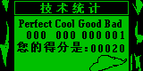 |


## Spitting King 2 v1.2 (口水王 2，黑白／灰度)

- Content: both distributions in `LAVA1 2 口水王1.2`, with their corresponding
  `ksw2.dat` and supplied `kswsav.dat`.
- Validation gap: the initial selection is the manual, and the stage selector
  initially points at a locked entry. Select Start Battle, move to the unlocked
  Suburbs stage, and confirm its introduction before checking gameplay.
- Validation: Up moves the player independently of the same traffic simulation.
  S fires and increases the visible score from 10 to 11. Page Up increases the
  shot-power indicator. Escape opens the exit prompt; N cancels it and restores
  movement. Confirming the two exit prompts with Y reaches BYE-BYE, where a
  final Enter exits with code zero. Both monochrome and grayscale scenery,
  characters, traffic, HUD and prompts render correctly. No additional emulator
  changes were required. Quitting this practice session does not write new
  progress; persistence is not claimed by this case.

| Monochrome field | Monochrome shot | Grayscale field | Grayscale shot |
| --- | --- | --- | --- |
| 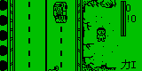 | 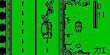 | 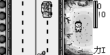 | 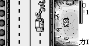 |


## BoBo Dance / 超级舞者 (Dance_all)

- Content: `LAVA1 Dance_all/未打包的文件/Bobo_Dance.lav`, `cbo_dance.dat`,
  and the corresponding `BoBo_dance.pac` distribution.
- Validation gap: input sent before the playable loop is ready is consumed
  together after loading. The direction sequence then changes with the beat;
  a generic 60-frame gap between keys can cross into the next sequence.
- Validation: enter the game and wait for the playable loop. At the recorded
  Up/Down sequence, input Up, Down and Enter at four-frame intervals. The
  score reaches 38, whereas an idle clone and an Up/Up/Enter branch remain
  at zero over the same 600 frames. Both distributions pass independently.
  The dancer animation, direction glyphs, timing bar and score render correctly.
  Right/Enter at the title opens Help; all five pages advance and return to the
  exact original title. No additional emulator changes were required.

| Direction sequence | Scored dance | Help | Returned title |
| --- | --- | --- | --- |
| 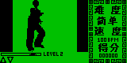 | 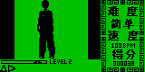 | 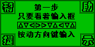 |  |


## Just_Fly 2.7

- Content: `LAVA1 Just_Fly/非pac/Just_Fly.lav` with `justfly.sav`, and
  `Just_Fly.pac`. The loose copy supplies a best distance of 61; the package
  supplies an empty record. Both entry points are checked independently.
- Validation gap: the first key dismisses the title, while the next starts a
  flight. Repeated short Enter presses can finish a flight before the next
  screenshot, leaving the instruction screen again.
- Validation: in mode 1, holding Up climbs and releasing it descends over the
  same 18-frame interval. F4 opens settings; Page Up selects mode 0, where
  one Down press changes the flight after Up without requiring a held key.
  Repeated climbs/releases set a new best distance of 63 and write the actual
  16,220-byte replay file. A fresh instance imports that file and uses R to
  replay it: the recorded aircraft/obstacle viewport matches the original
  trajectory exactly. The replay banner, distance and best-distance HUD are
  visible. No additional emulator changes were required.

| Held key: climb | Released key: descend | Mode 0 | Saved replay |
| --- | --- | --- | --- |
| 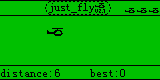 | 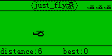 | 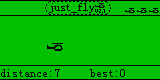 | 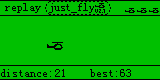 |


## EMAX Star Legend Fighter (EM 星纪传说—格斗)

- Content: `LAVA1 EM星纪传说—格斗/EM星纪传说—格斗.lav` and `xgdflash.dat`.
- Validation gap: short input sampled during ongoing combat did not establish
  movement or attacks. Actions need to span the fighter's animation cycle.
- Validation: start the bout, hold A and D in separate clones, and confirm
  different positions under the same opponent simulation. Hold L to animate
  an attack; its frame differs from an idle clone over the same interval.
  Unattended play reaches the visible defeat result and exits with code zero.
  Fighters, attacks, health bars, timer and result text render correctly.
  No additional emulator changes were required.

| Arena | Movement | Attack | Bout result |
| --- | --- | --- | --- |
| 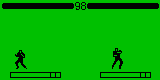 | 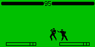 | 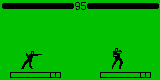 |  |


## Frog IQ Battle (IQ 大作战)

- Content: `LAVA1 IQ大作战/IQ大作战.lav`.
- Validation gap: startup passes through the completed-loading prompt and studio
  logo before the actual menu. Generic input did not establish tile removal
  or bomb use.
- Validation: enter Start Game; Right moves the selection, Enter removes the
  initial matching group of five, and B removes a single tile while reducing
  the bomb counter from one to zero. These actions are compared with an idle
  clone over the same interval. Escape returns to the exact original menu;
  Start opens another round. The board, selection, mascot and counters render
  correctly. No additional emulator changes were required.

| Board | Matching group removed | Bomb used | New round |
| --- | --- | --- | --- |
| 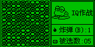 |  |  |  |


## QueerBox 1.1 (QUEERBOX)

- Content: `LAVA1 QUEERBOX/QUEERBOX.lav`; controls and extraction rules are
  documented in the supplied `help.txt`.
- Validation gap: selecting a bottom tile with two tiles above it does not
  allow a transfer. This is the game's extraction limit, not failed input.
- Validation: choose the basic difficulty, move Up twice to a top tile,
  select it with Enter, and transfer it Right. The destination stack changes
  and the step counter becomes one. Enter cancels the selection; F1 starts
  another board with zero steps. Escape followed by Y and completion of the
  title animation returns to the exact original menu. Board tiles, target
  markers, selected-tile icon and counters render correctly. No additional
  emulator changes were required.

| Board | Transferred tile | Restarted board | Title |
| --- | --- | --- | --- |
|  |  |  |  |


## Q version Dancer (Q 版 Dancer)

- Content: `LAVA1 Q版Dancer/Q版Dancer.lav`, the exact 23,739-byte release
  with CRC32 `12e8a226`. The supplied source differs from parts of the binary;
  the correction follows the actual compiled instructions.
- Problem: the contest input loop waits while a command is valid and accepts
  zero when no input remains. It also reads five responses for four generated
  commands and reuses the previous key before polling. Correct play therefore
  enters the miss acknowledgement instead of scoring normally.
- Fix: the program loader applies three guarded changes to its in-memory image:
  poll a fresh key first, finish waiting on a valid command, and read exactly
  the generated command count. Length, checksum and original instruction bytes
  must all match. The original file on disk is unchanged; generic Inkey behavior
  is unchanged. Matching PAC resources compare loaded program identities so
  embedded originals still match a normalized execution image.
- Validation: move the pixel cursor with real directional input to the contest
  hit box, finish the intro, then answer all four generated commands. The score
  increases while the miss count remains zero. A save-state round trip restores
  both values. Unrecognized images with the same size/instruction positions
  remain byte-for-byte unchanged.

| Contest menu | Correct answer animation |
| --- | --- |
|  |  |


## RC Racing (RC 赛车)

- Content: `LAVA1 RC赛车/RC赛车.lav` and `cv_car.dat`.
- Validation gap: the introductory animation needs to finish before Start is
  selected, and acceleration requires holding A. Releasing A slows the car,
  so a screenshot taken after an input helper's release interval can show zero
  speed despite a successful acceleration.
- Validation: start the race and hold A for 120 frames; speed reaches 90 km/h
  while the idle clone stays at zero. Left and Right with A produce different
  race views. P shows PAUSE and freezes the framebuffer for another 120 frames;
  Enter resumes. Escape returns to the exact original race menu. Track scenery,
  car, minimap, speed and pause overlay render correctly. No additional emulator
  changes were required.

| Track | Accelerating | Steering | Paused |
| --- | --- | --- | --- |
|  |  |  |  |

## Rush Out the Tunnel (8K, Lava1 16K, Lava2 16K)

- Content: the three `Rush_Out_For_Lava*.lav` releases under `LAVA1 Rush_Out`.
  The supplied MHT manual documents lift, bombs, pause and the 16K recording
  features. The 8K release intentionally omits names, rankings and replays.
- Validation gap: the author captions (including `QQ:171290999~`) are intentional,
  not corrupt scores. Independent GVmakerSE execution confirms these captions
  and the sparse initial tunnel. The game redraws the tunnel and submarine in
  separate presentations, so isolated screenshots can omit the submarine.
- Validation: compare held Up with released input over the same interval and
  assert that the visible submarine is higher. X reduces the bomb indicator;
  Z pauses, another 120 frames preserve the exact paused image, and Up resumes.
  Escape followed by Y returns to the exact original menu in all three versions.
- Persistence: in both 16K releases, complete a run, enter A as the name, and save
  the first replay slot. The 55-byte leaderboard contains the name and a positive
  score; the 12,012-byte replay file marks its first slot populated. Import those
  game-created files into a fresh session and play the saved slot. Its initial
  tunnel and eventual collision screen match the original run exactly.
  No additional emulator changes were required.

| Rising submarine | Bomb used | Paused | Saved replay |
| --- | --- | --- | --- |
|  |  |  |  |

## Snow Fight (打雪仗)

- Content: `LAVA1 SnowFight(打雪仗)/SnowFight.lav`. The in-game help specifies
  A/D movement and L attack; arrow keys control the title menu.
- Validation gap: arrow-key probes do not exercise the actual player controls.
  Closing Help resets the selection to Start, and the title greeting can change
  between visits, so menu comparisons use the choice panel.
- Validation: open and close Help, start a round, and compare A/D branches over
  the same interval. The visible player's body moves in opposite directions.
  L changes the throwing pose compared with an idle clone. A complete round
  reaches the defeat result, Enter returns to the menu, and Exit terminates
  normally. Snowfield, characters, gauges, help and result text render correctly.
  No additional emulator changes were required. This workflow does not claim
  a victory or verify the hit-rate calculation.

| Help | Moving | Throwing | Round result |
| --- | --- | --- | --- |
|  |  |  |  |

## SpaceWars (with and without delay)

- Content: `LAVA1 SpaceWars/SWR无延时.lav` and `SWR有延时.lav`.
  The supplied README specifies WASD movement, L shooting and Escape to exit.
- Validation gap: the title starts with S; Enter-only startup probes remain at
  the title. Its `Press key S` prompt blinks, so title comparisons exclude that
  prompt while retaining the title artwork.
- Validation: start Mission 1 in both releases and compare all four movement
  directions with an idle clone over equal intervals. Guest ship coordinates
  decrease/increase on the expected axes. Holding L creates a four-pixel-wide
  projectile above the ship at its firing position, also visible in the frame.
  An idle mission reaches Game Over and returns to the title. Escape from an
  active mission exits normally. Scenery, ship, projectiles and title display
  correctly. No additional emulator changes were required. Later stages and
  weapon upgrades have not been verified by this workflow.

| Mission | Moving right | Shooting | Returned title |
| --- | --- | --- | --- |
|  |  |  |  |

## Endless Travel demo (无尽的旅程试玩版)

- Content: `LAVA1 TRAVEL/travel.lav` with `Mapdata.dat`, and `打包travel.pac`.
  The supplied manual describes five scenes, one battle and a climbing-tool
  puzzle. Only Attack is implemented in the trial battle menu.
- Validation gap: the long automatic introduction must finish before navigation
  starts. Investigation uses a small directional cursor, not a walking character.
  Scene indices restart when the next resource group loads; the cabin legitimately
  becomes index zero while showing the new artwork.
- Validation: finish the introduction, move the cursor to the forest path and
  investigate with Enter. Trigger the encounter and repeatedly choose Attack
  until exploration resumes. Continue to the mountain, take the side path to
  the cabin, enter it and investigate the cabinet. The climbing-tool flag becomes
  set. Return to the mountain and climb to the trial ending. Escape also exits
  an exploration clone normally. Both exact entry points follow the same route;
  scenery, Chinese dialogue, battle sprites and gauges render correctly.
  No additional emulator changes were required.

| Forest investigation | Battle | Cabin interior | Demo ending |
| --- | --- | --- | --- |
|  |  |  |  |

## WarCraft (loose and PAC)

- Content: `LAVA1 WarCraft/非pac/WarCraft.lav` with `CraftBmp.DAT`, and
  `LAVA1 WarCraft/WarCraft.pac`. The supplied MHT documents turn-based controls.
- Problem: character-input history can retain Enter presses from screens that
  poll physical keys. Opening the system menu then consumes those old presses
  and selects speed settings without a new confirmation.
- Fix: a new key transition replaces unconsumed input history; physically
  releasing a key retains its pending event, and guest ReleaseKey removes that
  key's pending events. Simultaneously pressed keys retain their existing order.
  Save-state fields are unchanged. Removing pending input on every physical
  release was rejected after regressions in other games.
- Validation: both entry points open the system menu and wait for a fresh
  command. Train a worker for 75 gold (800 to 725), select its Move command,
  move it and recenter the cursor to check the changed map tiles. J completes
  the turn and income raises gold to 755; Shift shows the resource panel.
  The system Exit item waits for confirmation and calls the game's Exit(1).
- Limits: the compiled Save Management routine only displays a message that
  saving cannot solve the problem; it does not write a file. This release has
  no working save/load routine to validate. Combat and victory are not covered
  by this workflow. The earlier Dragon Kiss replay was extended through its
  actual introduction rather than relying on accumulated Enter history; its
  town movement, party save and fresh-session reload pass again.
- Regression evidence: rerun all 49 prior game workflows with the input update;
  48 passed immediately. The updated Dragon Kiss replay and both WarCraft entries
  then passed dedicated runs. Unit tests also cover physical release, guest
  ReleaseKey and replacement of stale input by a new press.

| Battlefield | System menu waits | Worker commands | Turn income |
| --- | --- | --- | --- |
|  |  |  |  |
