# Game compatibility fixes

These cases exercise the standalone content loader and the shared emulator core.
The local corpus is not distributed with the repository. Set `LAVAX_GAME_ROOT`
to its `lavax_game` directory, then run:

```powershell
cargo test --release -p lavaxemu --test game_compatibility -- --ignored
```

Only games with a completed display and input regression appear below. Startup
without an execution error alone does not establish playability.

## Dark Chess (暗子象棋)

- Content: `LAVA1 暗子象棋/未打包/暗子象棋.lav` and `LAVA1 暗子象棋/暗子象棋.pac`.
- Problem: the game opens `/LavaData/SCC.dat`, but its unpacked companion
  `SCC.dat` sits beside the program. The missing-file screen exits on a key press.
- Fix: when an exact `/LavaData/...` file is missing, resolve an existing
  companion at the content root. Actual device directory files take priority.
  Reads and writes use the same file entry, preserving write-back to the
  original companion rather than making a divergent copy.
- Validation: title, player-name prompts, board, cursor movement, piece flipping,
  and continued execution; 1,800-frame scripted replay and an opt-in regression. Both
  distribution entry points now run the same board/cursor/flip regression.
  The package loads its embedded data and reveals a pawn after confirmation.

| Packaged board | Packaged flipped piece |
| --- | --- |
| 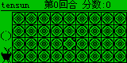 | 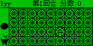 |


| Before | Board after input |
| --- | --- |
| 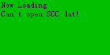 | 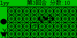 |

## Pet World 3H (宠物世界3H)

- Content: `LAVA1 宠物世界/GVmaker/NC3000/宠物世界3H.lav`.
- Problems: opcode `0x00` was rejected at `0x72`, although the reference VM
  treats it as a no-op. Importing only `GVmaker/NC3000` also omitted the sibling
  `LavaData/宠世图片.dat` directory.
- Fix: accept zero padding as a no-op; recognize `GVmaker` and `LAVA` device
  layouts with a sibling `LavaData` directory in both frontends. Standalone
  write-back uses the same root. Flat bundles retain their own content root.
- Validation: pet sprites, status information, pet management, detail pages,
  menu navigation and continued execution. Unit tests cover padding and
  nested resource/write-back paths, including unrelated ancestor directories.
  Write-back preserves existing on-disk path casing on case-sensitive systems.
  External multiplayer is outside this basic-control check.

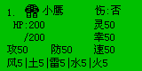

## Princess Maker 4 (美少女梦工场4)

- Content: `LAVA2 美少女梦工场/非pac/PM4.lav`.
- Problem: `/LavaData/pm_data*.dat` and `PM4_cfg.dat` could not be opened in
  the flat bundle, leaving a blank screen and exiting in the first frame.
- Fix: the shared flat-companion resolution above restores all four data
  files. This game's separate regression covers the complete introduction,
  character confirmation, main room, and opening the status screen with Enter.
- Validation: 6,666 scripted frames without an error or exit, a 15,000-frame
  exploratory replay, and visual inspection of the room and status pages.

| Main room | Status screen after Enter |
| --- | --- |
|  | 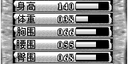 |

## Puzzled Sheep

- Content: `LAVA1 Puzzled Sheep/Psheep.lav`.
- Problem: starting the game opens `/GVMdata/Psheep.dat`, while the bundle
  places `Psheep.dat` beside the program; the game displayed `Error!` and exited.
- Fix: recognize the legacy `/GVMdata` resource prefix for existing flat
  companions, with the same exact-path priority as `/LavaData`.
- Validation: first-level loading, cursor movement, simulation animation,
  Escape to leave simulation, and 1,200 exploratory frames. Checked the
  supplied game source to verify the expected controls and resource name.

| Level selection | Simulation running |
| --- | --- |
| 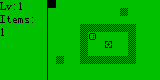 | 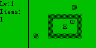 |

## Hit (打地鼠)

- Content: `LAVA2 打地鼠/LAVA2/Hit.lav`.
- Problem: the `LAVA2` program folder was not recognized as part of a device
  layout, so `/LavaData/MULogo.dat` could not be loaded and `Read Error` appeared.
- Fix: recognize `LAVA2` alongside `LAVA` and `GVmaker` in both frontends.
- Validation: logo, playfield, nine TYUGHJBNM hit controls, P to pause and
  Enter to resume. The regression checks the framebuffer stays frozen during
  a 120-frame pause and changes again after resuming. Also replayed 1,800 frames.
- Timer follow-up: `GetTime` now advances with the deterministic 60 Hz clock,
  including calendar rollovers. Previously it always returned the initial
  timestamp, preventing the game's countdown from advancing. The regression
  checks the game's time buffer changes over two seconds; clock tests cover
  leap years, year rollover, SetTime/GetTime, and save-state phase restoration.

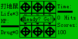

## Counter-Strike 1.3 (CS 1.3)

- Content: `LAVA1 CS 1.3/非pac/Cs(lav)1_3.lav` and `LAVA1 CS 1.3/Cs(lav)1_3.pac`.
- Problem: the flat bundle's `Csgun.dat` and other resources could not be
  opened through `/LavaData`, preventing normal startup.
- Fix: shared resource resolution restores startup, animation and mission
  assets. This game's separate regression exercises the title, setup menu,
  mission loading and direction controls after the calendar-clock fix.
- Validation: the replay selects Start, confirms Ready, and reaches combat.
  Direction input changes the actual camera coordinate, and the mission
  framebuffer changes as well. Stage checks follow guest execution rather
  than assuming a fixed animation duration.
  Both entry points run the same mission workflow. Wait for the first scene
  to render after the loading loop, then open B, choose the pistol category
  with B and confirm USP with Enter. Holding Z consumes ammunition (12 to 7)
  and renders the firing animation. Menu transition animations are allowed
  to finish before the next selection. Reserve-ammunition purchasing is not
  covered by this regression.

| Packaged mission | Pistol selection | After firing |
| --- | --- | --- |
| 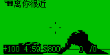 | 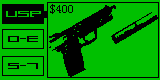 | 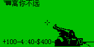 |


| Title | Mission |
| --- | --- |
| 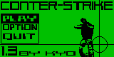 | 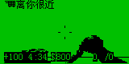 |

## Crazy F2 (疯狂F2)

- Content: `LAVA1 疯狂F2/F2.lav`.
- Problem: its five-second F2-press round polls the seconds returned by
  `GetTime`; the fixed timestamp previously prevented completion.
- Fix: the advancing guest calendar restores the round timer. This game's
  regression selects a platform, starts with F2, presses F2 five times, and
  waits for the score screen without injecting further input.
- Validation: the round completes and reports a positive press count. The
  initial title intentionally waits for F2, rather than Enter, to begin.


## Lost Fantasy

- Content: `LAVA1 lost fantasy/LF_demo.lav` and `LF_demo(PC).lav`.
- Problem: the device version continuously captures and redraws the full
  monochrome screen. Per-pixel buffer access made its 1,800-frame corpus
  replay exceed the 45-second scan limit. The PC version adds a 30 ms delay.
- Fix: copy in-bounds monochrome bitmaps in groups of eight pixels, and pack
  captured rows directly. Clipped, mirrored, inverted, and other color modes
  retain their existing paths. The bitmap fast paths preserve pixel results;
  presentation pacing is handled separately below.
- Validation: the same 1,800-frame replay completes in about 2.9 seconds when
  run individually on the development machine; frame 1,199 is identical to the
  previous capture. Both versions respond to D movement, with horizontal
  position and framebuffer differences checked against an idle clone.
  Bitmap tests exercise all 256 byte patterns and neighboring-pixel boundaries.


## Speed Racing corpus variant (极速狂飙 / 生死时速II)

- Content: `LAVA1 极速狂飙/极速狂飙.lav`, whose in-game title is 生死时速II.
- Problem: `Refresh` copied the framebuffer but kept executing guest code in
  the same host frame. Unthrottled draw loops consumed CPU and advanced past
  the moment when the frontend could deliver steering input.
- Fix: `Refresh` now returns `Presented`, yielding to the host after each
  visible frame. Unit tests check that successive presented frames remain
  distinct. The instruction budget remains unchanged.
- Validation: enter the main menu, select a difficulty, and start the game.
  Right steering changes horizontal position and the rendered track compared
  with an idle clone. All previously completed game regressions are rerun;
  the CS 1.3 replay now explicitly handles its Ready confirmation.


## Modified Speed Racing II (生死时速Ⅱ修改版)

- Content: `LAVA1 生死时速II/生死时速Ⅱ（修改版）.lav`.
- Problem: its score loop repeatedly calls Locate, printf and Inkey without
  Refresh. Profiling found 6,250 identical score prints in one host frame,
  making the full replay exceed the 45-second scan limit.
- Fix: printf yields `Presented` after rendering its console output, giving
  the frontend a display/input boundary for console-driven loops as well.
- Validation: choose easy mode, steer right, reach a stable score screen, and
  return to the mode menu with Escape. Steering position is checked against
  an idle clone. A 3,600-frame replay completes in about 0.4 seconds locally.
  A core test confirms console output is presented before the next input poll.

| Score | Menu after Escape |
| --- | --- |
|  | 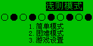 |

## Resource Manager (文件夹助手 3.7)

- Content: `LAVA1 百战天虫即时版/资源管理器.lav`.
- Problem: FileList returned cancellation immediately, so the program exited
  without showing its directory picker.
- Fix: implement the blocking file picker, GBK names, cursor and page navigation,
  selection/scroll return values, cancellation, and SetList help/delete flags.
  The caller handles directory changes and file operations, as in the reference VM.
- Validation: dismiss the splash, move the selection, open the file action menu,
  restore a pending picker save state, cancel, and confirm normal exit. Core tests
  cover Chinese names, paging, special keys, reset, and version 2 state migration.
  This introduced save-state version 3; current states retain version 2 loading support.

| Directory picker | File actions |
| --- | --- |
| 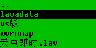 | 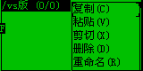 |

## Pet World legacy and L variants (宠物世界)

- Content: NC2600, NC3000, TC1000, TC1000S, and TC808 pairs under
  `LAVA1 宠物世界/GVmaker`.
- Initial finding: the five `宠世L_*.lav` variants exit immediately when
  `/LavaData/宠世存档.sav` does not exist. The main variants can start a new game.
- Validation: start each matching main variant, open the left/right menu,
  move right four times to 存档, and confirm. Transfer the actual written save
  into its L variant, then verify the sprite, pet management, and details controls.
  All five pairs pass without modifying their game binaries or synthesizing saves.
  This closes the earlier startup-only scan gap for these variants; the existing
  device-resource loading fixes are sufficient.

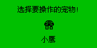

## Magic / 神州

- Content: `LAVA1 神州/神州.pac` and `非pac/Magic.lav`.
- Problem: the loose `非pac/Magic.lav` cannot open `GameSource.dat`, which is
  only present inside the PAC.
- Fix: both frontends can load the complete PAC. For a loose LAV, they also check
  PAC files beside it and in its parent directory. A package must contain the exact
  same program bytes before its missing resources are mounted in memory. Existing
  files, including loose saves resolved through LavaData aliases, take priority.
  The search stops at the nearest matching package and does not unpack onto disk.
- Validation: both the complete package and the loose LAV open `GameSource.dat`, display the intro,
  advances through dialogue, and reaches the map. Right input changes the rendered
  player position compared with an idle clone. Unit tests cover multiple entries,
  Chinese paths, truncated records, invalid paths, and the libretro load lifecycle.
  Additional regressions reject mismatched/incomplete companion packages and verify
  that an existing loose save remains authoritative and writes back to its original file.
  A filename-only CLI launch from the loose game's working directory is covered as
  well: relative paths are resolved before companion lookup and write-back. The
  earlier empty parent path caused even `lavaxemu --info Magic.lav` to fail.

| Map | After right movement |
| --- | --- |
|  | 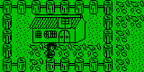 |

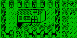

## Super Robot Wars (超级机器人大战)

- Content: `LAVA1 超级机器人大战/Setup/SRWDate.lav`, `Setup/SRW.lav`,
  and `Download/SRW.pac`.
- Initial finding: opening `Setup/SRW.lav` before running its data installer
  displays an installation error. `SRWDate.lav` finishes quickly because it is
  the installer, rather than a standalone game.
- Validation: execute the installer to completion, transfer its actual written
  data files into the setup game, start a new game, and advance into the tactical
  map. Right input moves the cursor compared with an idle clone. The complete PAC
  also loads its data and point tables and reaches the map and unit information.
  The PAC loader fixes the complete-package entry point; the setup pair works
  with the existing virtual file write-back workflow.

| Tactical map | Cursor after right input |
| --- | --- |
| 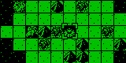 |  |

## Magic Era (魔法纪元)

- Content: `LAVA2 魔法纪元/魔法纪元.lav`.
- Problem: after the title prompt, the game checks that GetPID's high byte is
  `L` and exits when the previous zero-valued implementation fails this check.
  The reference PC VM also deliberately returns zero, so matching its exit alone
  would not satisfy compatibility with a Lava device.
- Fix: return the stable virtual Lava device identifier `0x4c000001`, following
  the device identifier layout shown in the original VM source. It remains
  consistent across resets and does not use a physical device's identity.
- Validation: pass the title/menu, start a new game, advance the opening story,
  and reach the castle map. Right input changes the player's rendered position
  against an idle replay. The regression covers 18,120 frames; the identifier
  test checks the value before and after reset. All 16 content/layout regressions
  pass, and a fresh scan of 267 LAV programs plus 57 PAC packages reports no
  loading errors, runtime errors, or timeouts. The scan does not certify every
  game's complete interaction flow.

| Castle map | After movement |
| --- | --- |
| 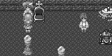 | 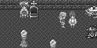 |

## New Hero (新英雄坛说)

- Content: `LAVA1 新英雄坛说/新英雄传说.pac` and its unpacked equivalent
  `LAVA1 新英雄坛说/非pac/Hero.lav`.
- Validation gap: the short batch replay only reached the long introductory
  dialogue and could not establish that the map accepted input.
- Validation: advance 7,200 frames through the startup sequence into the village,
  then compare separate up/down branches with an equal-duration idle replay.
  The dedicated workflow runs the same route for the packaged and unpacked
  entries, which reach byte-identical memory and frames. Up moves the player;
  down moves the player and scrolls the village map.
  The existing core and resource fixes suffice; this adds a gameplay regression
  rather than changing the game or emulator behavior.

| Village | Map after down input |
| --- | --- |
| 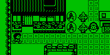 | 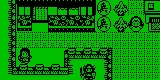 |

## Tokimeki (心跳回忆)

- Content: `LAVA2 心跳回忆/心跳回忆.lav`.
- Validation gap: the initial short replay remained in the story; a later room
  capture alone did not prove the activity controls worked.
- Validation: advance into the room, change the selected bottom icon with Right,
  open the club/work menu, select its ESC item with Enter to return to the room,
  and open Help (guest key 25 / F5) to display the icon descriptions. The menu's
  ESC item is selected with Enter; the physical Escape key does not close it.
  Several study activities update attributes without replacing the room image.
  No additional emulator behavior changes were needed for this workflow.

| Room | Club/work menu | Help |
| --- | --- | --- |
| 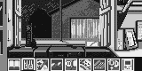 |  | 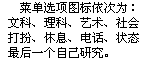 |

## Gamble (先赌为快)

- Content: `LAVA1 先赌为快/先赌★为快.lav`.
- Problem: the board's device-specific heart, snail, and other icons use F8–FD
  codes outside GB2312. The existing font rejected these pairs and interpreted
  subsequent bytes as unrelated Chinese characters, making the board unreadable.
- Fix: add the 527 built-in 16×16 NC/TC device icon glyphs and decode their
  documented two-byte range. The unchanged bitmap asset comes from the MIT-licensed
  WQX toolbox; its pinned source and retained license are in the assets directory.
- Validation: register a local account through 新手上路, acknowledge its restart
  request, reload the actual account file, and log in through 再续赌缘. The full
  board now displays its icons. Q adds a bet, Enter advances the round, the result
  prompt appears, and another bet can be placed afterward. The core regression
  checks the heart bitmap and the following ASCII character's position.

| Before | Correct board | Completed round |
| --- | --- | --- |
| 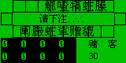 | 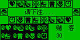 | 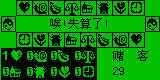 |

## Shushan (蜀山群侠传)

- Content: `LAVA1 蜀山群侠传/蜀山注册.lav` and `蜀山群侠传.lav`.
- Validation gap: the main game needs a local character account created by its
  separate registration program. Sending generic menu keys without that account
  never verified actual gameplay.
- Validation: follow the bundled manual, create an account and confirm with Y,
  transfer the registration program's actual `M-lava.dat` file, then log in with
  the main game after its splash finishes. Advance the story to the first map,
  compare upward movement with an idle branch, and open/close F3 character status.
  This verifies the existing shared file workflow without synthesizing a character
  save or changing the game binary.

| First map | Character status |
| --- | --- |
| 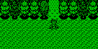 | 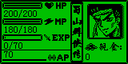 |

## My World corpus variant (我的世界～霸王屎)

- Content: `LAVA1 我的世界~霸王屎/我的世界.lav`.
- Validation gap: the generic direction sequence selected Exit from the main menu;
  an early halt therefore did not determine whether the game itself was playable.
- Validation: wait for the introductory animation, start a new character, enter a
  name, and confirm the character setup. The program loads `mine_SC.dat` and enters
  its tile map. Up input changes the player's rendered position compared with an
  equal-duration idle replay. No emulator behavior change was needed for this path.

| Map | After movement |
| --- | --- |
| 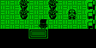 | 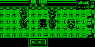 |

## Holiday Island (假日神秘岛)

- Content: `LAVA1 假日神秘岛/假日神秘岛 abcdef.lav`.
- Validation gap: the earlier replay sampled the lengthy opening sequence, during
  which the candidate movement keys did not affect the scene.
- Validation: advance 18,000 frames into the island map. Right input triggers the
  nearby conversation; further right presses finish it and walk along the path.
  A subsequent left branch changes the player/camera position relative to an
  equal-duration idle replay. Map tiles, characters, and dialogue render correctly.
  This closes the sampling gap without changing the program's original intro.

| Island map | Conversation | After walking along the path |
| --- | --- | --- |
|  | 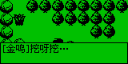 |  |

## Crazy Ball updated corpus version (疯狂弹球)

- Content: `LAVA1 疯狂弹球/疯狂弹球.pac` and `非pac/crazyball.lav`.
- Problem: the loose program could display its setup screens but failed to load
  `/CBMap/stagepack.dat`, reporting a stage-pack error instead of starting play.
- Fix: the matching-package loader supplies the missing CBMap files from the PAC,
  whose embedded program is byte-for-byte identical to the loose LAV.
- Validation: both entry points complete the initial player/control setup and
  display the first stage. Enter launches the ball; it hits bricks and scores.
  Left input changes the paddle position relative to an idle clone executing
  the same number of frames. This is a separate version from `LAVA1 Crazy_ball`.

| Missing stage pack | Loose LAV after loading | Paddle after left input |
| --- | --- | --- |
| 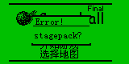 | 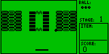 | 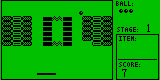 |

## Planting Gold (种金币)

- Content: `LAVA1 种金币/种金币.lav`.
- Validation gap: a small final-frame thumbnail showed the stage chooser rather
  than the playing board, leaving its coin controls unverified.
- Validation: dismiss the logo, choose level one, and use D (the documented WASD
  controls) to move a coin and increment the step counter. F1 replays the level;
  after its wipe transition, the entire board and zero step count exactly match
  the initial state. No additional emulator behavior changes were required.

| Level one | Coin after D |
| --- | --- |
| 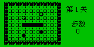 | 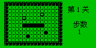 |

## Sky & Land (幕天席地 1.1)

- Content: `LAVA1 幕天席地1.1/幕天席地.lav`.
- Validation gap: the generic replay entered existing-account login without first
  creating a character, so its missing-account message did not validate gameplay.
- Validation: hold Enter briefly to leave the animated credit/title screens,
  choose a new game, confirm, and enter a local account and password. Up moves
  the character against an idle replay. F5 (guest key 25) opens the system menu;
  saving writes an 88-byte `LavaData/lava.sls` character file. Start a new emulator,
  provide that actual file, and log in: the saved map viewport and character
  position are restored exactly. The independently scrolling footer is excluded
  from the map comparison. No additional emulator behavior changes were needed.

| Map | System menu | Reloaded character |
| --- | --- | --- |
| 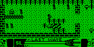 | 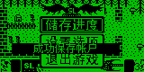 |  |

## Star Legend (星剑传奇)

- Content: `LAVA1 星剑传奇/未打包的[星剑传奇]/星剑注册.lav`,
  `星剑传奇.lav`, and `LAVA1 星剑传奇/打包的[星剑传奇]/星剑传奇.pac`.
- Validation gap: generic input stopped at account setup rather than proving
  that a registered character could enter the game. Both account and password
  must exceed five characters; the confirmation explicitly requires Y.
- Validation: enter a six-character account/password, confirm with Y, select a
  character, and enter a name. Registration writes a real 194-byte
  `LavaData/S-lavaxx.dat`. A fresh main-game instance reads that file, accepts
  the credentials, and displays the character summary. Enter opens the map;
  Up moves the character relative to an equal-duration idle replay.
- The package holds `LAVA/星剑注册.lav`, `LAVA/星剑传奇.lav`,
  `LavaData/StarMap.dat` and `LavaData/StarPic.dat`. Loading it runs the first
  program, so this entry performs the same registration flow and writes the
  194-byte record. Importing that record into the main program accepts the
  credentials and reaches the same map.
- No additional emulator behavior changes were required.

| Registration | Loaded character | Map movement |
| --- | --- | --- |
| 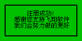 | 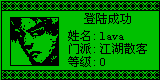 | 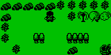 |

## Flat Cube (平面魔方)

- Content: `LAVA1 平面魔方/平面魔方.pac` and `非pac/平面魔方.lav`.
- Validation gap: the default menu selection opens instructions, so repeated
  Enter input never established whether the puzzle itself worked.
- Validation: Right then Enter starts the challenge. Direction keys select a
  tile; M then Right shifts a row and increments the move count. C, Right, Enter
  exchanges two tiles and reduces the exchange allowance from three to two.
  Esc opens the exit confirmation, and Y returns to the main menu. Both entry
  points render the full 5-by-5 icon grid and perform these operations. No
  additional emulator behavior changes were required.

| Starting board | Row shifted | Tiles exchanged |
| --- | --- | --- |
|  | 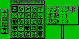 | 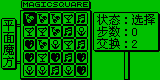 |

## Rocket Car (火箭车)

- Content: `LAVA1 火箭车/火箭车.lav`.
- Problem: menus and sprites rendered, but most track traffic disappeared once
  the initial screen scrolled away. The program accesses `_GRAPH` directly;
  address zero was returned without actually mapping the packed front buffer.
- Fix: lazily map GVmaker 1.0's 160-by-80 monochrome front/back buffers at
  addresses 0 and 1600. Keep guest assignments, memory-copy calls, and drawing
  calls coherent. Track RAM writes and synchronize small point/rectangle updates
  by region so repeated cursor drawing does not copy the entire screen.
  The layout is corroborated by
  [GVmakerSE RamManager](https://github.com/arucil/GVmakerSE/blob/f87166975bebfb3672c69de89838765a7106dde0/src/main/java/eastsun/jgvm/module/RamManager.java)
  and [its packed screen buffers](https://github.com/arucil/GVmakerSE/blob/f87166975bebfb3672c69de89838765a7106dde0/src/main/java/eastsun/jgvm/module/DefaultScreenModel.java).
  Save-state version 4 preserves activation and continues to load versions 2/3.
  Larger/color displays retain their existing unsupported direct-buffer behavior.
- Validation: start play and advance beyond the initial traffic. The track
  continues to render; Up changes the player position against an idle branch.
  Esc opens the score/name screen; entering a driver name returns to the title.
  Unit tests cover direct writes, drawing across packed-byte boundaries, bulk
  copies, and save-state restoration.

| Before | Track after the fix | Steering |
| --- | --- | --- |
|  | 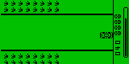 | 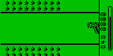 |

## Lazy YY Milk Battle (Lazy YY 牛奶大战)

- Content: the loose LAV and PAC in `LAVA1 Lazy YY牛奶大战/Ver1.2`, and the
  PAC in `Ver1.5 For TC800 Only`.
- Validation gap: the generic input sequence did not use the game's feeding
  keys. The empty dashed slots are the item inventory, not an account prompt.
  Version 1.2 creates `CatUser.dat` automatically when needed.
- Validation: enter challenge mode and start the first stage. Version 1.2 uses
  G/J to feed left/right; version 1.5 uses Left/Right. Feeding changes the
  milk/target state relative to an idle branch; the grey version's remaining
  target count drops from 150 to 149. Space pauses each version and the scene
  remains identical over another 60 frames. Space resumes 1.2; Enter selects
  Continue in 1.5's pause menu. Esc returns to the menu. Monochrome and grey
  sprites, counters, and menus render correctly.
- Frontend fix: the window previously translated physical Space to B, so actual
  keyboard users could not trigger the pause tested with guest key 32. Space now
  sends 32, and the regression drives the actual window keyboard translator.
  B/1 retain the B action. RetroArch now polls keyboard input alongside joypad
  input, exposing the game's Space/G/J keys as well as Enter, letters, page keys,
  Shift, and F1–F6 needed by other games. Both hosts also accept 0 and period.
  Keyboard IDs follow the official
  [libretro keyboard API](https://github.com/libretro/libretro-common/blob/master/include/libretro.h).
  A libretro lifecycle test delivers physical Space through `retro_run` to a
  guest GetChar call and checks that it receives 32.

| Monochrome play | Monochrome pause | Grey feeding | Grey pause menu |
| --- | --- | --- | --- |
| 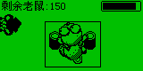 |  |  |  |

## Extreme Landlord 3.2 (极限斗地主)

- Content: `LAVA1 极限斗地主/极限斗地主.lav` and all three LAVs in
  `LAVA1 极限斗地主3.2` (standard, NC1020, TC800).
- Validation gap: fresh installations wait for Down to page through the first-run
  notice and Y to accept it. Enter does not advance that notice. The TC800
  version also starts its built-in name editor in pinyin mode; Shift switches
  to English entry. The original folder includes an existing player save.
- Validation: complete first-run setup where needed, enter a player name,
  choose a game, deal the cards, and bid. Right moves the cursor; Up raises a
  card and Down cancels that selection, restoring the exact prior frame. P
  suggests a legal play and Enter plays it, reducing the hand. F4 then Y ends
  the round with the game's stated score penalty; Enter returns to the scores.
  This writes the updated `jxddzsave*.dat` file automatically. All four versions
  execute these flows with correctly rendered hands, card backs, and scores.
  No additional emulator behavior changes were required.

| Dealt hand | Card selected | Card played | Updated scores |
| --- | --- | --- | --- |
|  |  |  |  |

## Champion Football Manager (冠军足球经理 05–06 v0.7)

- Content: `LAVA1 冠军足球经理05-06赛季0.7/CFM.lav` with `CFMdata.dat`.
- Validation gap: startup input did not complete the two password entries or
  obtain a coaching appointment. As the supplied readme explains, new coaches
  must approach weaker second-division clubs; stronger clubs reject them.
- Validation: create a coach, enter and confirm a password, and apply to Venezia
  in Italy's second division. Accept the appointment, keep the default budget
  allocation, and finish the season introduction. Training menus open correctly.
  Start and complete the first fixture; results and standings show Venezia's
  loss and the manager advances to round two. Save and leave exits normally and
  writes the 4014-byte `mdata0.sav` plus the manager index. A fresh instance loads
  that career with the password and restores the next-fixture menu and record
  pixel-for-pixel. No additional emulator behavior changes were required.

| First fixture | League standings | Reloaded career |
| --- | --- | --- |
|  |  |  |

## Princess Maker 2 monochrome (美少女梦工厂 2 黑白版)

- Content: `LAVA1 美少女梦工厂2黑白版/PM2.lav`, `head.DAT`, and `pic.DAT`.
- Validation gap: the generic replay stopped at the name confirmation or opening
  story. The main screen uses letter hotkeys, so arrow/Enter sampling did not
  establish whether its actions worked.
- Validation: enter a name, confirm with Y, choose the birthday, and finish the
  opening story. Z opens the attributes; C schedules work. Choose housekeeping
  and execute the first ten days: the date advances from January 1 to January 11
  and attributes/fatigue change. X then Enter chooses Time Stop and writes
  `LavaData/save.dat`. Import that actual file into a fresh instance and choose
  Read Progress at the title: the saved character screen is restored exactly.
  Portraits, dialogue, attributes, and daily work results render correctly.
  No additional emulator behavior changes were required.

| Character | Attributes | Housework results | Reloaded character |
| --- | --- | --- | --- |
|  |  |  |  |

## Dream World (梦中世界，更新 6)

- Content: `LAVA1 梦中世界（更新6）/梦中世界.lav`, `GameSave.dat`, and `GameNpc.dat`.
- Validation gap: account forms use Up/Down to choose fields; Enter submits the
  whole form. Generic Enter input therefore left the required fields empty.
- Validation: choose Apply for Account, fill the account/password/confirmation
  fields, name the character, and select a gender. Import the actual generated
  files into a fresh instance and log in. Down moves the player and scrolls the
  town map relative to an idle clone. F1 shows the created character and stats.
  Space opens the system menu; C exits normally and writes the updated
  11,357-byte character file. Town tiles, sprites, character data, and menus
  render correctly. No additional emulator behavior changes were required.

| Town map | After movement | Character record | System menu |
| --- | --- | --- | --- |
|  |  |  |  |

## Dragon Legend (龙之传说 v1.5)

- Content: `LAVA1 龙之传说/非pac/longX.lav` and `DatLong.dat`.
- Validation gap: Enter-only input stopped at class selection. Each party member
  needs a Q/W/E/R class selection and a Y confirmation before the opening story.
- Validation: choose a swordsman and mage, finish the opening, walk through the
  town, and use C plus Enter to view the first character's attributes. Leave by
  the western town exit and walk outside until a battle starts. B selects an
  ordinary attack and Enter confirms the target; the attack animation resolves
  (the recorded roll is MISS). Repeated H/Enter attempts eventually escape;
  movement changes the world-coordinate bytes again after returning to the map.
  Enemy sprites, party HP/MP, the time gauge, and battle commands render correctly.
- Persistence: B opens the menu; System → Save writes `LSav.dat`. A fresh
  instance chooses Continue (C) and confirms the save preview with Enter.
  The town viewport is restored exactly; the independently advancing footer clock
  is excluded from the comparison. No additional emulator changes were required.

| Character | Battle | Attack resolution | After escaping |
| --- | --- | --- | --- |
|  |  |  |  |


## Dragon Kiss demo (龙之吻体验版)

- Content: `LAVA1 龙之吻体验版/l2体验版.lav`, `DatL2.dat`, and the
  supplied `pinyin.dic`.
- Validation gap: the animated title needs N to start. That key also appears in
  the name editor, so delete it with Left before entering a Chinese name.
  Type `wen`, press Space to show candidates, then Enter to choose 问 and
  Enter again to finish. Q/W class choices require Y confirmations.
- Validation: finish the opening dialogue, walk through the town, and use C
  followed by Enter to view the named swordsman's attributes. B opens a six-row
  menu; five Down presses select System. Save writes `L2Sav.dat`. Import that
  actual file into a fresh instance, press C and Enter at the title, and open
  the character record again: the name, class and attributes match exactly.
  Town tiles, sprites, pinyin candidates and character menus render correctly.
  No additional emulator changes were required; combat is not covered here.

| Pinyin candidates | Town | Character | Reloaded character |
| --- | --- | --- | --- |
|  |  |  |  |


## 3D Maze (3D 迷宫)

- Content: `LAVA1 3D迷宫/3D迷宫.lav` and `maze.dat`.
- Validation gap: the opening logo needs a later key press, and Enter in the
  playable scene opens the satellite map. Repeating Enter therefore obscured
  movement checks by keeping the overview open.
- Validation: finish the introduction and dismiss the overview with Escape.
  Up changes the first-person corridor geometry. Page Up turns the direction
  indicator from north to west; Page Down turns the other way. Enter opens
  the satellite maze, and Escape restores the original corridor exactly.
  Regression comparisons exclude the advancing timer. No additional emulator
  changes were required.

| First-person corridor | After walking | After turning | Satellite map |
| --- | --- | --- | --- |
|  |  |  |  |


## PACMAN 2.30

- Content: both `LAVA1 PACMAN/非pac/PACMAN.lav` and `PACMAN.pac`, with
  `stagepac.dat` and the supplied three-byte `sysinfo.dat`.
- Validation gap: starting requires Enter at the title and another Enter at
  the stage selector. The supplied progress file unlocks only stage one;
  unchanged stage selection with Left/Right is not an input failure.
- Validation: launch both distributions, enter stage one, and compare Left,
  Right and Down with an idle clone over the same 18-frame ghost simulation.
  The player moves through the maze and clears pellets along the chosen route.
  Continued idle play reaches the visible `You Lost!` result and exits with
  code zero. Bricks, pellets, player and ghosts render correctly. No additional
  emulator changes were required.

| Stage selector | Maze | Right movement | Round result |
| --- | --- | --- | --- |
|  |  |  |  |


## Cloud / 疾龙云飞

- Content: the `LAVA1 Cloud` and `LAVA1 疾龙云飞` folders each contain the
  same loose `cloud_all.lav`/`cbo_cloud.dat` and `bobo_cloud.pac` package.
  All four entry points are exercised independently.
- Validation gap: generic Enter input misses the first cliff and reaches a
  zero-score result. Actual play needs a jump near the cliff and another
  confirmation when the rotating character approaches the landing angle.
- Validation: open Options, assign Enter to confirmation/jumping and B to
  acceleration, and finish the speed settings. This writes `cloud_cfg.dat`.
  Start a round and time Enter near the cliff: the character jumps, the
  completed attempt receives one Bad judgement and 20 points, whereas the
  idle branch falls and receives zero. Import the real configuration into a
  fresh instance and replay the same input: the scored result matches exactly.
  Intro logos, menu, moving/rotating character, background and result table
  render correctly. No additional emulator changes were required.

| Ready | Jump | Scored result | Result after reloading settings |
| --- | --- | --- | --- |
|  |  |  |  |


## Spitting King 2 v1.2 (口水王 2，黑白／灰度)

- Content: both distributions in `LAVA1 2 口水王1.2`, with their corresponding
  `ksw2.dat` and supplied `kswsav.dat`.
- Validation gap: the initial selection is the manual, and the stage selector
  initially points at a locked entry. Select Start Battle, move to the unlocked
  Suburbs stage, and confirm its introduction before checking gameplay.
- Validation: Up moves the player independently of the same traffic simulation.
  S fires and increases the visible score from 10 to 11. Page Up increases the
  shot-power indicator. Escape opens the exit prompt; N cancels it and restores
  movement. Confirming the two exit prompts with Y reaches BYE-BYE, where a
  final Enter exits with code zero. Both monochrome and grayscale scenery,
  characters, traffic, HUD and prompts render correctly. No additional emulator
  changes were required. Quitting this practice session does not write new
  progress; persistence is not claimed by this case.

| Monochrome field | Monochrome shot | Grayscale field | Grayscale shot |
| --- | --- | --- | --- |
|  |  |  |  |


## BoBo Dance / 超级舞者 (Dance_all)

- Content: `LAVA1 Dance_all/未打包的文件/Bobo_Dance.lav`, `cbo_dance.dat`,
  and the corresponding `BoBo_dance.pac` distribution.
- Validation gap: input sent before the playable loop is ready is consumed
  together after loading. The direction sequence then changes with the beat;
  a generic 60-frame gap between keys can cross into the next sequence.
- Validation: enter the game and wait for the playable loop. At the recorded
  Up/Down sequence, input Up, Down and Enter at four-frame intervals. The
  score reaches 38, whereas an idle clone and an Up/Up/Enter branch remain
  at zero over the same 600 frames. Both distributions pass independently.
  The dancer animation, direction glyphs, timing bar and score render correctly.
  Right/Enter at the title opens Help; all five pages advance and return to the
  exact original title. No additional emulator changes were required.

| Direction sequence | Scored dance | Help | Returned title |
| --- | --- | --- | --- |
|  |  |  |  |


## Just_Fly 2.7

- Content: `LAVA1 Just_Fly/非pac/Just_Fly.lav` with `justfly.sav`, and
  `Just_Fly.pac`. The loose copy supplies a best distance of 61; the package
  supplies an empty record. Both entry points are checked independently.
- Validation gap: the first key dismisses the title, while the next starts a
  flight. Repeated short Enter presses can finish a flight before the next
  screenshot, leaving the instruction screen again.
- Validation: in mode 1, holding Up climbs and releasing it descends over the
  same 18-frame interval. F4 opens settings; Page Up selects mode 0, where
  one Down press changes the flight after Up without requiring a held key.
  Repeated climbs/releases set a new best distance of 63 and write the actual
  16,220-byte replay file. A fresh instance imports that file and uses R to
  replay it: the recorded aircraft/obstacle viewport matches the original
  trajectory exactly. The replay banner, distance and best-distance HUD are
  visible. No additional emulator changes were required.

| Held key: climb | Released key: descend | Mode 0 | Saved replay |
| --- | --- | --- | --- |
|  |  |  |  |


## EMAX Star Legend Fighter (EM 星纪传说—格斗)

- Content: `LAVA1 EM星纪传说—格斗/EM星纪传说—格斗.lav` and `xgdflash.dat`.
- Validation gap: short input sampled during ongoing combat did not establish
  movement or attacks. Actions need to span the fighter's animation cycle.
- Validation: start the bout, hold A and D in separate clones, and confirm
  different positions under the same opponent simulation. Hold L to animate
  an attack; its frame differs from an idle clone over the same interval.
  Unattended play reaches the visible defeat result and exits with code zero.
  Fighters, attacks, health bars, timer and result text render correctly.
  No additional emulator changes were required.

| Arena | Movement | Attack | Bout result |
| --- | --- | --- | --- |
|  |  |  |  |


## Frog IQ Battle (IQ 大作战)

- Content: `LAVA1 IQ大作战/IQ大作战.lav`.
- Validation gap: startup passes through the completed-loading prompt and studio
  logo before the actual menu. Generic input did not establish tile removal
  or bomb use.
- Validation: enter Start Game; Right moves the selection, Enter removes the
  initial matching group of five, and B removes a single tile while reducing
  the bomb counter from one to zero. These actions are compared with an idle
  clone over the same interval. Escape returns to the exact original menu;
  Start opens another round. The board, selection, mascot and counters render
  correctly. No additional emulator changes were required.

| Board | Matching group removed | Bomb used | New round |
| --- | --- | --- | --- |
|  |  |  |  |


## QueerBox 1.1 (QUEERBOX)

- Content: `LAVA1 QUEERBOX/QUEERBOX.lav`; controls and extraction rules are
  documented in the supplied `help.txt`.
- Validation gap: selecting a bottom tile with two tiles above it does not
  allow a transfer. This is the game's extraction limit, not failed input.
- Validation: choose the basic difficulty, move Up twice to a top tile,
  select it with Enter, and transfer it Right. The destination stack changes
  and the step counter becomes one. Enter cancels the selection; F1 starts
  another board with zero steps. Escape followed by Y and completion of the
  title animation returns to the exact original menu. Board tiles, target
  markers, selected-tile icon and counters render correctly. No additional
  emulator changes were required.

| Board | Transferred tile | Restarted board | Title |
| --- | --- | --- | --- |
|  |  |  |  |


## Q version Dancer (Q 版 Dancer)

- Content: `LAVA1 Q版Dancer/Q版Dancer.lav`, the exact 23,739-byte release
  with CRC32 `12e8a226`. The supplied source differs from parts of the binary;
  the correction follows the actual compiled instructions.
- Problem: the contest input loop waits while a command is valid and accepts
  zero when no input remains. It also reads five responses for four generated
  commands and reuses the previous key before polling. Correct play therefore
  enters the miss acknowledgement instead of scoring normally.
- Fix: the program loader applies three guarded changes to its in-memory image:
  poll a fresh key first, finish waiting on a valid command, and read exactly
  the generated command count. Length, checksum and original instruction bytes
  must all match. The original file on disk is unchanged; generic Inkey behavior
  is unchanged. Matching PAC resources compare loaded program identities so
  embedded originals still match a normalized execution image.
- Validation: move the pixel cursor with real directional input to the contest
  hit box, finish the intro, then answer all four generated commands. The score
  increases while the miss count remains zero. A save-state round trip restores
  both values. Unrecognized images with the same size/instruction positions
  remain byte-for-byte unchanged.

| Contest menu | Correct answer animation |
| --- | --- |
|  |  |


## RC Racing (RC 赛车)

- Content: `LAVA1 RC赛车/RC赛车.lav` and `cv_car.dat`.
- Validation gap: the introductory animation needs to finish before Start is
  selected, and acceleration requires holding A. Releasing A slows the car,
  so a screenshot taken after an input helper's release interval can show zero
  speed despite a successful acceleration.
- Validation: start the race and hold A for 120 frames; speed reaches 90 km/h
  while the idle clone stays at zero. Left and Right with A produce different
  race views. P shows PAUSE and freezes the framebuffer for another 120 frames;
  Enter resumes. Escape returns to the exact original race menu. Track scenery,
  car, minimap, speed and pause overlay render correctly. No additional emulator
  changes were required.

| Track | Accelerating | Steering | Paused |
| --- | --- | --- | --- |
|  |  |  |  |

## Rush Out the Tunnel (8K, Lava1 16K, Lava2 16K)

- Content: the three `Rush_Out_For_Lava*.lav` releases under `LAVA1 Rush_Out`.
  The supplied MHT manual documents lift, bombs, pause and the 16K recording
  features. The 8K release intentionally omits names, rankings and replays.
- Validation gap: the author captions (including `QQ:171290999~`) are intentional,
  not corrupt scores. Independent GVmakerSE execution confirms these captions
  and the sparse initial tunnel. The game redraws the tunnel and submarine in
  separate presentations, so isolated screenshots can omit the submarine.
- Validation: compare held Up with released input over the same interval and
  assert that the visible submarine is higher. X reduces the bomb indicator;
  Z pauses, another 120 frames preserve the exact paused image, and Up resumes.
  Escape followed by Y returns to the exact original menu in all three versions.
- Persistence: in both 16K releases, complete a run, enter A as the name, and save
  the first replay slot. The 55-byte leaderboard contains the name and a positive
  score; the 12,012-byte replay file marks its first slot populated. Import those
  game-created files into a fresh session and play the saved slot. Its initial
  tunnel and eventual collision screen match the original run exactly.
  No additional emulator changes were required.

| Rising submarine | Bomb used | Paused | Saved replay |
| --- | --- | --- | --- |
|  |  |  |  |

## Snow Fight (打雪仗)

- Content: `LAVA1 SnowFight(打雪仗)/SnowFight.lav`. The in-game help specifies
  A/D movement and L attack; arrow keys control the title menu.
- Validation gap: arrow-key probes do not exercise the actual player controls.
  Closing Help resets the selection to Start, and the title greeting can change
  between visits, so menu comparisons use the choice panel.
- Validation: open and close Help, start a round, and compare A/D branches over
  the same interval. The visible player's body moves in opposite directions.
  L changes the throwing pose compared with an idle clone. A complete round
  reaches the defeat result, Enter returns to the menu, and Exit terminates
  normally. Snowfield, characters, gauges, help and result text render correctly.
  No additional emulator changes were required. This workflow does not claim
  a victory or verify the hit-rate calculation.

| Help | Moving | Throwing | Round result |
| --- | --- | --- | --- |
|  |  |  |  |

## SpaceWars (with and without delay)

- Content: `LAVA1 SpaceWars/SWR无延时.lav` and `SWR有延时.lav`.
  The supplied README specifies WASD movement, L shooting and Escape to exit.
- Validation gap: the title starts with S; Enter-only startup probes remain at
  the title. Its `Press key S` prompt blinks, so title comparisons exclude that
  prompt while retaining the title artwork.
- Validation: start Mission 1 in both releases and compare all four movement
  directions with an idle clone over equal intervals. Guest ship coordinates
  decrease/increase on the expected axes. Holding L creates a four-pixel-wide
  projectile above the ship at its firing position, also visible in the frame.
  An idle mission reaches Game Over and returns to the title. Escape from an
  active mission exits normally. Scenery, ship, projectiles and title display
  correctly. No additional emulator changes were required. Later stages and
  weapon upgrades have not been verified by this workflow.

| Mission | Moving right | Shooting | Returned title |
| --- | --- | --- | --- |
|  |  |  |  |

## Endless Travel demo (无尽的旅程试玩版)

- Content: `LAVA1 TRAVEL/travel.lav` with `Mapdata.dat`, and `打包travel.pac`.
  The supplied manual describes five scenes, one battle and a climbing-tool
  puzzle. Only Attack is implemented in the trial battle menu.
- Validation gap: the long automatic introduction must finish before navigation
  starts. Investigation uses a small directional cursor, not a walking character.
  Scene indices restart when the next resource group loads; the cabin legitimately
  becomes index zero while showing the new artwork.
- Validation: finish the introduction, move the cursor to the forest path and
  investigate with Enter. Trigger the encounter and repeatedly choose Attack
  until exploration resumes. Continue to the mountain, take the side path to
  the cabin, enter it and investigate the cabinet. The climbing-tool flag becomes
  set. Return to the mountain and climb to the trial ending. Escape also exits
  an exploration clone normally. Both exact entry points follow the same route;
  scenery, Chinese dialogue, battle sprites and gauges render correctly.
  No additional emulator changes were required.

| Forest investigation | Battle | Cabin interior | Demo ending |
| --- | --- | --- | --- |
|  |  |  |  |

## WarCraft (loose and PAC)

- Content: `LAVA1 WarCraft/非pac/WarCraft.lav` with `CraftBmp.DAT`, and
  `LAVA1 WarCraft/WarCraft.pac`. The supplied MHT documents turn-based controls.
- Problem: character-input history can retain Enter presses from screens that
  poll physical keys. Opening the system menu then consumes those old presses
  and selects speed settings without a new confirmation.
- Fix: a new key transition replaces unconsumed input history; physically
  releasing a key retains its pending event, and guest ReleaseKey removes that
  key's pending events. Simultaneously pressed keys retain their existing order.
  Save-state fields are unchanged. Removing pending input on every physical
  release was rejected after regressions in other games.
- Validation: both entry points open the system menu and wait for a fresh
  command. Train a worker for 75 gold (800 to 725), select its Move command,
  move it and recenter the cursor to check the changed map tiles. J completes
  the turn and income raises gold to 755; Shift shows the resource panel.
  The system Exit item waits for confirmation and calls the game's Exit(1).
- Limits: the compiled Save Management routine only displays a message that
  saving cannot solve the problem; it does not write a file. This release has
  no working save/load routine to validate. Combat and victory are not covered
  by this workflow. The earlier Dragon Kiss replay was extended through its
  actual introduction rather than relying on accumulated Enter history; its
  town movement, party save and fresh-session reload pass again.
- Regression evidence: rerun all 49 prior game workflows with the input update;
  48 passed immediately. The updated Dragon Kiss replay and both WarCraft entries
  then passed dedicated runs. Unit tests also cover physical release, guest
  ReleaseKey and replacement of stale input by a new press.

| Battlefield | System menu waits | Worker commands | Turn income |
| --- | --- | --- | --- |
|  |  |  |  |

## Rainbow Bubbles 3.0 beta (七彩泡泡)

- Content: `LAVA1 七彩泡泡/七彩泡泡.lav`. The README specifies Left/Right
  movement, Q shooting and P pause. Main-menu choices use Left/Right;
  the replay choice is one step Right from Start.
- Validation gap: early Enter presses leave the game at the difficulty screen;
  another confirmation is required before entering a playable round. The actual
  recording filename is `bu_replay.dat`, unlike the older name in the README.
- Validation: start a normal round, compare opposite movement branches and
  check that P freezes the exact framebuffer for 120 frames. Enter resumes.
  Hold Q through a complete round; the hit counter becomes positive and the
  statistics screen displays elapsed time, hits and score. Confirm that screen,
  then S writes the replay. Import the game-created files into a fresh session,
  choose Replay and verify the exact same Game Over screen. Exit terminates
  normally. Bubbles, hero, weapon, timer and text render correctly.
  No additional emulator changes were required. This test completes a losing
  round; it does not claim a cleared stage or verify every power-up.

| Round | Moving hero | Paused | Statistics |
| --- | --- | --- | --- |
|  |  |  |  |

## Color Liner 1.1.7.17 (七彩连珠)

- Content: `LAVA1 七彩连珠/七彩连珠.lav`. The embedded instructions specify
  directional selection, Enter to select a ball and destination, and Escape
  to cancel. A move needs a connected empty path; non-scoring moves add three
  balls.
- Validation gap: early startup input can leave a ball selected, so the workflow
  explicitly cancels before its move sequence. Escape during play cancels a
  selection; the title's Exit choice shows acknowledgements before terminating.
- Validation: cancel without changing the ball count, then execute a recorded
  sequence of 15 legal moves using only real directional and Enter input.
  The first non-scoring move adds three balls. The final move reduces the ball
  count and raises the score to 10. Read-only board/score checks accompany the
  rendered cursor, ball patterns, preview and counters. A fresh title session
  chooses Exit and confirms the closing pages before normal termination.
  No additional emulator changes were required. Board saturation, leaderboard
  name entry and persistence are not covered by this workflow.

| Selected ball | First move | Before clearing | Scored line |
| --- | --- | --- | --- |
|  |  |  |  |

## Seven King Five Two Three (七王五二三 v1.3)

- Content: `LAVA1 七王五二三/七王五二三.lav`. The built-in rules explain
  card order, matching combinations and controls: Left/Right choose a card,
  Up selects it, Down cancels, Enter plays, P passes, and Escape ends the game.
- Validation gap: fixed input intervals can collide with computer turns and
  animations. The regression waits for the actual player prompt before each
  command and distinguishes it from the round-result prompt.
- Validation: deal five cards to each side, move the cursor, select and cancel
  a card, then make a legal play that advances the deck and refills the hand.
  Continue single-card play and passing through the full round. All 54 cards
  are dealt, one hand empties, and the score/result menu appears. Play Again
  starts another five-card deal. Escape opens confirmation; N preserves the
  exact deal and Y exits normally. Card faces, backs, remaining count, score,
  portraits, result and confirmation render correctly.
  No additional emulator changes were required. The tested strategy loses;
  victory and every multi-card combination are not claimed.

| Deal | Selected card | Round result | Exit confirmation |
| --- | --- | --- | --- |
|  |  |  |  |

## Three Kingdoms (三国志): city commands, expedition and save/load

- Content: `LAVA1 三国志/三国志.pac`, which supplies its program, `sgz.dat`
  resources and an initial 16,384-byte `sgz.sav` slot file.
- Validation gap: menus and the map selector have different cursor behavior.
  Recruitment uses a four-digit editor controlled by arrows, rather than typing
  digit characters. Save slots are accessed through Domestic / System / Store.
- Validation: begin a new Ma Teng game in Xiliang. Population development with
  the selected officer raises population from 800 to 820 and consumes one of
  five command points. Recruit 100 reserve troops using the numeric editor;
  gold falls from 210 to 190, reserves become 100 and another command point is
  consumed. Store a slot and confirm that `sgz.sav` changes. Import those files
  into a fresh PAC session and Continue from that slot: population 820, gold
  190 and reserves 100 are restored. The system Exit choice terminates normally.
  Map, city portrait, officer information, menus and save slots render correctly.
  No additional emulator changes were required.
- Expedition: switch administration to the frontier city of Tianshui, choose
  an adjacent enemy city and select Han Sui to lead the force. Allocate 100 gold
  and 100 rice using the numeric editors. The tactical map opens; select the
  general, Move to the neighboring tile and verify his position changes in the
  map. Retreat produces the defeat summary and returns to Tianshui commands.
  Initial Xiliang has friendly neighbors, so its inability to attack them is a
  rule restriction rather than failed input.
- Scope still open: campaign month progression, tactical damage calculations
  and victory remain unverified. The battlefield check covers deployment,
  movement and retreat rather than defeating an opponent.

| City commands | Officer | Recruitment editor | Save slots |
| --- | --- | --- | --- |
|  |  |  |  |

| Tactical map | Retreat |
| --- | --- |
|  |  |

## Chinese Riddles (中国灯谜)

- Content: `LAVA1 中国灯谜/中国灯谜.lav` and `ZGDM.dat`. The supplied usage
  notes describe a riddle browser: arrows browse records, Enter or another
  non-directional key reveals the answer. There is no answer-entry or scoring
  interface to test.
- Validation gap: a startup screenshot does not verify the six category ranges,
  the external question/answer records or the answer-reveal interaction.
- Validation: open each of the six categories and verify that the displayed
  record belongs to that category. Compare the question and answer buffers
  against the corresponding 34-byte record in the original data file. Enter
  reveals the answer without changing the record; Down advances, resets the
  hidden-answer label, and Up restores the previous record. A letter also
  reveals the answer. Random browsing selects another valid record, Escape
  returns to the title, and the browser exits normally. Chinese prompts,
  question text, category labels, answer text and decorative panels render
  correctly. No additional emulator changes were required.
- Scope: the fixture contains 7,807 riddles; the workflow samples all six
  categories rather than claiming to have reviewed every record visually.

| Question | Answer revealed | Character riddle | Random browsing |
| --- | --- | --- | --- |
|  |  |  |  |

## Chinese Fireworks 1.1 (绚丽中国烟火)

- Content: `LAVA1 中国烟火 1.1/中国烟火.lav` and `FirePic.dat`.
  The in-game manual describes rotating fuses to connect the fire source on
  the left to the rockets on the right. Arrows/WASD move, Z/X and other
  documented confirmation keys rotate, P pauses and Escape asks to quit.
- Validation gap: rotating a visible tile alone does not prove a working fuse
  connection. A scoring exit also enters the high-score name flow before
  returning to the main menu.
- Validation: start difficulty one and use real arrows and Z to connect six
  tiles across the board. Cursor positions and orientations are checked read
  only. The connected route lights fireworks and scores 20, above an idle clone
  over the exact same frame interval. Pause freezes the image for 120 frames;
  Enter resumes. Escape/N cancels quitting, then Escape/Y reaches name entry.
  Enter `emu`, verify the score/name written to `Firefig.dat`, return to the
  menu and choose Stop Fireworks. Confirm the closing pages and exit normally.
  Pipe tiles, night scenery, fireworks, score and leaderboard render correctly.
  No additional emulator changes were required. Other difficulty levels and
  custom picture selection are not covered by this workflow.

| Fuse board | Paused | Lit fireworks | Saved high score |
| --- | --- | --- | --- |
|  |  |  |  |

## Chinese Chess (中国象棋 v0.89)

- Content: `LAVA1 中国象棋/象棋90.lav`, with the supplied
  `LavaData/CXQ` records. This release is a two-player board and record viewer;
  it does not provide a computer opponent. The supplied initial board starts
  with the black side to move.
- Validation gap: startup alone did not verify legal moves, captures, undo,
  record navigation or the native file picker used when loading.
- Validation: move the black pawn forward, advance the opposing red pawn,
  then capture it. Read-only board assertions check all three moves. I undoes
  the capture and O redoes it. F2 saves `emu.cxq`; a fresh emulator imports the
  written file and F3 selects it through FileList, restoring the exact captured
  board. A separate fresh session loads the supplied `QIPU1.TXT`, acknowledges
  the end/start prompts, advances its first pawn move and reverses it. Escape/N
  preserves play; Escape/Y and the closing-page acknowledgements reach the
  program's explicit exit code 255. Board, cursor, Chinese prompts and file
  names render correctly. No additional emulator changes were required.
- Scope: the other supplied TXT records, custom layout editor and autoplay
  are not covered by this workflow.

| Capture | File picker | Restored game | TXT record first move |
| --- | --- | --- | --- |
|  |  |  |  |

## Chinese Mahjong (中国麻将)

- Content: `LAVA1 中国麻将/中国麻将.lav`. This release presents a
  two-player hand against the computer, with Enter for drawing/discarding and
  Left/Right for choosing a tile. Escape ends the hand when the wall is empty.
- Validation gap: a dealt-hand screenshot did not prove tile selection,
  drawing, discarding, computer responses or transition to the next hand.
- Validation: draw and verify the wall decreases by one and a valid tile
  occupies the fourteenth hand slot. Move selection left/right/left and
  discard the selected tile. The remaining hand must exactly match the sorted
  original tiles with that selected tile removed; the computer takes its turn
  and consumes more wall tiles. Continue real draw/discard input to a hand
  result, using Escape if the wall runs out. Acknowledge the result, verify
  fresh valid tiles and a replenished wall, and continue to the next hand.
  Tile faces, cursor, discards, revealed result and next hand render correctly.
  No additional emulator changes were required.
- Scope: this workflow does not claim coverage of every chow/pung/kong/hu
  combination or scoring pattern.

| Selected tile | Discard and computer response | Hand result | Next hand |
| --- | --- | --- | --- |
|  |  |  |  |

## School Legend (中学传奇, first episode)

- Content: `LAVA1 中学传奇/未打包的/中学传奇.lav`, `sch_SC.dat`,
  and `LAVA1 中学传奇/打包的/SCH_RPGPACK.pac`. Both distributions run
  the same workflow with their real companion/package resources.
- Validation gap: the startup gallery did not establish map navigation,
  medicine effects, slot selection during saving/loading, or a working battle.
- Validation: enter town and walk south. Open the inventory, inspect the
  medicine, and press the documented Y in its detail window to use it.
  Quantity decreases from five to four and maximum HP increases from 200 to
  300. Save to `sch_save.dat`, import the actual written file into a fresh
  emulator, choose the load slot, acknowledge success and return to the map.
  Read-only HP checks and the complete status panel below the tab bar verify
  that the upgrade survives loading.
- Battle validation: an independent branch from the new-game state follows
  real directions through town into the training area, walks until an
  encounter, and chooses normal attacks. Enemy HP decreases, the enemy
  counterattacks, and further attacks win the encounter. The character remains
  alive, earns experience and money, acknowledges victory, returns to the map
  and walks again. The driver stops at the actual return rather than holding
  confirmation into another encounter. Map tiles, characters, item details,
  battle sprites, weapons and status panels render correctly in both versions.
  No additional emulator changes were required.
- Scope: the four-flower main quest, later bosses, spell selection and item
  use during combat are not covered by this workflow.

| Item after use | Restored attributes | First battle | Attack |
| --- | --- | --- | --- |
|  |  |  |  |

| Loose version after victory | PAC version after victory |
| --- | --- |
|  |  |

## Five in a Row v0.80 (五子联珠)

- Validation gap: initial board rendering alone did not verify alternating
  play, victory, undo/redo or persistent game records.
- Both monochrome and 16-level grayscale editions pass the same real-input
  workflow. Place alternating white and black stones, scroll the board and
  complete five black stones in a row. Verify all nine occupied cells and the
  victory prompt. Undo removes the winning stone; redo restores it and the
  victory result. Open help and verify its Chinese controls visually.
- Save a named `.5LZ` record, import the actual written file into a fresh
  emulator and select it through the native file picker. The complete board
  must match. Cancel restarting, then confirm a new game and verify an empty
  board. Cancel quitting, then confirm and acknowledge the closing page;
  the guest explicitly exits with code 255.
- The workflow required sufficient released time between menu inputs; no
  additional emulator changes were needed. Local captures were inspected
  but are not distributed. Autoplay and every numeric shortcut are outside
  this workflow's scope.

## Five Tigers (五虎 v1.0)

- Validation gap: the opening board did not verify alternating play, occupied
  cell rejection or the scoring performed only when all 25 cells are filled.
- The real-input workflow checks both arrow and WASD movement and all four
  placement keys (Enter, Q, Z, P). Repeated placement on an occupied cell
  preserves the board and turn count. F1 clears an unfinished round.
- Complete two rounds, verifying every cell and all 25 accepted moves. A
  checkerboard scores black 18, white 12, exercising the edge-to-edge diagonals
  of lengths three, four and five. A second layout scores black 18, white 8,
  adding small squares and horizontal/vertical lines of five. The expected
  totals were independently calculated from the documented rules.
- Both results, piece colors, tiger panels and Chinese labels were inspected
  locally. Acknowledging each result creates an empty board with reset scores
  and turn count. Escape exits with code zero. No emulator core changes were
  needed; the shared fixture lookup is also rechecked by the preceding game's
  dual-edition workflow. Captures and game data are not distributed.

## Five Dice Yahtzee (五骰 Yahtzee)

- Validation gap: a dice display does not prove retention during rerolls,
  roll limits, one-use scoring choices or completion of the full game.
- Actual controls are Enter to roll/score, Space to toggle a selected die's
  hold flag, Up/Down to switch regions and Left/Right to select. The supplied
  numeric-key instructions differ from the program's actual key handling.
- The regression selects and holds two dice, rerolls, checks that both values
  remain unchanged and waits for the complete animation before comparing
  results. After the reroll limit, another Enter leaves all dice unchanged.
  Release both holds and cancel the quit prompt.
- Complete all 14 scoring choices. For every sampled roll, independently
  compute the selected category's preview from the five actual values, then
  check its used flag and accumulated score after confirmation. Attempting
  to reuse the first category preserves the roll count and used-category
  count. The final score, category selection, hold marks, dice faces and
  return to the main menu were inspected locally. Choose Exit and verify
  normal termination with code zero.
- No additional core changes were required. This workflow samples the rolls
  generated during one complete game; it does not exhaustively cover every
  combination or demonstrate the upper-section bonus threshold. Captures
  and game resources are not distributed.

## Fairy Fate (仙境奇缘)

- Validation gap: startup alone did not verify the separate movement and menu
  controls, cross-map travel, persistent progress or combat resolution.
- Both the LAV and PAC workflows use WASD to move, arrows to navigate menus,
  F4 to open the system menu and Enter to confirm. Move from (8, 10) to
  (10, 10), write the game's 952-byte save and import the actual saved files
  into a fresh emulator. Loading restores the coordinates and HP, and redraws
  the surrounding map. The actor's facing resets when loading, so the image
  comparison excludes the actor while checking the rest of the framebuffer.
- Replay movement from the church through the outdoor map into the forest.
  Verify the battle location, positive enemy HP, incoming damage and reduced
  enemy HP after selecting attacks. Continue with the initial equipment until
  defeat; inspect the battle HUD and defeat message, then verify confirmation
  exits normally with code zero. Both distributions pass the same assertions.
- No additional emulator core changes were needed. This workflow verifies a
  losing battle; victory, equipment purchases and later story progression
  remain unverified. Captures, saves and game resources are not distributed.

## Arbitrary Picture Puzzle (任意拼图)

- Validation gap: the title and picture menu did not establish whether tile
  selection, swapping, image reconstruction or completion worked.
- Choose each of the four pictures using the number-key aliases B, N, M and
  G. Verify distinct previews and shuffled permutations of all 24 tiles.
  Left/Up at the initial boundary preserve the cursor, board and swap count.
- Use arrows and Enter to select two tiles. Selection alone preserves the
  board; each confirmed exchange changes exactly those two tiles and advances
  the internal swap count. Solve each shuffled picture in 20 exchanges using
  actual inputs, with no guest memory writes. Check all 24 final tile indices
  and the reconstructed image against the preview, excluding the highlighted
  cursor tile and victory banner.
- Inspect all four previews, shuffled boards and victory pictures locally.
  The result screen retains the count displayed before the winning exchange;
  the internal count includes that exchange. Acknowledging victory exits
  normally with code zero for every picture. No additional core changes were
  required. Captures and picture resources are not distributed.

## Russian Poker (俄罗斯扑克)

- Validation gap: a falling card did not prove horizontal control, accelerated
  falling, locked cards, scoring or either termination path.
- Left and Right reach columns 0 and 6 while preserving the initial score.
  Compare two identical game states for 240 frames: with Down held, two J
  cards lock in the central column; without input those cells remain empty.
  Continue accelerated play and verify the sampled score changes from 0 to
  20. Check the current/next cards, stack and score display locally.
- Continue stacking until the top playable row is occupied. The game reaches
  its credits and ends with code zero. Separately press Escape during play;
  the guest explicitly calls `exit(1)`, which the regression checks as a
  distinct requested termination status. No emulator errors are suppressed.
- No additional core changes were required. The workflow samples one scoring
  sequence; it does not exhaustively validate every card combination or level.
  Captures and game resources are not distributed.

## Mooncake (吃月饼)

- Open and close help, set speed to both limits (0 and 100), restore the
  default delay and start playing. Hold A or D in separate branches and
  verify the player reaches the left and right boundaries at x=5 and x=126.
- Steer toward falling items using deterministic input without changing
  guest memory. Catch all five item types, assert each resulting expression
  and its exact stun duration (0, 20, 30, 40 or 50 updates), then verify the
  affected expressions return to normal after their counters expire.
- Escape returns to the menu; Escape again opens the credits and confirmation
  exits with code zero. All 15 captures are inspected locally. This workflow
  requires no additional core changes and does not claim a score or ending
  that the program does not implement. Captures and game data are not distributed.

## Tetris v1.3 (俄罗斯方块 1.3)

- Bug: after ordinary play, the monochrome release reads an uninitialized
  local name buffer. Confirming the displayed Chinese name can copy leftover
  stack values into the ranking file, replacing its first two bytes with
  control bytes. The regression reproduced this failure before the repair.
- Identify the exact monochrome image by length and CRC. In the loaded copy,
  preserve the function's original entry instructions and initialize its local
  name buffer from the current name before continuing. The source file and
  general VM local-storage behavior stay unchanged. A guard test checks that
  a similar image with a different CRC is left untouched.
- Both monochrome and grayscale workflows pause for 180 frames, assert that
  the piece, board and image freeze, and verify that resuming restarts gravity.
  Replay 40 placements using actual rotation, movement and Down inputs, with
  bounded waits for each piece to lock. Every placement checks the occupied
  cell count against four cells per piece minus ten per cleared row.
- Clear 14 lines, including single, double and triple clears. Check each score
  increment as `10 * cleared_rows * cleared_rows`, ending at 220 points.
  Stack to game over, confirm the Chinese name and inspect the ranking. Verify
  its six saved name bytes, score and line count in the real 101-byte file.
  Import that file into a fresh emulator and compare the ranking display.
  Confirm exit and allow the farewell animation to finish before checking
  termination with code zero. All captured stages were inspected locally.
- Coverage is the standard seven-piece mode. Four-line clears, the five
  extended piece modes, custom key settings and dictionary-based name entry
  remain unverified. Captures, ranking files and game resources are not
  distributed.

## Adventure Island IV (冒险岛 IV)

- Validation gap: the first scene did not establish whether jumping, scrolling,
  collection, damage recovery, stage exits or saved controls worked. Verify
  the monochrome and grayscale releases in both LAV and PAC form. The fixture
  lookup uses filename and size to distinguish editions with identical names.
- Default controls are A/D to move, U to jump and P to pause. Check that pause
  preserves the position and framebuffer for 180 frames, resume and verify
  movement. Leave through the pause menu, configure H/L/K/Q, confirm the change
  and exit normally. Inspect the actual 36-byte settings file and import it
  into a fresh emulator. Old controls no longer move, jump or pause; all four
  new controls perform their assigned actions.
- Replay a deterministic 1,350-frame route using single-key inputs. Check all
  four collection milestones, horizontal and vertical scrolling, damage and
  respawn with retained keys. Return through the exit with four keys, verify
  that the stage index advances and the new stage resets the key count, and
  inspect the second stage with two lives remaining. The same route and state
  assertions pass for all four entry points, and their captured scenes, HUDs,
  pause menus and restored controls were inspected locally.
- No additional core changes were needed. The shared fixture lookup's default
  behavior was also rechecked with the complete picture-puzzle workflow.
  Later stages, advanced devices and leaderboard scoring remain unverified.
  Captures, settings files and game resources are not distributed.

## Battle on Namek (决战娜美克)

- Bugs: three hits reset the per-stage hit count before a victory condition
  requires that count to reach five, making the ending unreachable. Perfect
  play continues beyond the advertised five stages until the motion delay
  underflows. Starting again after three misses also retains the miss count
  and immediately loses. Both failures were reproduced before the repair.
- Match the exact image length, CRC and expected instructions. In the loaded
  copy, allow the completed fifth stage to reach the ending and redirect the
  new-game branch through initialization of the stage, hit/miss counters and
  delay parameters. A guard test leaves a similar image with a different CRC
  unchanged. The original content file and general VM semantics stay intact.
- Use actual number-key aliases for every guess. Three deliberate misses
  increment the failure count, display defeat and return to the title. Start
  again in the same emulator and check stage one with zero hits and misses.
  Then land three hits in each of five stages, checking the chosen position,
  target coordinates, hit counter, stage transition and each faster delay.
  Acknowledge the final upgrade, inspect victory and verify normal exit with
  code zero. No guest memory writes manufacture progress.
- Captures cover hidden targets, incorrect guesses, every correct hit,
  upgrades and both endings. Game images and captures are not distributed.

## Volley Shooting v1.5 (凌空抽射 1.5)

- Bugs: creating a record file writes only the chosen score without reserving
  the three mode slots. Seeks to the other slots can then fail, leaving later
  records at the wrong offset. Updating an existing shooting record also
  writes from the read cursor instead of slot zero. The original workflow
  produced a one-byte file after three goals and 15 points.
- Identify the exact release by length, CRC and expected instructions. In its
  loaded copy, pad the record file to at least three bytes during startup,
  preserving existing bytes, and rewind before replacing the shooting score.
  Similar images with different CRCs remain unchanged. The general file-seek
  bounds and original game file stay intact.
- Verify A/D movement, then replay a deterministic button sequence until three
  goals have each added five points. Check an actual kicked ball and the goal
  counter. Quit training and inspect the real record bytes. Enter goalkeeper
  training, wait for a saved shot worth three points without a conceded goal,
  and branch to J/K/L to verify left dive, jump and right dive positions.
  Save the goalkeeper record while retaining the shooting record.
- Import the file into a fresh emulator and verify both records in the ranking
  display. Confirm the farewell screen and normal exit. Separately start with
  empty, one-byte and two-byte record files and check that startup preserves
  their bytes while adding missing slots. Captured gameplay, records and
  goalkeeper poses are reviewed locally.
- Coverage is training mode and record persistence. Cup rounds, extra time
  and winning a tournament remain unverified. Captures, records and game
  resources are not distributed.

## Fighter of the Phoenix (凤凰战斗机)

- Validation gap: the title and a moving battlefield did not establish whether
  the controls, damage, pause, retry or boss progression worked.
- Check all four directions and movement boundaries. A produces an active
  shot; Z produces a moving bomb. Space pauses the game, and 180 additional
  frames preserve both guest memory and the presented image. Confirming the
  pause resumes flight and movement.
- Without defensive input, reach mission failure with depleted HP, inspect the
  defeat screen and acknowledge both input waits. The retry restores seven HP
  and the starting position. The successful route starts from an independent
  copy of the original game state.
- Replay 904 frames of fixed directional inputs with A and Z held. Check that
  the player stays alive, the first boss appears, its weak point loses health
  from its initial 45 HP and reaches zero, and its defeat removes the boss.
  Continue for 12 frames and verify that the stage script advances to stage
  two. Inspect ordinary flight, the boss, damage and the new stage locally.
- Escape during play explicitly requests `exit(1)`; verify that requested exit
  status without suppressing emulator errors. No additional core changes were
  needed. Later bosses, advanced weapon pickups and healing crystals remain
  unverified. Captures and game resources are not distributed.

## Power Ski (动力滑雪)

- Bug: both ending functions draw a full-screen picture to the back buffer,
  then wait for a key without presenting it. After completing the course or
  exhausting energy, the player sees the previous skiing or crash frame.
  The original regression failed the visible defeat-picture assertion; local
  buffer inspection also confirmed the hidden victory picture.
- Match the exact release by length, CRC and the two expected drawing flags.
  Change those flags in the loaded copy to draw the full-screen pictures to
  the front buffer. A guard test leaves similar images with a different CRC
  untouched. General drawing, presentation and key-wait behavior stay intact,
  and the original content file is not modified.
- Check Left/Right steering and both boundaries, Up jumping and A/D air control.
  Open the status display with the Help key, verify that 180 frames preserve
  the picture and progress, then use Escape to resume.
- Deliberately collide ten times. Each collision consumes one energy point;
  Up recovers from each crash. Check zero energy and the defeat picture at
  distance 61. Separately use timed Up inputs to clear the entire course at
  distance 1000 while retaining all ten energy points. Both ending checks
  compare every presented pixel with the guest's corresponding picture data.
- Acknowledge victory, return to the menu, select exit and inspect the credits;
  confirming them exits normally with code zero. Stage captures are inspected
  locally. The remaining air-trick poses and the menu's instruction pages are
  not exhaustively checked. Captures and game resources are not distributed.

## Brave Legend (勇者传说)

- Validation gap: the first board did not establish whether keys, locked doors,
  moving platforms, falling, restart or campaign completion worked.
- Collect a key and raise a platform, then press F1. Verify that restarting
  restores the complete board, the key, platform, starting position and key
  indicator. Confirm the new stage to resume play.
- Replay all 40 stages with 1,125 directional and Enter inputs. Check every
  stage index before and after its route, all 40 key pickups and removal of
  each collected key from the board. Every successful platform move checks
  that its original cell clears and its new cell retains the same direction;
  the routes exercise right, left, up and down platforms.
- Separately enter stage two's door without collecting its key and verify
  that the stage does not advance. Campaign routes account for automatic
  falling, including falling immediately after a suspended key is collected.
  Progress comes entirely from actual inputs, with no guest memory writes.
- After the final door, confirm the ending, allow the scrolling picture to
  finish, inspect The End and confirm normal exit with code zero. All 40
  board images and captured control states are inspected locally; the first
  39 completion popups are identical. No additional core changes were needed.
  Optional level selection and instruction pages remain unverified. Captures,
  board data and game resources are not distributed.

## Dragon Quest Monsters (勇者斗恶龙), standard and special editions

- Validation gap: reaching the palace did not establish whether world travel,
  purchases, dungeon encounters, commands, recruitment or saved progress worked.
  The editions share an executable basename and size, so the regression locates
  each through its distinct resource companion.
- From a fresh game, walk to the merchant, select the first four-gold item,
  type quantity `1` and confirm. Verify money decreases from 1000 to 996 and
  the inventory count increases from zero to one. Quantity entry uses numeric
  keys; directional keys select menu entries.
- Independently travel to the first dungeon and trigger a deterministic
  encounter. Defend for one turn and verify that the enemy remains alive and
  no experience is awarded. In a separate branch, attack and defeat the enemy,
  advance the party monster from level 10 to 11, verify its remaining experience
  and increased health, and recruit the defeated monster. Confirm its name and
  return to dungeon movement; the owned-monster count increases from one to two.
- Save through F4, Settings, Save Progress and the default slot. Export the
  actual 1,820-byte file and import it into a fresh emulator. Select Load Game
  with Right at the title, then select the default slot. Check the complete
  carried-monster record and owned-monster count. Loading returns to the palace
  according to the game's rules, rather than recreating the random dungeon.
- Select Settings, Exit Game and confirm normal exit with code zero. Screens
  for both editions are inspected locally. These operations need no additional
  core changes. Breeding, arena ranks, later dungeons, sale and item effects
  remain unverified. Captures, save files and game resources are not distributed.

## Hell Adventure (勇闯地狱)

- Validation gap: the opening board did not establish whether paired mechanisms,
  forced movement, wall collision, restart or stage transitions worked.
- Verify that the top and left borders block movement. Enter the first switch
  from the left: its paired obstacle disappears, its source becomes a wall,
  and forced movement reaches the cell beside the second switch. Verify the
  three surrounding walls block movement. Approach the second switch from the
  right to clear its corresponding obstacle and regain the upper corridor.
- Press F1 and compare all 200 map cells with the original board, including both
  switches and both obstacles. Check the player returns to the starting cell
  and the stage index stays unchanged.
- Replay 29 directional inputs through the first stage. Verify the stage index
  advances, the second board replaces the first and the player starts at its
  entrance. Actual VM execution determines the route, including the special
  movement around neighboring switches; no guest state is edited for progress.
- Escape returns to the menu. Browse the help's multiple pages, return to the
  menu, select Exit and acknowledge the farewell for normal exit with code zero.
  Captures are inspected locally. No additional core changes were needed.
  Later stages, the level selector and the editor remain unverified. Captures,
  map data and game resources are not distributed.

## The Missing Doctor (博士失踪记)

- Validation gap: the opening street did not establish whether dialog pages,
  movement, scene transitions, inventory or story events worked.
- Move down and back up, verify the tree blocks further movement, then walk to
  the doctor. Choose Talk and acknowledge all dialog pages. Check the first
  conversation advances the story without editing guest memory.
- Return home, examine the cabinet and collect the slingshot. Verify the full
  three-item inventory and the cabinet's changed map tile. Go to bed, advance
  to the next morning and talk to the police officer. Verify the officer leaves
  the home's entrance and appears at the doctor's door, reopening the route out.
- At the neighboring house, use the phone and check that its failed call leaves
  the story and officer unchanged. Select the slingshot instead, acknowledge the
  alarm sequence and verify the officer's door tile changes to clear passage.
  The story progresses through states 0, 10, 15, 20 and 30 while collected items
  remain intact. This completes the first diversion puzzle.
- F5 help originally produced three blank pages: the text-buffer opcode
  returned address zero, while LCD updates rendered a separate console buffer.
  It now returns `0x1400`; direct guest writes, character output and formatted
  output share that memory. NUL cells render as spaces without truncating a row.
  Deterministic unit tests cover guest writes, refresh, mixed output, clearing
  and migration of version 4 console cells. State version 5 preserves new guest
  text and continues to load versions 2 through 4.
- Open F5 help and verify all three instruction/credit pages contain visible
  text, then return to the same street position and story state. All 75 existing
  dedicated release workflows pass after the shared-memory change. Captures are
  inspected locally. Later puzzles, the ending and complete campaign remain
  unverified; this workflow does not claim
  a native save or exit command. Captures and game resources are not distributed.

## Pokemon PK (口袋妖怪 PK 场)

- Reproduced problems: after P1's first defeat, P2 could not confirm a living
  replacement because the check read P1's party. P2's displayed HP numbers also
  came from P1, while names and bars came from P2. After all three P1 members
  fell, an increment of the active slot left the defeat counter unchanged,
  preventing P2's victory. Defeated members could retain negative HP.
- Party setup also overwrote the first move's metadata: choosing Fire Punch
  could produce Fire Kick with invalid PP. Preserve the initialized move catalog
  before selecting parties and read move metadata from that copy. This leaves
  party records and move definitions in separate guest-memory regions.
- Repair only the identified program's loaded copy, guarded by its 80,098-byte
  length, CRC32 and expected instructions. Correct P2's numeric display and
  replacement check, increment P1's defeat counter, and clear defeated HP before
  the replacement menu. Similar images with a different CRC remain unchanged.
- Configure three Venusaur and three Charizard, then choose four distinct moves
  for each member. Check move IDs, initial/current PP, accuracy, type and power
  against the preserved catalog. Replay two matches with the teams reversed:
  both sides take damage, all three losing members fall to zero HP, defeated
  replacements are rejected, living P2 members are accepted and the correct
  player wins. P2's roster HP numbers are checked against its own party by
  comparing the rendered digits, including the selected-row highlight.
- Acknowledge each result, return to the title, open and close the credits and
  select normal exit with code zero. Captures are inspected locally. Other
  species and moves, voluntary exchange and exhaustive status interactions
  remain unverified. Captures, move data and game resources are not distributed.

## Pokemon exploration prototype (口袋妖怪)

- Reproduced display problem: inverted text in the catalog and menu tabs was
  rendered normally. TextOut mode 9 requires inversion of both foreground and
  background pixels. Honor its `0x08` flag; a deterministic unit test first
  reproduces the failure, then verifies every pixel in both font sizes.
- Enter a room, move and turn in all four directions, inspect an object dialog,
  return outdoors and exit normally with Q. In a separate branch, collect an
  Great Ball and verify its inventory count changes from zero to one. Browse
  all four bag categories and find that item in the ball category.
- Browse the catalog list and compare each rendered name with its resource
  record using the correct inverted style. Select the next entry, check its
  detail name against the corresponding record, and open its description.
  Browse a party member's status, abilities and moves, select the next member,
  then return through the menus to the map. The four complete party records,
  collected item and map position remain unchanged by browsing; Q exits with
  code zero. Captures are inspected locally.
- This is an unfinished program. Purchases, selling and battles are not
  implemented in its bytecode; some statistics, labels and move text are
  placeholders. This workflow covers its existing exploration and menus and
  does not claim native saving, trading, combat or complete game content.
  Captures and game resources are not distributed.

## Tunshi v0.29 (吞食天地)

- Reproduced a false victory after all five party members lost their troops:
  enemy target selection continued into enemy slots and killed its own side,
  awarding experience and money. The deterministic regression fails on this
  outcome before the repair. A length/CRC-gated loaded-image repair checks
  party defeat before each actor and before ending the round, reuses the
  program's defeat message and returns without rewards. Escape also returns
  from exploration to the existing title, clearing its pending request first.
- Closed equipment menus previously remained visible until movement. Redraw
  the field and standing character before accepting the next input; compare
  all pixels outside the character tile with the original map. Canceling the
  field menu with Escape stays on the map, while Escape on the map returns
  to the title.
- Acknowledge the intro, walk from the starting room through the city to the
  world map, enter a real random encounter and finish a loss while enemies
  remain alive. Confirm no rewards, return to the title and restart; the
  complete party records reload from the supplied initial-state file.
- Use the original inventory menus to equip all five members' weapons, clothing,
  headgear and shields. Assert item transfers, emptied held inventories and
  attack/defense values against item records. Return to the world map, attack
  until the enemy side is defeated while allies survive, and verify positive
  money and experience rewards. Escape returns to the title; normal exit
  displays the farewell and halts with code zero.
- Saving/loading slots and several command choices remain explicit placeholders
  in this early program. The workflow does not claim native save creation,
  complete strategies or later story content. Captures are inspected locally;
  neither the initial-state file nor other game resources are distributed.

## Sword (听剑)

- Saving the second slot first previously wrote its 2,000 bytes at the start
  of a new file: seeking past EOF failed and the program ignored that result.
  The save regression first reproduces the 2,000-versus-4,000-byte failure.
  A length/CRC-gated loaded-image repair reserves both slots before the
  original save routine runs. It preserves existing bytes and leaves general
  file-seek bounds unchanged; unrelated images remain unmodified.
- For both packaged and loose versions, save slot two before slot one and
  verify the first half is empty. Collect the blue coat, save slot one at a
  different position and assert the complete second slot stays unchanged.
  Import the actual save file into two fresh emulator sessions and use the
  native load menu for each slot, checking its position, scroll and item count.
- Collect and equip the coat through the original menus, verify its armor
  field and increased defense, leave the room, finish the opening conversation
  and check the story flag. Walk through the courtyard and village exit to
  the forest, enter a real random encounter and use normal attacks. Verify
  both sides take damage, the player survives, money and experience increase,
  and the game returns to the map. Use the system menu to exit with code zero.
- Both distributions run these workflows with deterministic keyboard input.
  Captures are inspected locally. Later story content, optional tasks, other
  combat commands and exhaustive item effects remain unverified. Captures,
  native saves and other game resources are not distributed.

## Four-player Mahjong (四人麻将)

- The program checked the remaining wall only after several turns. Exhaustion
  between those checks allowed the next player to decrement zero, wrap the
  count and keep drawing. A deterministic discard sequence reproduces this
  failure before the repair.
- A length/CRC-gated loaded-image repair checks before every normal draw and
  follows the existing drawn-hand result and redeal path when no tile remains.
  A kong is rejected before changing the hand when no replacement tile remains.
  Unrecognized images are left unchanged.
- The regression checks left/right selection, unchanged tiles while selecting,
  the selected tile entering discard history, a remaining count within 0–54,
  the native drawn-hand confirmation, a fresh hand with cleared history,
  a native winning result and dealer update, and normal exit. Input is
  scripted without modifying guest memory. Captures are
  inspected locally; game files and captures are not distributed.
- The winning branch holds the documented automatic-win key while discarding;
  the game still checks its own hand rules and an AI player wins the recorded
  sequence. Player pong/kong choices and every scoring or rule combination
  have not been verified.

## Trapped Spider v1.1 (困虫斗)

- Both packaged and loose releases have a deterministic workflow using the
  original movement and net keys. A separate collision branch verifies the
  first hit consumes the remaining protection, cancels the net and returns
  the player to the starting point without awarding territory.
- The successful branch captures four regions, checking the remaining cells
  decrease from 252 to 154, 77, 35 and 20. Check four net attempts, intact
  protection and the native victory confirmation; the final board reports
  92.0 percent coverage. Finish the original result flow with 288 points.
- Enter `EMU` through the original name prompt and verify the 193-byte native
  ranking file contains the name and score. Import that file into a fresh
  emulator, open the ranking from the title and check both values are loaded
  without altering the file. Return to the title and exit normally.
- Captures are inspected locally. This adds reproducible coverage without an
  emulator behavior change. Higher difficulties, custom controls, every
  background and the second-hit defeat result remain unverified. Game files,
  native rankings and captures are not distributed.

## Territory Game (圈地运动)

- The regression starts the original 3-by-3 board separately in two-player
  and computer modes. It reads the board to choose an available wall and uses
  only direction keys and the native start-point confirmation to build it.
  Cursor movement remains bounded and verifies the selected position.
- Complete all 24 walls and check that nine territories are awarded in total.
  In two-player mode each accepted move builds exactly one wall, switches
  turns when no territory is gained and keeps the same player after a claim.
  In computer mode the original AI builds its own walls between human moves.
- Inspect the native result screen, return to the title, open the credits and
  exit with code zero. Captures are reviewed locally. This adds reproducible
  workflow coverage without an emulator behavior change.
- Larger boards and exhaustive strategies remain unverified. Game files and
  captures are not distributed.

## Saints vs Gold (圣金)

- Complete the original training mode with native keyboard input: charge twice
  from one to three, choose the second attack and its target, verify the attack
  costs one charge and reduces the enemy's HP from five to two. Use flight to
  avoid the demonstrated ground attack, then use the shield against the two
  tutorial attacks. Player HP stays at five while shield HP drops from eight
  to three. Finish the tutorial and return to mode selection.
- Configure all eight slots as computer players through the original menus,
  select a character and let the original AI resolve an actual battle. Check
  damage on both sides, defeated members with zero HP, and exactly one side
  with surviving members when the native victory prompt appears. Open the
  rating table, switch its page and return to mode selection.
- Captures are reviewed locally. This adds reproducible workflow coverage
  without an emulator behavior change. The original mode menu has no exit
  command; the workflow ends after returning to it. Other modes, every skill
  interaction and every team composition remain unverified. Game files and
  captures are not distributed.

## Tank 2004 (坦克2004)

- Both packaged and loose releases run a deterministic workflow for turning,
  collision with walls, moving, firing and pausing. During 120 paused frames,
  the map, actors, player state and displayed image remain unchanged.
- Save through the original S/Y prompt, move away, then use R/Y to restore the
  saved position. Import the actual native file into a fresh emulator and use
  the title's load option to restore the same position without changing the file.
- A separate input sequence destroys terrain and an enemy: the native kill
  and full-energy bonus take the score from 40 to 440. A separate sustained-fire
  branch reaches the original base-loss result. Return from active play to
  the title in the save branch and exit through the original farewell screen.
- Captures are inspected locally. This adds reproducible workflow coverage
  without an emulator behavior change. Level completion, every enemy type,
  all power-ups and custom maps remain unverified. Game files, native saves
  and captures are not distributed.

## Sky Fighting Art (天空格斗艺术)

- Read the six native control pages and enter normal, mixed and duel modes.
  In each mode, redistribute ten machine points from health to shielding and
  check the committed capacities (90 and 110). Start a separate default battle
  for the control checks.
- Pause with P, release the key, and check that simulation state and the
  presented framebuffer stay unchanged for 300 frames. A fresh P press resumes
  play. Hold a direction to move, toggle the weapon, deploy the shield and
  activate support fire; check position, weapon selection and consumed energy.
- In normal mode, switch to the gun and hold attack until at least one enemy
  is destroyed and the native loss animation appears. Acknowledge that screen,
  check the score page and return to the title. The duel branch also reaches
  its native loss and score page. Check normal exit from the title and from
  active battles.
- This adds deterministic compatibility coverage without changing emulator
  behavior. Captures are reviewed locally. Duel victory and long survival runs
  remain unverified. Game files and captures are not distributed.

## Zelda Minigames (塞尔达小游戏)

- The chest timer previously ended only when the remaining time was exactly
  zero. In power-saving input mode, resuming after the deadline skipped the
  timeout and kept the game running. The regression reproduces this by waiting
  40 seconds before confirming. A length/CRC-gated loaded-image repair accepts
  zero or negative remaining time; unknown images remain unchanged.

- The lizard workflow uses read-only guest state to plan native direction and
  throw keys. Pick up the projectile, carry it to the boundary and throw it
  outward at falling targets. Check the first two difficulties complete with
  five and ten hits, acknowledge each result and its next-difficulty prompt,
  then check the third difficulty's native failure and return to the title.
- In the chest game, plan a route through the original walkable tiles, face
  the chest and open it with the native confirmation key. Check the reward
  prompt and return to the title. A separate clone waits for the timer to
  expire and verifies the original timeout result.
- Check decreasing and restoring movement speed, both instruction/credit
  pages, returning from settings and normal exit. Captures are reviewed
  locally. Guest memory is never edited to produce an outcome.
- Completing the final two lizard difficulties and every random chest layout
  remain unverified. Game files and captures are not distributed.

## Strategy (大战略)

- Both packaged and loose versions enter the original ten-by-nine battlefield.
  Move the first artillery unit one tile and choose rest from its action menu.
  Check its coordinates and completed-action state rather than relying on a
  changed screenshot alone.
- In a separate branch, move infantry onto the bridge and attack the adjacent
  opposing infantry. Let the battle animation finish, then check the committed
  position, both units' remaining health (66 and 62), and ammunition (98 each).
- Save through the native battle menu, change to the second player's turn,
  move and rest their artillery, and return to the first player's turn.
  Import the actual 2,015-byte native save into a fresh emulator and load it
  through the title menu. Check the original team, cursor, moved infantry,
  damage and ammunition, and that the later artillery move was not restored.
- This adds deterministic compatibility coverage without changing emulator
  behavior. Captures are reviewed locally. Complete campaigns, map editing,
  every unit action and every scenario remain unverified. Game files, saves
  and captures are not distributed.

## Eagle (天鹰战机·血战)

- The standard release and all five VS builds enter their single-player
  battlefield. Check altitude and heading changes with the native controls.
  Pause, verify that the battle state and presented image remain unchanged
  for 300 frames, then choose the original resume option.
- Use read-only enemy positions to choose turn, climb, descend and fire keys.
  Check that an actual enemy is destroyed, the score becomes one and the player
  remains alive. Let the remaining enemies finish the battle and check its
  native loss and score page.
- Enter a name through the original ranking dialog. Check the native 55-byte
  ranking file contains the name and score. Import it into a fresh emulator,
  open the ranking from the menu and compare the displayed table. Check the
  farewell screen and normal exit after acknowledgement.
- This adds deterministic compatibility coverage without changing emulator
  behavior. Captures are reviewed locally. Serial multiplayer and extended
  survival remain unverified; these workflows cover single-player operation
  in the VS builds. Game files, saves and captures are not distributed.


## Liuye (天龙八步)

- Complete naming and the opening, then move through the town to the riddle
  interaction. Answer with the native confirmation key and check both the
  awarded inventory item and the recorded interaction flag.
- Save through the original system menu. Import the actual native file into
  a fresh emulator, start a new session and restore through the original load
  menu. Check the saved position, awarded item and interaction flag.
- In a separate branch, walk into the tavern and follow the original dialogue
  into its duel. Use normal attacks, check damage to both participants, and
  finish the scripted encounter before returning to the tavern map.
- This adds reproducible compatibility coverage without changing emulator
  behavior. The duel's return to the map is not treated as a victory. Full
  story completion, all spells and optional quests remain unverified.
  Game files, saves and captures are not distributed.


## Space Treasure (太空寻宝)

- Check the initial board and its six mirror items. Walk through the corridors
  and place all six mirrors through the original inventory and targeting menus.
  The sequence moves before placing some mirrors, since mirrors also block
  walking. Only native direction and confirmation keys change the board.
- Complete the first stage, check its original success prompt, empty inventory,
  exit coordinates and transition to the second stage. A separate branch walks
  into a ray, checks the loss prompt and retries with the initial state restored.
- Cancel an exit request and check the second-stage board, inventory and
  position remain unchanged. Return to the menu, read the instructions and
  acknowledge the farewell page to exit normally.
- This adds deterministic compatibility coverage without changing emulator
  behavior. Captures are reviewed locally. Stages two through eight, all item
  types and every possible mirror layout remain unverified. Game files and
  captures are not distributed.


## Space Battleship (太空战舰)

- The battle loop had no delay or refresh boundary. Multiple updates could
  execute between input opportunities, consuming all five lives within a few
  frames. A length/CRC-gated loaded-image repair routes each loop return
  through an 80 ms delay. The original content file and unknown images remain
  unchanged; general input polling behavior is unchanged.
- The regression checks the help page, initial battle state and a 60-frame
  idle interval without the previous immediate loss. Pause freezes battle
  memory and the presented frame for 300 frames; a fresh key resumes play.
- Use physical movement and firing events to intercept enemies. Check that
  enemy count decreases, the native loss prompt appears after lives run out,
  and acknowledging it returns the release's original exit code of one.
- Captures are reviewed locally. Clearing all four formations and every
  power-up remain unverified. Game files and captures are not distributed.


## Nine Stars (奇门九星诀房屋风水勘测)

- Treat this entry as a direction-query utility. Check its title, initial south
  orientation and selection screen, then traverse all eight orientations and
  all eight queried directions for each orientation.
- Check the selected indices and the utility's original 64-entry result table.
  Review captures of all eight output categories, including the instruction
  page shown for the matching orientation/direction. The animated compass and
  text remain visible while querying.
- Check direction selection wraps in both directions, return to orientation
  selection, check its wraparound and exit with the original Escape control.
- This adds reproducible display and input coverage without changing emulator
  behavior. It verifies the software's table and navigation. Game content and
  captures are not distributed.


## Cosmos (宇宙大战)

- The identified release initialized only five bytes for five two-byte records.
  Its exit menu also terminated before the existing save epilogue. A length/CRC
  guarded loaded-image repair initializes ten bytes and returns through that
  epilogue. The content file and general exit behavior remain unchanged.
- Check that a new record file contains ten zero bytes and reopening it in a
  fresh emulator yields five zero scores. Traverse all five difficulty choices
  and check the selection bounds.
- Check four movement directions, help paging and return, plus a 300-frame
  pause with unchanged memory and display. Evade meteors using real key input,
  earn a nonzero score, exhaust lives and return to difficulty selection.
- Review the native ranking screen, exit normally and check the ten-byte
  base-200 record encoding. Import that generated file into a fresh emulator
  and verify the same score and ranking screen. Captures are reviewed locally.
- This covers basic play at the first difficulty; all higher-difficulty battles
  and recovery of previously malformed score files remain unverified. Game
  files and captures are not distributed.


## Pet World TC800 (宠物世界80)

- `DiskCheck` returned zero, causing a storage warning at startup and refusing
  native saves. Extended function 14 now reports positive capacity for the
  unbounded virtual file system, capped at the signed 16-bit maximum. It does
  not depend on host storage; reclaim remains a no-op.
- Start a fresh game, check the pet and information screens, then select the
  pet through its management menu and allocate all 200 initial potential points
  to increase maximum life from 200 to 800 using the native amount editor.
- Check both the menu save and save-and-exit paths, including normal exit.
  Inspect the generated 1,072-byte native save signature and upgraded values;
  load that actual file in a fresh emulator and check the same pet count, zero
  remaining potential and 800 maximum life. Review the restored display and
  information screen locally.
- This covers basic pet management and persistence. Serial multiplayer, every
  battle action and later progression remain unverified. Game content, saves
  and captures are not distributed.


## Pet Picture Converter (宠世导出入)

- Import counted the 18-byte ABM header as image data after already skipping
  it. A 256-byte picture collection became 274 bytes, with trailing zeros;
  repeated export/import would continue growing the file. A length/CRC-guarded
  loaded-image repair subtracts the header before reading and writing payload.
- Use the original restore command to create eight native 16 by 16 images.
  Export a 274-byte ABM album and check its signature, dimensions, count,
  offsets and unchanged payload. Perform three complete export/import cycles
  and check all 256 picture bytes remain identical without length growth.
- Restore the editor album, compare it with the exported album, and import
  that actual generated file in a fresh emulator. Check byte-for-byte equality
  with the original pictures, success screens, menu navigation and normal exit.
- Captures are reviewed locally. This workflow covers the converter commands;
  picture editing is outside its scope. Content and captures are not distributed.


## Pixel Album (象素画册)

- Open an actual ABM album generated by the converter's restore command.
  Toggle pixels with Enter, move with the editor's WASD controls, switch to
  the next picture, edit it and return to the first. Check the working buffer
  and committed image bytes at every step, including the rendered page number.
- Save through the native file menu, verify the header and exact changed
  payload, then reopen that generated album in a fresh emulator. Check both
  edited pictures and the presented frames.
- Create new 8 by 8 and 16 by 16 albums, draw a three-pixel pattern, choose
  the default save folder and type a filename. Check the native ABM signature,
  dimensions, picture count and exact pixel bytes, then reopen each actual
  saved album and verify its pixels again.
- Check return to the title and normal exit from each session. Captures are
  reviewed locally. The existing emulator behavior is sufficient; clipboard,
  transforms and the remaining drawing tools are outside this workflow.
  Content and captures are not distributed.


## Locked Room (密室杀机)

- Start a new game, enter a Chinese account name through the native Pinyin
  candidate selector and confirm a password twice. Acknowledge the introduction
  until the first controllable map appears at position (15, 5).
- Check four independent physical movement branches against the original
  coordinates and visible map. Walk through passable tiles using real keys
  until the departure event triggers at (11, 13), then acknowledge its story
  and check the next scene at map 3, position (19, 7).
- Open the status and system menus, write the native 3,891-byte save, and
  check its signature, map and coordinates. Import that generated file into a
  fresh emulator, use the same Pinyin account and password, and check restored
  map position, quest flags, variables and party display.
- Return from menus, confirm leaving the map and exit the title normally.
  Captures are reviewed locally. No emulator behavior change is required;
  solving the later mystery and every optional menu action remain unverified.
  Game content and saves are not distributed.


## Rich World (富甲天下)

- Check packaged and loose versions through the animated introduction, main
  menu, three-player setup and map. Stop each of the first two players' rolls
  with a fresh Enter press, check actual player coordinates change and control
  passes from player one to two to three. Decline continuation of the native
  casino event when it occurs so the turn can finish.
- Open System, choose the first native save slot and acknowledge completion.
  Import the actual 3,474-byte file into a fresh emulator, choose Load and the
  same slot, acknowledge loading, then check player three remains current and
  all three players' records match, including their positions and resources.
- Check normal exit through System. Captures are reviewed locally. No emulator
  behavior change is required. Combat, every city action and campaign victory
  remain unverified. Game content, saves and captures are not distributed.


## Battle Blocks (对战方块)

- Check both device and computer builds through default player names, the
  control instructions and the two-board game. Move both players simultaneously
  with left-side WASD and right-side arrow controls, and rotate visible pieces
  after allowing their native polling loops to observe the input.
- Pause with P, check that all guest memory and the presented frame stay
  unchanged for 300 frames, and resume with a fresh key.
- Replay fixed sequences of real rotations, horizontal moves and accelerated
  drops: 25 placements in the device build and 14 in the computer build. Check
  that pieces lock, both players remain alive, the native score increases from
  zero to one and no completed row remains. No guest memory is modified to
  construct the board or score.
- Let the boards fill naturally, check a native loss flag, acknowledge both
  prompts and review the scores and winner screen. Decline another round and
  check normal exit. Captures are reviewed locally.
- This adds reproducible coverage without changing emulator behavior. Multiple
  simultaneous line clears and every garbage-row interaction remain unverified.
  Game content and captures are not distributed.


## Monkey River (小猴过河)

- Check the title and all four instruction pages, including page bounds and
  backward navigation. Enter the puzzle and check the initial eight placements
  and cursor bounds. Use the actual arrows to select the road position.
- Place roads through the native Q/A/Z controls. Check each valid placement
  consumes one opportunity; reject placing over an occupied slot without
  changing the board or remaining count.
- Finish four unsuccessful layouts and use the native replay menu each time.
  On the next generated layout, place eight road pieces at fixed positions
  and check the native success result. Independently traverse the resulting
  board to verify it connects the entrance at (1, 2) to the exit at (12, 11).
  The unsuccessful layout must fail the same connectivity check.
- Review the crossing message, leave through the replay menu, acknowledge
  both credit pages and check normal exit. Captures are reviewed locally.
  This adds reproducible coverage without changing emulator behavior; it does
  not assert that every random sequence of pieces has a solution. Game content
  and captures are not distributed.

## Mountain Go v2.0 (山尘围棋)

- Start a new 19×19 board and move the cursor to the top-left corner through
  actual arrow input. Place alternating stones at (0, 1), (0, 0) and (1, 0).
  Check the surrounded corner stone is removed while both surrounding stones
  remain. Review the board before and after capture.
- Undo the last move and check the captured stone returns and the last placed
  stone disappears. Redo and check the complete board matches the capture result.
- Save through the native filename editor, check the record signature, import
  that genuine record into a fresh emulator and load it through the game menu.
  Check all 361 intersections and move-history counters match. Continue with
  the opposite color at (1, 1). Captures are reviewed locally.
- This adds reproducible coverage without changing emulator behavior. SGF
  import, every capture pattern and the maximum record length remain unverified.
  Game content and captures are not distributed.

## Mountain Go v2.19 (山尘围棋)

- Repeat the actual-input corner capture, undo and redo workflow in both
  monochrome and grayscale builds. Check the same native board outcomes and
  review the title, stones, cursor and board in each display mode.
- Save through the native filename editor into the game record directory.
  Import the genuine record into a fresh instance, open the file list, move
  selection down and up, then load the saved record. Check all 361 intersections
  and move-history counters match; continue with the opposite color.
- This adds reproducible coverage without changing emulator behavior. Both
  versions have reviewed captures; SGF import, all capture patterns and record
  length limits remain unverified. Game content and captures are not distributed.

## Mountain Go save converter

- Generate a short game with a corner capture through actual game input and
  save the native record. Encode this genuine record into the legacy headerless
  layout with byte counters, then load it using the converter's filename editor.
  Check the complete board and move counters match the original game.
- Save the new-format output through the converter. Check it matches the original
  native record byte for byte and that the legacy input remains unchanged.
  Import the output under the game's native record extension into a fresh
  instance, load it and check the board and counters again; continue play.
- The legacy input is a derived test fixture, rather than a historical save.
  This verifies short-record conversion and the actual tool controls, without
  claiming coverage of all historical saves or counter limits. Captures are
  reviewed locally. No emulator behavior changes are needed; game content and
  captures are not distributed.

## Village Gold (山村淘金记)

- Run the packaged and loose versions through startup, the introduction and
  actual name entry. Finish the mayor's opening dialogue and check the map
  begins at (12, 15), retaining the entered name.
- Walk east, check the southern obstacle prevents movement, then walk east
  again. Assert world coordinates after each action. Open the status view,
  browse all five menu sections and save through the first native diary slot.
- Import that genuine 414-byte save into a fresh instance and load it through
  the title menu. Check position, name and cash match the saved game, the save
  remains unchanged and walking can continue. Review all ten capture pairs;
  both distributions produce identical images.
- This adds reproducible coverage without changing emulator behavior. Business,
  mining, every interaction and the ten-year ending remain unverified. Game
  content and captures are not distributed.

## Empire v4.1 (帝国传)

- The identified monochrome and grayscale builds compared day-based current
  time against stored times without the day. Construction finished immediately.
  Resource refresh also subtracted a timestamp address literal, and later
  replaced paid construction costs with an older resource snapshot.
- Repair only the two fingerprinted loaded images. Align timer timestamps,
  read the stored resource timestamp and deduct construction costs from both
  current resources and the next resource snapshot. Original content remains
  unchanged and unrelated images are not patched.
- Start the wood-production building upgrade through actual menus and the U
  control. Check the displayed costs are paid, the 75-second job remains pending
  after ten seconds, and save that pending job through the native exit menu.
  Check the genuine 1,433-byte record and normal exit.
- Load that record in a fresh instance. Check resources and the pending job,
  allow the timer to finish, then check level one and production eight. Resource
  refresh must retain the paid costs. Start the next upgrade to verify continued
  operation. Both display modes have reviewed captures.
- Combat, all unit types, month rollover and long-term economic progression
  remain unverified. Game content and captures are not distributed.

## Sky and Land Helper (幕天助手)

- Leaving monster information with Escape previously fell through to the main
  menu's exit check with the same key value. Redirect that one fingerprinted
  loaded image to redraw the menu after the catalog returns. Original content
  and unrelated images remain unchanged.
- Generate an actual game account and native 88-byte save, then read it through
  the helper's account editor. Check the account and bag bytes match the genuine
  record. Review character attributes, equipment and bag contents.
- Browse all 24 monsters and 50 items using actual arrows, checking each native
  index and both ends of each catalog. Leave monster information and assert
  the main menu remains active, then enter item information. Verify browsing
  leaves the account file unchanged, review credits and check normal exit.
- Captures are reviewed locally. Item transfer is not covered by this workflow.
  Game content and captures are not distributed.

## Sky and Land II (幕天席地 2)

- Create a named warrior through the opening and native confirmation. Use actual
  arrow input to leave the village, verify the field map transition and approach
  a nearby enemy. No character or enemy memory is edited to create the encounter.
- Attack through the native Enter control. Check the enemy's health reaches zero
  or below, the character receives ten experience and loses some health while
  remaining alive. Open the bag and consume a red potion; check full health and
  the consumed slot becoming empty.
- Save through the system menu and check the genuine 578-byte record. Load it
  through the account editor in a fresh instance, then check map, world position,
  experience, health and the whole visible bag match. Continue walking and check
  the record remains unchanged. Captures are reviewed locally.
- This adds reproducible coverage without changing emulator behavior. Other
  classes, skills, quests and the ending remain unverified. Game content and
  captures are not distributed.

## Sky and Land III demo (幕天席地 3)

- Create a named character using the native E confirmation, finish the opening
  dialogue and walk from the starting area to the village and the field. Check
  all three map IDs and world positions. Read the gate dialogue and continue
  walking after leaving it.
- Approach a field enemy and attack through the native Enter control. Check
  eight experience and eight gold are awarded while the character takes damage
  and survives. Use the bag's native action menu to consume a life potion; check
  full health and the inventory slot becoming empty.
- Save the genuine 400-byte account through the system menu. Read it in a fresh
  instance, then check map, position, health, experience, gold and bag contents.
  Continue walking, leave through the system confirmation and check normal exit.
  Captures are reviewed locally.
- This adds reproducible coverage without changing emulator behavior. All quests,
  other classes, skills and every demo area remain unverified. Game content and
  captures are not distributed.

## Phantom Fighter (幻影战机)

- Review the introduction, title, menu and first-stage start. Check all four
  movement bounds through actual held arrows. Pause through P, check the native
  timer and gameplay memory remain unchanged for 300 frames, then resume.
- Replay a fixed sequence of actual fire and directional inputs through the
  first stage. Check player bullets appear, enemy health reaches zero, the
  character takes damage and survives, and the stage timer exceeds 2,000 ticks.
  No guest memory is modified to construct enemies or progress.
- Check the native stage advances to two, health resets and weapon power and
  firing mode upgrade. Acknowledge the second-stage start and continue shooting.
  Review the native abandon-menu selection and check normal exit.
- This adds reproducible coverage without changing emulator behavior. Later
  stages, every weapon interaction and the ending remain unverified. Captures
  are reviewed locally; game content and captures are not distributed.

## Ghost House (幽灵屋)

- The identified release reverses its two load-menu choices: choosing the first
  slot reads the second native file. With only a first-slot save, it reads missing
  data as invalid level and life values. Repair the selected-slot predicate in
  the loaded image, guarded by program length and CRC; leave original files and
  general VM/file behavior unchanged. A negative fingerprint test protects
  unrelated programs.
- Replay the loose and packaged versions through native easy settings, collecting
  four charms through springs and falling passages to reach stage two. Check
  ghost capture decrements life and restarts the first stage; verify P freezes
  gameplay for 300 frames and confirmation resumes it.
- Save distinct two- and three-charm positions through F1 and F2. Import each
  genuine 151-byte file and the native settings into a fresh instance, select
  its matching menu slot, and assert all map cells, positions, level, lives and
  collected count restore. Continue moving after each reload. Return to the
  menu and check normal exit; review all stage captures locally.
- Other difficulty modes, later levels and the ending remain unverified. Game
  content, saved data and captures are not distributed.

## Foreign Land prologue (异域传说序章)

- Saving the second slot first reports success while only writing a 2,000-byte
  first slot, because the guest seeks beyond an empty file before reserving the
  second slot. Extend the fingerprinted native save-space repair to this release:
  reserve 4,000 bytes without changing existing data, then perform its original
  save routine. General file-seek behavior and original content remain unchanged.
- Replay loose and packaged versions through the opening introduction, city
  movement, a scripted battle, school stairs and the classroom conversation.
  Check the native victory epilogue is reached; the opening enemy gives zero
  experience and money, and the player's initial health remains intact.
- Save the classroom point into slot two first, then the earlier city point into
  slot one. Check both slots exist and the second slot is preserved byte for byte.
  Read each slot in a fresh instance, verify position and character values, then
  continue walking and exit through the system menu. Review captures locally.
- The previously supported save-space repair also retains its two-slot regression.
  Later areas, other battles, equipment crafting and the ending remain unverified.
  Game content, save files and captures are not distributed.

## Power Driller (强力钻土机)

- Two device releases omit the paced release's shared 40 ms gameplay wait and
  use short per-level waits instead. A deterministic 180-frame idle check shows
  90 updates in those releases versus 45 in the paced release. Restore the
  shared wait across all drawing returns and remove the two superseded short
  waits, restricted by the two program length/CRC fingerprints. Keep original
  files and general VM timing unchanged; protect unrelated images with a test.
- Run all three releases through level selection, instructions, four-direction
  movement and resource consumption. Check identical 45-update pacing, collect
  all five training diamonds, and clear the first actual stage through fixed
  real movement and idle inputs. Check enemy damage is survivable and the native
  stage advances to two; no guest memory is changed to construct progress.
- Check the native 25-byte record contains the completed first stage and second
  stage unlock. Import it into a fresh instance, verify the unlock table, select
  stage two with the menu cursor and continue into its map. Return to the level
  menu and check normal exit. Review all stage captures locally.
- Later levels, maximum completion ratings and special weapons remain
  unverified. Game content, native records and captures are not distributed.

## Ninja (忍う者)

- The identified release copies five bytes of its six-byte GBK default name,
  splitting the last character when an empty name is confirmed. Copy all six
  bytes in the loaded image, guarded by its program length and CRC. Entered
  names retain their original path.
- Saving slot two first seeks beyond the empty native file and writes slot one
  instead. Extend the existing save-space repair to reserve both 2,000-byte
  slots before the original write, preserving existing contents. General file
  behavior and original content remain unchanged; a negative fingerprint test
  protects unrelated programs.
- Replay loose and packaged versions through name confirmation, the cemetery
  conversation, the 1,000-money reward and town-to-forest travel. Use genuine
  movement and attack inputs to finish a wild battle, return to the field and
  check level one, 202 HP and 1,007 money.
- Write that point into slot two first, then the earlier town point into slot
  one. Check both halves of the 4,000-byte file and preserve slot two byte for
  byte. Load each slot in a fresh instance, check position, name and character
  values, continue moving and exit through the system menu. Review captures
  locally; game content, saves and captures are not distributed.
- Other encounters, spell learning, the seven-person quest and the ending
  remain unverified.

## Love (情怨)

- When slot two is chosen before any save file exists, the game attempts to seek
  2,000 bytes past the empty file. The seek fails, but the save reports success
  after writing the first slot at offset zero. Extend the existing native save
  space repair to this exact release fingerprint, reserving two slots before
  the original write. Preserve existing bytes and keep general file seeking
  unchanged. A negative fingerprint test protects unrelated programs.
- Replay the loose and packaged versions through the opening map, real movement
  and system menu. Save the opening location to slot two first, then move to a
  distinct tile and write slot one. Check the 4,000-byte save file, preserve the
  second slot, restore both locations after fresh starts, and continue moving.
  Review captures locally; game data, saves and captures are not
  distributed.
- Later encounters, story chapters, and the ending remain unverified.

## My World: Other Realm map test

- The map-test release boots through its opening text to a visible outdoor area.
  No emulator behavior defect was reproduced, so no runtime patch was needed.
- A dedicated release workflow checks the rendered map and compares down, left,
  and right movement against an idle clone at the same frame. Only the map-test
  release is covered; story progress, encounters, saving, and other areas remain
  unverified.

## Strategy 1 (战略1号)

- The packaged and loose releases both reach the live battlefield through the
  title and map selection screens. The earlier startup evidence did not exercise
  unit controls, and no emulator runtime defect was reproduced.
- A dedicated release workflow checks the rendered battlefield, visible unit
  selection through A, all four direction keys, and Page Down orders. Selection,
  order-state changes, and battlefield updates are compared with idle clones at
  the same frame.
- Construction menus, sustained resource collection, combat outcomes, saving,
  and later campaign states remain unverified.

## Poker Battle (扑克大战)

- The title had startup-only evidence, so normal betting and card replacement
  had not been checked. No emulator runtime defect was reproduced.
- A dedicated release workflow enters the instructions and betting screen,
  checks that Up changes the displayed terms, uses number keys 1–5 to select
  cards, replaces one card, settles the hand with Enter, and reaches the next
  betting round.
- Reaching the stated long-term money target, additional rounds, and other
  result paths remain unverified.

## Plane Shooter (打飞机)

- Startup-only evidence had not covered the practice board or its controls. No
  emulator runtime defect was reproduced.
- A dedicated release workflow enters single-player practice, checks all four
  direction keys select distinct board positions, checks Enter changes the
  board display, and verifies Escape opens the in-game exit confirmation.
- Two-player mode, complete plane attacks, and round outcomes remain
  unverified.

## Minesweeper (扫雷)

- Startup evidence had not covered the game board. No emulator runtime defect
  was reproduced.
- A dedicated release workflow checks the opening, main menu, default
  difficulty and board. Arrow keys select four distinct cells, Enter reveals a
  cell, key 14 toggles its marker on and off, and Escape returns to difficulty
  selection.
- Other difficulty settings, a complete round, and win/loss results remain
  unverified.

## Wrist Wrestling (扳手腕)

- Startup-only evidence had not covered a match. No emulator runtime defect was
  reproduced.
- A dedicated release workflow enters single-player mode, cycles fighter
  selection in both directions, selects the default difficulty, starts and
  pauses the match, resumes it, and compares rapid Enter input with an idle
  clone to verify the strength bar responds.
- Two-player behavior, other difficulties, hidden fighter codes, and complete
  match outcomes remain unverified.

## Spot the Difference (找茬)

- Content: `LAVA1 找茬/大家来找茬.lav` and `LAVA1 找茬/找茬.pac`.
- Startup-only evidence had not covered the board or its controls. No emulator
  runtime defect was reproduced; the packaged and unpacked entries execute the
  identical program.
- A dedicated release workflow advances past the title image, checks the level-1
  difference coordinates and centered cursor, moves the cursor with W/A/S/D,
  presses Enter over all three differences, and verifies the found flags, the
  drawing changes, and the automatic advance to level 2 with reset flags and
  timer.
- Levels 3 and 4, the timer-based game over, and the completion screen remain
  unverified.

## Battleship (护卫战舰)

- Content: `LAVA1 护卫战舰/护卫战舰.pac` and
  `LAVA1 护卫战舰/非PAC/护卫战舰.lav`.
- Startup-only evidence had not covered the menus or a battle. No emulator
  runtime defect was reproduced; the packaged and unpacked entries execute the
  identical program.
- A dedicated release workflow advances past the five intro screens, checks the
  main-menu cursor moves down and back up, opens the level-1 briefing and
  cancels it with Escape, then starts the battle. It checks the default ship
  position, fires with Z (ammo decreases and a shell spawns at the ship), waits
  for the hit to register a score, moves the ship left and right, waits for the
  loss of all ships, checks the game-over screen preserves the score, and
  verifies Escape returns to the main menu.
- The settings screen, secondary fire with X, pause, later levels, and the
  victory screen remain unverified.

## Boxing (拳击)

- Content: `LAVA1 拳击/boxing.lav`.
- Startup-only evidence had not covered a match. No emulator runtime defect was
  reproduced.
- A dedicated release workflow advances through the title and key-guide screens,
  then plays a fight with a fixed key cycle. It checks the enemy's counter-move
  and both fighters' stamina after each of thirteen exchanges, verifies that a
  knockout ends the match and returns to the title, starts a rematch with
  restored stamina, and checks Escape leaves the fight.
- Opponent variety, audio, scoring, and paused or repeated-tap input patterns
  remain unverified.

## Matchsticks (拿火柴)

- Content: `LAVA1 拿火柴/拿火柴.lav`.
- Startup-only evidence had not covered a game. No emulator runtime defect was
  reproduced.
- A dedicated release workflow dismisses the rules screen, checks the
  deterministic opening state (`n=186`, `m=10`), rejects an input larger than
  `m`, and plays seventeen turns taking one match each. It verifies that the
  computer always removes `n % (m + 1)` matches (leaving 176, 165, ... 11), that
  the computer takes the last match, and that `Y` at the result screen starts a
  new game with `n=156`, `m=17`.
- On a rematch, `N` at the result screen is ignored and another game starts
  (`n=155`, `m=15`): the guest loop skips storing the new answer after the
  first game. On a fresh load, `N` at the first result screen quits as intended.
  Escape also exits from the number prompt.
- A player-victory route, keypad edge cases, and the drawing delay remain
  unverified.

## Pipe Connection (接水管)

- Content: `LAVA1 接水管/接水管.lav`.
- Startup-only evidence had not covered a round. No emulator runtime defect was
  reproduced.
- A dedicated release workflow waits on the title screen, starts a round, and
  checks the deterministic opening state: the cursor sits on the water source at
  column 19, row 25, the source cell holds 14, and the three-minute timer starts
  at 180. It verifies one step in each cursor direction and the reverse step
  that restores the position, places a pipe with `A` (first piece value 6),
  confirms a second `A` does not overwrite it, and removes it with `S` without
  disturbing the source.
- The round turns the arrow keys: 23 and 22 move the cursor along the column and
  21 and 20 along the row. `P` pauses the countdown and `P` again resumes it.
  Escape returns to the title menu with a reset selection, and choosing
  `离开游戏` reaches the credits screen, where any key halts the program.
- The pause check holds `P` for several frames because the guest polls the
  keyboard only after a 500 ms delay, so a short tap is lost. That pause loop
  lives in the guest program and is not an emulator defect.
- Level completion, scoring, ranking, the remaining menu items, and the other
  arrow-key orientations remain unverified.

## Sokoban (推箱达人)

- Content: `LAVA1 推箱达人/推箱达人.pac` and
  `LAVA1 推箱达人/未打包的/推箱达人.lav`.
- Startup-only evidence had not covered a board. No emulator runtime defect was
  reproduced. The package stores the level data as `LavaData/txdr.dat`; the
  unpacked entry reaches the same data through the flat companion fallback.
- A dedicated release workflow covers both entries. It checks the level-1
  opening state (player at tile 5,5, pixel origin 45,1, two glyphs, 21 levels),
  moves in all four directions, and verifies the wall row blocks movement. It
  pushes a glyph through the empty corridor, checks that sliding alone does not
  change the counter, then completes the level by pairing an identical glyph.
  The clear screen is verified, any key advances to level 2, and the type-9
  glyphs are checked to move exactly one tile per push before they annihilate.
- Level 3 is spot-checked for its counter and glyph layout. `N` loads level 4,
  where a push slides the glyph to the wall and `F1` replays the level with the
  original layout. Escape halts the program.
- Levels 5-21, the remaining glyph types, and the exit path after the last level
  remain unverified.

## Porter (搬运工)

- Content: `LAVA1 搬运工/搬运工.lav` with its companion `搬运工.dat`.
- Startup-only evidence had not covered a level. No emulator runtime defect was
  reproduced.
- A dedicated release workflow confirms `Enter` on the title screen opens the
  level confirmation and `Y` starts level 1. The board lives at `0x2050` with a
  9x9 map indexed by `x * 12 + y`: three goal pads sit at column 1, rows 3-5,
  three crates at (5,2), (6,2) and (6,3), indestructible walls at (6,4) and
  (6,5), a bomb pickup at (4,7), and the player starts at (7,1).
- The workflow moves in all four directions, checks that the outer wall blocks
  the top corridor, pushes a crate one tile, undoes the push with `H`, and
  restarts the level with `R`.
- A deterministic route collects the bomb pickup (both counters rise from 0 to
  1), `B` enters the aiming loop at pc `0xa93`, the arrow keys move the aim
  cursor across cells, and `Enter` destroys the wall at (6,5) and spends the
  bomb. The route then pushes a crate into the goal column, where the pad value
  changes from 4 to 6.
- `O` fades the board out and halts the program.
- Level completion, auto-save, scoring, the remaining levels, and WASD input
  remain unverified.

## Billiards (撞球高手)

- Content: `LAVA1 撞球高手/撞球高手.lav`.
- Startup-only evidence had not covered a rack. No emulator runtime defect was
  reproduced.
- A dedicated release workflow opens the game from its title screen, then
  accepts the level banner. The first rack is deterministic even though the
  banner is labelled as a random level: the seven balls are stored at `0x2000 +
  index * 8` as 8.8 fixed-point coordinates, with the cue as index 0.
- The workflow checks every rack coordinate, the full shot clock (`0x20b0`,
  starting at 149), the zero score, and the starting aim cursor (`0x20b6`,
  `0x20b8`). The left/right and up/down arrows turn the aim in steps of two,
  and `A`/`D`/`W`/`S` mirror them.
- A rightward shot moves the cue five pixels, writes the shot vector to
  `0x2098`, sets the power field at `0x209c`, and spends two seconds. The slide
  animation advances on key input rather than on idle frames: the workflow
  presses a key to finish the shot and observes the power field settle at 1.
- Escape returns from the board to the title without halting, and a second
  Escape on the title leaves the program.
- Only the first rack, the aim controls, one shot direction, and the quit path
  are verified. Collisions, pockets, scoring, the remaining shot powers, and
  later racks remain unverified.

## Sudoku (数独1.3)

- Content: `LAVA1 数独1.3/sudoku.lav` with its companion `sudokuq.dat`,
  `sudokua.dat` and the `数独解算器` subdirectory.
- Startup-only evidence had not covered a board. No emulator runtime defect was
  reproduced.
- A dedicated release workflow waits on the title menu (pc `0x26f3`), moves the
  menu selection (`0x262e`) down and back up, and starts level 1 with `Enter`.
  The 9x9 board lives at `0x2383` as 81 row-major bytes, and the workflow checks
  every given cell and the level number at `0x237d`.
- The cursor column at `0x2008` and row at `0x200a` start at (4,4), follow the
  arrow keys, and wrap from 8 back to 0. The number keys reach the guest as the
  codes `b`, `n`, `m`, `g`, `h`, `j`, `t`, `y`, `u`; entering `h` writes 5 into
  the selected cell. `F1` toggles the hint flag at `0x200c`.
- `Enter` on an unfinished board opens the "你还没做完!" dialog at pc `0x51e`,
  and a second `Enter` dismisses it. `F2` asks before showing answers, `n`
  cancels, and `y` overlays the answer file. `F3`/`F4` ask before moving to the
  next or previous level, and `Escape` returns to the menu.
- The menu's help item opens pc `0x1bd7`; `Escape` returns to the menu, and the
  exit item halts the program.
- The answer overlay is deterministic but does not form a valid solution: the
  game skips the same header it reads from `sudokuq.dat` ("SDK_Q" plus padding)
  when opening `sudokua.dat`, which has no header, so the displayed answer bytes
  are shifted. This comes from the distributed data file rather than the
  emulator, and the regression locks the observed overlay to catch changes.
- Saving/continuing, the menu hint toggle, level completion and scoring, the
  remaining levels, and the solver subdirectory remain unverified.

## Circuit Simulator (数电模拟器)

- Content: `LAVA1 数电模拟器/已打包的文件/数电模拟器.pac` and
  `LAVA1 数电模拟器/未打包的文件/数电模拟器.lav` with its companion `ttl.dat`.
  Both entries produce identical memory and frames at every checked point.
- Startup-only evidence had not covered a screen beyond the intro. No emulator
  runtime defect was reproduced.
- A dedicated release workflow waits for the intro to settle on the menu (pc
  `0x4a81`), then moves the row cursor at `0x25bd` down through both sections,
  wraps it forward, wraps it back with Up, and switches the column at `0x25bc`
  between the gate and trigger sections with Left/Right.
- `Enter` on the gate section opens the chip viewer (pc `0x4cd4`/`0x4cd7`) with
  the seven chips listed and the index at `0x25d4`. The viewer auto-scrolls its
  marquee, so navigation is phase-gated; the workflow presses Down until the
  selection advances, walks from 74LS00 to 74LS283, moves back up to 74LS138,
  and escapes to the menu.
- The notes item opens pc `0x5338`, where any key returns to the menu. The
  trigger section opens the trigger list at pc `0x54df`; Down walks all five
  entries, the list clamps at the last one, and Up and Escape return.
- The design/editor item first shows an intro at pc `0x7e27`, then opens the
  trigger list and the waveform editor at pc `0x56be`. The column cursor at
  `0x25c3` walks the 16 columns and wraps in both directions, the row cursor at
  `0x25c4` clamps between the S̄ and R̄ rows, and input cells default high: a
  digit writes a low pulse.
- A deterministic route drives the S̄ column low, simulates the latch, and
  reaches the waveform result at pc `0x5b9d`. Escape asks to return to the
  editor (`0x5bdf`), `y` returns, Escape asks to leave the editor (`0x586d`), and
  `y` returns to the menu.
- Escape on the menu shows the credits at pc `0x48a5`, and a further Escape
  halts the program.
- The remaining chips, trigger types, editor columns, and result views remain
  unverified.

## Rotary Slot Machine (旋转老虎机)

- Content: `LAVA1 旋转老虎机/旋转老虎机.lav`.
- Startup-only evidence had not covered the menu, betting or a spin. No
  emulator runtime defect was reproduced.
- A dedicated release workflow waits on the title splash (pc `0x21fd`), presses
  `Enter` until the menu settles (pc `0x2348`), and checks the menu selection
  (`0x4132`) walking down both sections, wrapping both ways between the first
  and last item.
- The instructions item opens pc `0x24f3` and `Escape` shows the second page at
  `0x2524`; a key returns to the menu. The version item opens pc `0x2400` and
  `Escape` shows the second page at `0x2480`; a key returns to the title.
- `Enter` on the first item starts a round at pc `0x2720` with 20 credits
  (`0x4168`), no total bet (`0x4166`), and seven empty per-column bets at
  `0x414e + column * 2`. Up bets one credit on the first column and deducts it,
  Right moves the cursor (`0x4130`), a second Up bets on the next column, and
  Down withdraws that bet and refunds the credit.
- `Enter` with a one-credit bet enters the spin animation at pc `0x2c13` and
  reaches the result screen at pc `0x2ead` with fixed fields (`0x4164` = 6,
  `0x416a` = 16) while the remaining credits stay at 19. A key returns to the
  table and clears every bet.
- `Escape` asks to quit at pc `0x3089`; Right selects cancel and `Enter`
  returns to the table, while `Enter` on the default choice returns to the
  title and restores the starting credits. The menu exit item then halts the
  program.
- The double-up/double-down ten-credit shortcuts, the 500-point bonus picture,
  both easter eggs, and other spin outcomes remain unverified.

## Bottomless Pit (无底洞)

- Content: `LAVA1 无底洞/无底洞.lav`.
- Startup-only evidence had not covered difficulty selection, a fall or the
  record flow. No emulator runtime defect was reproduced.
- The title and the result screen share the same key wait at pc `0x762`. `L`
  cycles the difficulty (`0x2143`) through 0, 1 and 2 and back to 0. `Enter`
  starts a run, which waits at pc `0xeee`/`0xbac` while the character falls.
- The falling character is steered only with Left and Right: the horizontal
  position (`0x323a`) moves by two pixels per press. Up and Down leave it
  unchanged.
- Without steering the fall ends at pc `0x762` with a smiling face and the
  floor counter (`0x2145`) at 1. `Escape` aborts a run to the same screen with
  a frowning face.
- On the result screen `S` opens the `Yes?` prompt at pc `0x7ec`. `Y` confirms
  and writes `/lavadata/hole.sav` (4080 bytes, first byte 1); any other key
  cancels.
- `R` with a saved record replays the fall without input and reaches the same
  result screen with the floor counter back at 1.
- The effect of each difficulty level on level generation, the exact meaning
  of the panel `M` value, the other record slots inside the save file, and the
  score display remain unverified.

## Down 100 Floors (是男人就下100层)

- Content: `LAVA1 是男人就下100层（模拟器可能不能运行）/是男人就下100层.lav`.
- Startup-only evidence had not covered the title, the run or the game-over
  flow, and the entry name warns that the emulator may not run it.
- The title waits at pc `0x1189`. `Enter` opens two credit screens that wait at
  pc `0x12b5` and `0x1328`, and a third `Enter` starts a demonstration run at
  pc `0x19f7`.
- The character stands on platforms in a vertical shaft. Left and Right move it
  horizontally; Up and Down leave the rendered frame unchanged at this point.
- Leaving the run unattended ends it at pc `0x1a1a` with a GAME OVER screen.
- No additional emulator behavior changes were required.

## Hold 20 Seconds (是男人就撑20秒正式版)

- Content: `LAVA1 是男人就撑20秒正式版/是男人就撑20秒正式版.lav`.
- Startup-only evidence had not covered the menu, the run or the result flow.
- The title menu (start, settings, recordings, ranking, exit) loops between
  pc `0x1ec6` and `0x1fcd`. `Enter` starts a survival run at pc `0x1bdb`.
- The player is a four-pixel square in a field of falling particles. Each arrow
  key moves it one pixel per poll; holding for at least 20 frames produces four
  distinct positions, while shorter taps leave the frame unchanged.
- Steering into a particle ends the run and shows the survived-time overlay at
  pc `0x1665`, which waits for a key. Another `Enter` returns to the run at
  pc `0x1bdb`.
- The level shown in this scene is `L:2`; how the level value advances and what
  the settings, recording and ranking menus do remain unverified.

## Fly 10000 Meters (是男人就飞10000米)

- Content: `LAVA1 是男人就飞10000米/是男人就飞10000米.lav`.
- Startup-only evidence had not covered the settings screen, the flight or the
  end-of-flight flow.
- The title waits at pc `0x9a7`. The screen only advertises F4; `Enter` starts
  the flight and F4 opens the speed adjustment at pc `0x8d0`.
- The speed adjustment shows `Current speed: 5` and asks for Up/Down. Up raises
  the value and Down lowers it, so Up followed by Down restores the frame.
- The plane climbs while any key is held and sinks without input; the distance
  counter and obstacles keep advancing. An unattended flight ends on the
  credits screen at pc `0xbc6`, which waits for Escape and then halts at
  pc `0xbd7`.
- The speed value's effect on obstacle speed, the 10000-meter goal, scoring,
  the LIFE counter and how altitude affects collisions remain unverified.

## Moon City (月光城)

- Content: `LAVA1 月光城/Moon.pac` and `LAVA1 月光城/非pac/Moon.lav`.
- Startup-only evidence had not covered the menu items, character creation or
  the village.
- The packaged and loose entries render an identical title after 300 frames;
  the title menu waits at pc `0x286`.
- The load item opens the two save slots at pc `0x1191`. Loading a missing slot
  reports a failed read and returns to the title.
- A new game asks for a name at pc `0x122d`; an empty name enters the village.
  All four arrow keys change the rendered view in four distinct directions.
- The exit item shuts the program down at pc `0x2f61`.
- Save persistence, combat, dialogue and later maps remain unverified.

## Unnamed Village (未知/game.lav)

- Content: `LAVA1 未知/game.lav`.
- The entry has no title or menu: it starts directly on a fenced village map at
  pc `0x66de`.
- At the spawn the character faces a fence. Right walks and scrolls the map,
  Up and Left only turn the sprite in place, and Down is blocked (the frame is
  identical to the idle clone).
- After walking east to the edge, Up, Down and Left all scroll the map and move
  the character out of that corner.
- Enter, Space, Escape and letter keys have no visible effect on this map. The
  purpose of the companion `goldmap.dat`, dialogue, combat and events remain
  unverified.

## Dream Twenty-One (梦幻21点)

- Content: `LAVA1 梦幻21点/梦幻21点.lav`.
- Startup-only evidence had not covered the card table.
- The splash waits at pc `0x18f4`; `Enter` starts a round, which then waits at
  pc `0x198c`.
- The table shows the remaining deck (`Rest`) counting down from 54, the next
  card, four pile totals and the score. Right and Left move the pile cursor and
  `Enter` places the next card into the selected pile.
- Each placed card scores 50 points. An ace is worth 11 or 1, so two aces total
  12 rather than 22. Placement, deck accounting and score were confirmed
  against the round state, not only against the rendered frame.
- Escape ends the round. The GAME OVER screen keeps the score and waits for a
  key at pc `0x1681`; another key press halts the program at pc `0x1686`.
- How the round or the 54-card deck ends, the role of the four piles' limits,
  and the meaning of the other header counters remain unverified.

## Dream Mario (梦幻mario)

- Content: `LAVA1 梦幻mario/梦幻mario.lav`.
- The intro logo animation ignores an `Enter` pressed at 300 frames. Once the
  title menu is shown, `Enter` on `Start` displays the `地图：1` prompt at pc
  `0x3626`, and a second `Enter` starts the first map.
- The map waits for input at pc `0x3092`. `D` and `A` walk right and left by
  four pixels per step, `L` jumps (the player rises from y 26 to 22 and lands
  again), and `W`/`S` leave the idle frame unchanged.
- The player record is at `0x3880` (`0x80` marker, x at `0x3881`, y at
  `0x3882`). Holding `D` for 120 frames moves the player from x 76 to 108 and
  onto higher ground at y 38.
- `Down` changes the title selection to the help entry, which displays
  `帮助信息！` and stays on the title screen.
- Later maps, enemies, items, the level progression and the map mode mentioned
  by the bundled readme remain unverified.

## Rubber House (橡皮屋)

- Content: `LAVA1 橡皮屋/橡皮屋.lav`.
- The title menu waits at pc `0x377a` with the entries 进去瞧瞧, 设置一下,
  指点迷津, 秘密基地 and 路过而已. Right and Down move forward, Left and Up move
  back.
- 进去瞧瞧 shows the `进入第1关` prompt at pc `0x1472`; the prompt ignores the
  arrow keys and `Enter` loads the first level. 指点迷津 opens the rules at pc
  `0x2991`, where `Escape` turns all seven pages and returns to the menu.
  设置一下 opens the settings at pc `0x259a`, and `Enter` there opens the key
  binding screen at pc `0x26da`: four key presses lead to the `确定修改？[Y/N]`
  confirmation at pc `0x1472`, where `N` returns to the settings.
- 秘密基地 shows `通关了再来吧。` and 路过而已 shows `感谢玩赏！` before halting
  the program at pc `0x2d3f`.
- Level one waits for input at pc `0x24dd`. The remaining bead count is at
  `0x34db` (23), the sprite position at `0x34e1`/`0x34e2` (starting at 8/8),
  and the first bead tile at `0x343f` (`5`).
- `Right` walks along the ledge and collects beads: holding it for 30 frames
  moves x to 18 and lowers the count to 22, and 60 frames reach x 28 with 21
  beads left. `Left` stops at x 0, drops to y 20 and collects nothing. Up and
  Down neither move the sprite nor change the idle frame.
- `Escape` during a level asks `确定不玩了？Y/N` at pc `0x1472`; `N` resumes the
  level and `Y` returns to the title menu.
- The other built-in scenes, the level clear condition, saving and the wider
  game flow remain unverified.

## Happy Gomoku (欢乐五子棋)

- Content: `LAVA1 欢乐五子棋/欢乐五子棋.lav`.
- The title menu waits at pc `0x1269` with 人机对战 and 双人游戏. Up and Down
  both move to the other entry and wrap back, while Left and Right leave the
  menu unchanged.
- Both modes share the same 13-by-13 board. The cursor starts at screen
  `(42, 36)`, moves six pixels per arrow press and wraps at the edges
  (`6 -> 78` horizontally and `72 -> 0` vertically). `Enter` places a stone and
  an occupied point rejects another one.
- Board cells are stored from `0x21b4`, two bytes per point, with a 30-byte
  column stride and a two-byte row stride. The last placed column and row are at
  `0x21b6` and `0x21b8`; the first move from the centre lands on column 8, row 8.
- 人机对战 plays black, and the AI answers the opening move up-left at column 7,
  row 7. The cursor then moves to the AI stone, so the next `Right` places the
  player's second stone at column 8, row 7 with the reply at column 8, row 6.
- `H` removes the last round (the player stone and the AI reply, or the black
  and white stones in 双人游戏). `R` clears the board back to the fresh
  position.
- In 双人游戏 the stones alternate black and white without an AI move. Five
  black stones in a row end the game at pc `0x288d` with a `黑棋win!` overlay;
  keys are ignored during the win animation, and a later key starts an empty
  rematch that keeps `win:1` and gives white the first move.
- White wins, draws, later AI replies, saving and the menu exit remain
  unverified.

## Wuxia (武侠)

- Content: `LAVA1 武侠/武侠.lav`.
- The title menu waits at pc `0x330` with the entries 初涉武林, 游龙再现 and
  豹隐山林. Down and Up move and wrap in both directions, and the selected entry
  is held when the menu is reopened.
- 初涉武林 opens a night scene that contains only a 14x13-pixel tree icon.
  Down advances the typed dialog: the first page reveals
  `这是一个没有月亮的夜晚，森林上空都是乌云。` in the bottom box, and the
  scene switches to a room with a portrait after six pages. The next page draws
  the room dialog (`我这是在哪?`).
- 游龙再现 opens the two-slot load menu (`读取进度一` / `读取进度二`) at pc
  `0x1553`. Selecting an empty slot shows `存档读取失败`, and Escape returns to
  the title with 游龙再现 still selected.
- 豹隐山林 calls the system exit and halts the program with code 0 at pc
  `0x3868`.
- The rest of the intro, actual gameplay, saving, combat and the remaining story
  branches remain unverified.

## Pipe Works (水管工)

- Content: `LAVA1 水管工/PC模拟器端/水管工.lav`.
- The title menu waits at pc `0x479f` with 开始游戏 / 游戏设定 in the top row,
  游戏手册 / 关于游戏 in the middle row and 榜上有名 / 结束游戏 in the bottom
  row. The selected cell blinks inverted. Up and Down move inside a column and
  stop at the first and last rows. Left and Right step through the entries in
  reading order; Left on 开始游戏 and Right on 结束游戏 land on the neighbouring
  column of the same row.
- 游戏手册 opens a single illustrated control page at pc `0x444b`; Down returns
  to the title. 榜上有名 opens the 水管英雄榜 at pc `0x2d26`, which lists five
  default `Pipe Hero` scores (100, 90, 80, 70, 60); Enter returns.
- 游戏设定 opens the 难度设定 selector at pcs `0x4380`-`0x43ff` with the
  entries 简单, 中等 and 困难 plus a blinking marker. Down moves the marker and
  Enter confirms and returns to the title. 关于游戏 shows two text pages at pcs
  `0x453b` and `0x4632`; Down advances and then returns to the title.
- 开始游戏 shows the studio logo splash (pc `0x2803` / `0x2826`) and then the
  pipe board. The plumber timer in the right panel animates, and the arrow keys
  move the grid cursor (Escape returns to the title). 结束游戏 shows the same
  splash and halts the program with code 0.
- Pipe placement, rotation, scoring, the effect of the selected difficulty on a
  round, level completion and high-score saving remain unverified.
- The 文曲星 build at `LAVA1 水管工/文曲星端/水管工.lav` runs the same
  screens with every checked address shifted by eight bytes (menu `0x4797`,
  manual `0x4443`, high scores `0x2d1f`, difficulty `0x4380`-`0x4430`, about
  pages `0x4533` / `0x462a`, studio splash `0x27fc` / `0x281f`, and Escape back
  to `0x4797`). Its difficulty marker is drawn one pixel lower than in the PC
  build, and 结束游戏 leaves the title menu on screen before halting with code
  0 instead of drawing the studio splash.

## Jianghu: Pirate Legend (江湖--海贼王传说)

- Content: `LAVA1 江湖--海贼王传说/world.lav` with the companion data file
  `world_SC.dat`.
- The title waits at pc `0x39e` with 初涉江湖, 渔龙再现 and 豹隐山林. Down and
  Right select the next entry and Up and Left select the previous entry; both
  directions wrap, and the selected entry is drawn as an inverted box over the
  title artwork.
- 初涉江湖 starts the intro without a save. The typed conversation between
  雷恩 and 米雪 advances one page per key (雷恩：咦，这是什么地方？, 米雪：好像是
  魔王的领地耶。 and later pages), and the seventh key press reaches the field
  at pc `0x8b7e`, a walled room with the player sprite. The field redraws
  nothing while idle; Right and Left move the sprite along its rows and Up
  moves it to a higher row.
- 渔龙再现 tries to read a save game. Without one the title stays at pc `0x39e`
  with a 存档读取失败 overlay over the menu; any key dismisses the overlay back
  to the title with 渔龙再现 still selected, and Enter retries the failed load.
- 豹隐山林 fades the title out and halts the program with code 0.
- Saving, the remaining intro pages, character creation, combat and the story
  after the field remain unverified.

## Jianghu: Chaos (江湖-混沌初开)

- Content: `LAVA1 江湖-混沌初开/world.lav` with the companion data file
  `world_SC.dat`.
- The title waits at pc `0x2ef` with 新的征程, 再续前缘 and 退隐江湖. Down and
  Right select the next entry and Up and Left select the previous entry; both
  directions wrap, and the selected entry is drawn as an inverted box over the
  title artwork.
- 新的征程 starts the same intro as the pirate episode. The first page reads
  雷恩：咦，这是什么地方？, every key advances one page, and the seventh key press
  reaches the field at pc `0x8b20`. The field redraws nothing while idle; Right
  and Left move the sprite along its rows and Up moves it to a higher row.
- 再续前缘 opens the two-slot load menu (`读取进度一` / `读取进度二`) at pc
  `0x11fa`. Selecting an empty slot draws a 存档读取失败 overlay over the menu;
  any key returns to the title with 再续前缘 still selected.
- 退隐江湖 fades the title out and halts the program with code 0.
- Saving, character creation, combat and the story after the field remain
  unverified.

## Wangwang Tycoon (汪汪大富翁)

- Content: `LAVA1 汪汪大富翁/wangwang.lav`.
- The title waits at pc `0x227a` with 进入游戏, 系统设置, 软件说明 and 退出游戏.
  Up and Down select the previous and next entry and wrap at both ends; Left and
  Right leave the selection unchanged. The selected entry is drawn inverted.
- 进入游戏 opens an inline submenu with 开始游戏 and 读取游戏. 开始游戏 scrolls
  the title away, starts the board at pc `0xa33f` and waits for input. Enter
  takes a turn; the turn reaches a purchase prompt (`升级需要336$，升级么Y/N`)
  and answering it advances to the next player, where AI turns produce events
  such as `遇到福神`.
- 读取游戏 lists four empty save slots (`存档一` to `存档四`) at pc `0x1b4c`.
  Down moves the cursor, Enter on an empty slot leaves the list on screen, and
  Escape returns to the title with 进入游戏 still selected.
- 系统设置 opens an inline submenu with 角色设定 and 高级选项. 角色设定 lists
  阿土伯, 张经理 and 钱夫人 with a 人工 / 电脑 / 破产 mode per row; Left and Right
  change the selected row's mode, Up and Down change the row, and Enter returns
  to the title. 高级选项 shows the starting economy (`存款` 10000, `点卷` 300,
  `物价` 4) plus a 胜利 / 限期 setting, and Enter returns to the title.
- 软件说明 shows the version and author credits (v1.0, 汪子滨, 蛙蛙, QQ and
  e-mail) and any key returns to the title.
- 退出游戏 halts the program with code 0 at pc `0x2310`; Escape on the title
  halts it with code 0 at pc `0x22ef`.
- Saving, buying or declining property, bankruptcy, victory and the full board
  progression remain unverified.

## Meteor Butterfly Sword (流星蝴蝶剑)

- Content: `LAVA1 流星蝴蝶剑/流星蝴蝶剑.lav` with the picture data file
  `MTpic.dat`.
- The loading splash waits at pc `0x51de` with a butterfly artwork and the text
  正在读取数据... Any key opens the title at pc `0x4fce`. The title has three
  vertical entries rendered in a brush font; Left and Right select the previous
  and next entry and stop at both ends, while Up and Down leave the selection
  unchanged.
- The first entry opens the control page at pc `0x4ddb` (W/A/S/D 方向, f 暴气,
  j 攻击, k 重击(20%), l 大绝(40%), 游戏中按q退出). Any key starts the arena at
  pc `0x480b`. In the arena a/s/d/w change the scene, j animates an attack, and
  q opens the credits and halts the program with code 0.
- The second entry opens the difficulty selector at pc `0x4f03` with the text
  请按左右键调节您的难度 and the 容易 / 困难 labels. Left and Right adjust the
  bar. Escape returns to the title before any adjustment; after an adjustment
  the selector accepts only Left and Right, and Escape or Enter no longer leave
  it in this build.
- The third entry opens an about page at pc `0x4e72` with the 末浪LeeStorm
  credits, and Enter returns to the title. Escape on the title opens a second
  credits page at pc `0x2db2` with the e-mail and QQ contact, and Enter there
  halts the program with code 0.
- Combat depth, enemies, the effect of the difficulty level, the energy-gated
  attacks and saving remain unverified.

## Haidian Floating Life (海淀浮生记)

- Content: `LAVA1 海淀浮生记/海淀浮生记.lav` with the companion data file
  `hd.dat`.
- The title waits at pc `0x61d`. Enter opens the name prompt at pc `0x761`;
  typed letters are echoed, and Enter starts the life menu at pc `0x153a`.
  The name is stored at `0x247f` (`abc\r` plus zero padding) together with the
  starting values at `0x2488`: 5000 cash, 5000 debt, health 85, morality 80,
  happiness 75, day index 0 (shown as 第1天).
- The eight menu entries are selected by the LavaX key codes of their printed
  number keys, `1`..`8` = `b`, `n`, `m`, `g`, `h`, `j`, `t`, `y`:
  ①状态 (`0xb5e`), ②银行 (`0xb71`), ③市场 (`0xc66`), ④赌场, ⑤医院 (`0xe20`),
  ⑥酒吧 (`0xefb`), ⑦睡觉 and ⑧系统 (`0x12d5`). The status page redraws with the
  current name and values, and any key returns to the menu.
- 市场 lists six goods (①电脑 30030, ②窃听器 290, ③色情杂志 1517, ④发票 2015,
  ⑤毕业证 7526, ⑥盗版光盘 83). Selecting a good opens ①买入 / ②卖出 / ③离开 at
  pc `0xcaa`; buying or selling asks for a quantity at pc `0x6a7` and reports
  the result at pc `0xd4e` / `0xe00`. Two discs cost 166 and selling one refunds
  its full price of 83; a quantity of the 30030 computer is rejected at
  pc `0xd68` when the cash is short.
- 医院 offers ①献血 (pc `0xe76`) and ②治疗 (pc `0xecf`). Donation costs 5 health
  and raises morality by 5; treatment costs 1000 cash and restores 5 health.
  酒吧 (pc `0xefb`) charges 1000 cash, 1 health and raises happiness by 5 on the
  first key press at pc `0xf69`.
- 银行 offers ①贷款 and ②还贷. Both ask for an amount at pc `0x6a7`; a 5000
  loan adds cash and debt, and a repayment subtracts the same amount from both.
- 赌场 refuses a stake below 10000 and returns to the menu from pc `0x1007`
  with the 没有钱 message.
- ⑦睡觉 advances the calendar by one day, charges 5000 cash, adds ten percent
  interest to the debt and costs 5 health. The finished night redraws the menu
  at pc `0x153a` with the next 第 N天.
- ⑧系统 opens ①存档 / ②取档 / ③离开 / ④退出 at pc `0x12d5`. Saving shows
  pc `0x1322` / `0x132b` and writes a 31-byte `/lavadata/hd.sav` record holding
  the 9-byte name field, cash, debt, health, morality, happiness and day.
  Loading shows pc `0x137b` / `0x1384` and restores that record; ④退出 halts
  the program with code 0 at pc `0x15e8`.
- The registry round trip is checked by saving, donating blood (health 79 to
  74, morality 85 to 90) and loading the record back to the saved values.
- Multi-day progression, the casino's random outcome after a large stake,
  other goods and the story consequences of the statistics remain unverified.

## Pirate Ship (海盗船)

- Content: `LAVA1 海盗船/打包/海盗船.pac` and
  `LAVA1 海盗船/未打包/海盗船.lav`. Both distributions render the same frames
  and reach the same state with the same inputs.
- The splash waits at pc `0x7d1` and Enter opens the studio logo at pc `0x83b`;
  a second Enter fades to pc `0x12f` and then the title menu at pc `0x8a1`.
- The title has four entries (开始游戏 / 游戏帮助 / 制作人员 / 退出游戏) with
  the selection count stored at `0x2f76`. Down wraps the entries 1→2→3→4→1 and
  Up wraps them 1→4.
- 游戏帮助 opens the 游戏帮助 page at pc `0x6be`. Down scrolls through its ten
  pages and the text stops at the end; Escape leaves at pc `0x12f` and returns
  to the menu.
- 制作人员 shows four credit pages at pc `0x9a0`, `0x9c8`, `0x9f0` and
  `0xa18`, each advanced by Enter. The last page leaves to pc `0x12f` and the
  menu returns.
- 退出游戏 shows a farewell page at pc `0xa4d`; any key halts the program with
  code 0 from pc `0xa55`.
- 开始游戏 opens the difficulty selector at pc `0xab4` with three settings
  (简易 / 正常 / 困难). Down wraps 1→2→3→1 and Up wraps 1→3. The
  choice is stored at `0x2f4e` and decides the starting fleet: easy places one
  pirate ship, one island and four harbors, normal places three ships, two
  islands and three harbors, and hard places three ships, three islands and two
  harbors. Every difficulty starts with three lives at `0x2f64` on level one at
  `0x2f66`, and each lays out a different sea.
- Sailing runs at pc `0x133d`. The main ship starts at `(4,4)` at `0x2f10` /
  `0x2f12` and the first pirate ship at `(4,1)` at `0x2f28` / `0x2f2a`. Right,
  Left, Up and Down move one cell, `a`/`z`/`s`/`x` move diagonally, and Enter
  fires without moving the ship while the pirate ships take their turn.
- Escape opens the leave prompt at pc `0x1990`; `n` resumes sailing and `y`
  leaves to the difficulty selector at pc `0xab4`.
- Sailing into the reef at `(4,1)` sinks the ship: pc `0x1e4f`, the sinking
  animation at `0x1e71`, the sunk message at `0x12f`, and the next ship after
  Enter. A life is deducted when the message is dismissed. After the third loss
  the game-over path runs from pc `0x1e8d` with no lives left and returns to the
  difficulty selector.
- Level clearing, enemy sinking, scoring, the effect of the difficulty on the
  AI and the later levels remain unverified.

## Spirit Sword Shooting (灵剑射击)

- Content: `LAVA1 灵剑射击/灵剑射击.lav`.
- The splash waits at pc `0x2259`; Enter opens the first-run message at
  pc `0x23b5`, whose Enter starts the logo animation at pc `0x1962` / `0x1a06`.
  Enter again reaches pc `0x19ac` and then the title menu at pc `0x1b66`.
  When `/lavadata/shoop.dat` already exists the first-run message is skipped
  and the logo opens directly.
- The title has three entries (开始游戏 / 排行榜 / 退出游戏). Down stops at the
  third entry and Up stops at the first; the rendered selection frames are
  stable at both ends.
- F5 opens the help page at pc `0x1ab8`; Down leaves it and returns to the menu
  with the first entry selected.
- 排行榜 opens the leaderboard at pc `0x24f3`; an empty table shows zeroed
  rows and Enter returns to the menu.
- 开始游戏 starts level one at pc `0x215a` / `0x215b`. The level byte is
  `0x3391`, the remaining arrows at `0x338b` start at ten, and the HUD text
  buffer begins at `0x3397` (`分数：0 总分：0`); the level label at `0x33b5`
  reads `第1关`.
- The target moves vertically at `0x3380` (big-endian) and waits at the right
  edge `0x3382 = 150`. The arrow stays at `0x3384 = 53` and `0x3386 = 18`.
  Firing with `a` at the moment the target reaches row 60 hits for thirteen
  points, spends one arrow and renders `分数：13 总分：13`.
- Ten shots spend the quiver and five hits produce the level total of 65. The
  next level starts with the arrows restored to ten, the level total reset and
  the cumulative total kept; the level label reads `第2关`.
- `p` pauses the round at pc `0x206e` and freezes the target; any key resumes.
- Escape during a round asks for a leaderboard name at pc `0x1479`. Entering
  `xy` and pressing Enter returns to the menu, and the leaderboard then shows
  the name with the total 65.
- The leaderboard writes a 48-byte `/lavadata/shoop.dat` holding four rows; the
  first row keeps the 2-byte name and the total score at offset 40. Importing
  the file into a fresh emulator reads the same leaderboard back.
- 退出游戏 asks four nested questions at pc `0x2519`, `0x253e`, `0x256e` and
  `0x2593`. Answering `n` at any question returns to the menu and answering `y`
  at the last one halts the program with code 0.
- Later levels, misses and the exact target motion range remain unverified.
