# Game compatibility fixes

These cases exercise the standalone content loader and the shared emulator core.
The local corpus is not distributed with the repository. Set `LAVAX_GAME_ROOT`
to its `lavax_game` directory, then run:

```powershell
cargo test --release -p lavaxemu --test game_compatibility -- --ignored
```

Only games with a completed display and input regression appear below. Startup
without an execution error alone does not establish playability.

## Dark Chess (暗子象棋)

- Content: `LAVA1 暗子象棋/未打包/暗子象棋.lav`.
- Problem: the game opens `/LavaData/SCC.dat`, but its unpacked companion
  `SCC.dat` sits beside the program. The missing-file screen exits on a key press.
- Fix: when an exact `/LavaData/...` file is missing, resolve an existing
  companion at the content root. Actual device directory files take priority.
  Reads and writes use the same file entry, preserving write-back to the
  original companion rather than making a divergent copy.
- Validation: title, player-name prompts, board, cursor movement, piece flipping,
  and continued execution; 1,800-frame scripted replay and an opt-in regression.

| Before | Board after input |
| --- | --- |
| 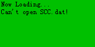 | 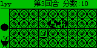 |

## Pet World 3H (宠物世界3H)

- Content: `LAVA1 宠物世界/GVmaker/NC3000/宠物世界3H.lav`.
- Problems: opcode `0x00` was rejected at `0x72`, although the reference VM
  treats it as a no-op. Importing only `GVmaker/NC3000` also omitted the sibling
  `LavaData/宠世图片.dat` directory.
- Fix: accept zero padding as a no-op; recognize `GVmaker` and `LAVA` device
  layouts with a sibling `LavaData` directory in both frontends. Standalone
  write-back uses the same root. Flat bundles retain their own content root.
- Validation: pet sprites, status information, pet management, detail pages,
  menu navigation and continued execution. Unit tests cover padding and
  nested resource/write-back paths, including unrelated ancestor directories.
  Write-back preserves existing on-disk path casing on case-sensitive systems.
  External multiplayer is outside this basic-control check.

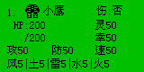

## Princess Maker 4 (美少女梦工场4)

- Content: `LAVA2 美少女梦工场/非pac/PM4.lav`.
- Problem: `/LavaData/pm_data*.dat` and `PM4_cfg.dat` could not be opened in
  the flat bundle, leaving a blank screen and exiting in the first frame.
- Fix: the shared flat-companion resolution above restores all four data
  files. This game's separate regression covers the complete introduction,
  character confirmation, main room, and opening the status screen with Enter.
- Validation: 6,666 scripted frames without an error or exit, a 15,000-frame
  exploratory replay, and visual inspection of the room and status pages.

| Main room | Status screen after Enter |
| --- | --- |
|  | 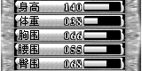 |

## Puzzled Sheep

- Content: `LAVA1 Puzzled Sheep/Psheep.lav`.
- Problem: starting the game opens `/GVMdata/Psheep.dat`, while the bundle
  places `Psheep.dat` beside the program; the game displayed `Error!` and exited.
- Fix: recognize the legacy `/GVMdata` resource prefix for existing flat
  companions, with the same exact-path priority as `/LavaData`.
- Validation: first-level loading, cursor movement, simulation animation,
  Escape to leave simulation, and 1,200 exploratory frames. Checked the
  supplied game source to verify the expected controls and resource name.

| Level selection | Simulation running |
| --- | --- |
| 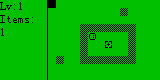 | 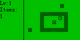 |

## Hit (打地鼠)

- Content: `LAVA2 打地鼠/LAVA2/Hit.lav`.
- Problem: the `LAVA2` program folder was not recognized as part of a device
  layout, so `/LavaData/MULogo.dat` could not be loaded and `Read Error` appeared.
- Fix: recognize `LAVA2` alongside `LAVA` and `GVmaker` in both frontends.
- Validation: logo, playfield, nine TYUGHJBNM hit controls, P to pause and
  Enter to resume. The regression checks the framebuffer stays frozen during
  a 120-frame pause and changes again after resuming. Also replayed 1,800 frames.
- Timer follow-up: `GetTime` now advances with the deterministic 60 Hz clock,
  including calendar rollovers. Previously it always returned the initial
  timestamp, preventing the game's countdown from advancing. The regression
  checks the game's time buffer changes over two seconds; clock tests cover
  leap years, year rollover, SetTime/GetTime, and save-state phase restoration.

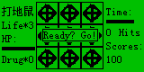

## Counter-Strike 1.3 (CS 1.3)

- Content: `LAVA1 CS 1.3/非pac/Cs(lav)1_3.lav`.
- Problem: the flat bundle's `Csgun.dat` and other resources could not be
  opened through `/LavaData`, preventing normal startup.
- Fix: shared resource resolution restores startup, animation and mission
  assets. This game's separate regression exercises the title, setup menu,
  mission loading and direction controls after the calendar-clock fix.
- Validation: the replay selects Start, confirms Ready, and reaches combat.
  Direction input changes the actual camera coordinate, and the mission
  framebuffer changes as well. Stage checks follow guest execution rather
  than assuming a fixed animation duration.

| Title | Mission |
| --- | --- |
| 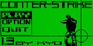 | 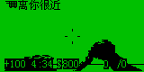 |

## Crazy F2 (疯狂F2)

- Content: `LAVA1 疯狂F2/F2.lav`.
- Problem: its five-second F2-press round polls the seconds returned by
  `GetTime`; the fixed timestamp previously prevented completion.
- Fix: the advancing guest calendar restores the round timer. This game's
  regression selects a platform, starts with F2, presses F2 five times, and
  waits for the score screen without injecting further input.
- Validation: the round completes and reports a positive press count. The
  initial title intentionally waits for F2, rather than Enter, to begin.


## Lost Fantasy

- Content: `LAVA1 lost fantasy/LF_demo.lav` and `LF_demo(PC).lav`.
- Problem: the device version continuously captures and redraws the full
  monochrome screen. Per-pixel buffer access made its 1,800-frame corpus
  replay exceed the 45-second scan limit. The PC version adds a 30 ms delay.
- Fix: copy in-bounds monochrome bitmaps in groups of eight pixels, and pack
  captured rows directly. Clipped, mirrored, inverted, and other color modes
  retain their existing paths. The bitmap fast paths preserve pixel results;
  presentation pacing is handled separately below.
- Validation: the same 1,800-frame replay completes in about 2.9 seconds when
  run individually on the development machine; frame 1,199 is identical to the
  previous capture. Both versions respond to D movement, with horizontal
  position and framebuffer differences checked against an idle clone.
  Bitmap tests exercise all 256 byte patterns and neighboring-pixel boundaries.


## Speed Racing corpus variant (极速狂飙 / 生死时速II)

- Content: `LAVA1 极速狂飙/极速狂飙.lav`, whose in-game title is 生死时速II.
- Problem: `Refresh` copied the framebuffer but kept executing guest code in
  the same host frame. Unthrottled draw loops consumed CPU and advanced past
  the moment when the frontend could deliver steering input.
- Fix: `Refresh` now returns `Presented`, yielding to the host after each
  visible frame. Unit tests check that successive presented frames remain
  distinct. The instruction budget remains unchanged.
- Validation: enter the main menu, select a difficulty, and start the game.
  Right steering changes horizontal position and the rendered track compared
  with an idle clone. All previously completed game regressions are rerun;
  the CS 1.3 replay now explicitly handles its Ready confirmation.


## Modified Speed Racing II (生死时速Ⅱ修改版)

- Content: `LAVA1 生死时速II/生死时速Ⅱ（修改版）.lav`.
- Problem: its score loop repeatedly calls Locate, printf and Inkey without
  Refresh. Profiling found 6,250 identical score prints in one host frame,
  making the full replay exceed the 45-second scan limit.
- Fix: printf yields `Presented` after rendering its console output, giving
  the frontend a display/input boundary for console-driven loops as well.
- Validation: choose easy mode, steer right, reach a stable score screen, and
  return to the mode menu with Escape. Steering position is checked against
  an idle clone. A 3,600-frame replay completes in about 0.4 seconds locally.
  A core test confirms console output is presented before the next input poll.

| Score | Menu after Escape |
| --- | --- |
|  | 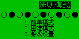 |

## Resource Manager (文件夹助手 3.7)

- Content: `LAVA1 百战天虫即时版/资源管理器.lav`.
- Problem: FileList returned cancellation immediately, so the program exited
  without showing its directory picker.
- Fix: implement the blocking file picker, GBK names, cursor and page navigation,
  selection/scroll return values, cancellation, and SetList help/delete flags.
  The caller handles directory changes and file operations, as in the reference VM.
- Validation: dismiss the splash, move the selection, open the file action menu,
  restore a pending picker save state, cancel, and confirm normal exit. Core tests
  cover Chinese names, paging, special keys, reset, and version 2 state migration.
  This introduced save-state version 3; current states retain version 2 loading support.

| Directory picker | File actions |
| --- | --- |
| 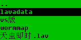 | 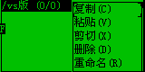 |

## Pet World legacy and L variants (宠物世界)

- Content: NC2600, NC3000, TC1000, TC1000S, and TC808 pairs under
  `LAVA1 宠物世界/GVmaker`.
- Initial finding: the five `宠世L_*.lav` variants exit immediately when
  `/LavaData/宠世存档.sav` does not exist. The main variants can start a new game.
- Validation: start each matching main variant, open the left/right menu,
  move right four times to 存档, and confirm. Transfer the actual written save
  into its L variant, then verify the sprite, pet management, and details controls.
  All five pairs pass without modifying their game binaries or synthesizing saves.
  This closes the earlier startup-only scan gap for these variants; the existing
  device-resource loading fixes are sufficient.

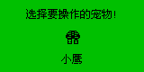

## Magic / 神州

- Content: `LAVA1 神州/神州.pac` and `非pac/Magic.lav`.
- Problem: the loose `非pac/Magic.lav` cannot open `GameSource.dat`, which is
  only present inside the PAC.
- Fix: both frontends can load the complete PAC. For a loose LAV, they also check
  PAC files beside it and in its parent directory. A package must contain the exact
  same program bytes before its missing resources are mounted in memory. Existing
  files, including loose saves resolved through LavaData aliases, take priority.
  The search stops at the nearest matching package and does not unpack onto disk.
- Validation: both the complete package and the loose LAV open `GameSource.dat`, display the intro,
  advances through dialogue, and reaches the map. Right input changes the rendered
  player position compared with an idle clone. Unit tests cover multiple entries,
  Chinese paths, truncated records, invalid paths, and the libretro load lifecycle.
  Additional regressions reject mismatched/incomplete companion packages and verify
  that an existing loose save remains authoritative and writes back to its original file.
  A filename-only CLI launch from the loose game's working directory is covered as
  well: relative paths are resolved before companion lookup and write-back. The
  earlier empty parent path caused even `lavaxemu --info Magic.lav` to fail.

| Map | After right movement |
| --- | --- |
| 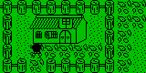 | 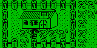 |


## Super Robot Wars (超级机器人大战)

- Content: `LAVA1 超级机器人大战/Setup/SRWDate.lav`, `Setup/SRW.lav`,
  and `Download/SRW.pac`.
- Initial finding: opening `Setup/SRW.lav` before running its data installer
  displays an installation error. `SRWDate.lav` finishes quickly because it is
  the installer, rather than a standalone game.
- Validation: execute the installer to completion, transfer its actual written
  data files into the setup game, start a new game, and advance into the tactical
  map. Right input moves the cursor compared with an idle clone. The complete PAC
  also loads its data and point tables and reaches the map and unit information.
  The PAC loader fixes the complete-package entry point; the setup pair works
  with the existing virtual file write-back workflow.

| Tactical map | Cursor after right input |
| --- | --- |
|  | 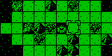 |

## Magic Era (魔法纪元)

- Content: `LAVA2 魔法纪元/魔法纪元.lav`.
- Problem: after the title prompt, the game checks that GetPID's high byte is
  `L` and exits when the previous zero-valued implementation fails this check.
  The reference PC VM also deliberately returns zero, so matching its exit alone
  would not satisfy compatibility with a Lava device.
- Fix: return the stable virtual Lava device identifier `0x4c000001`, following
  the device identifier layout shown in the original VM source. It remains
  consistent across resets and does not use a physical device's identity.
- Validation: pass the title/menu, start a new game, advance the opening story,
  and reach the castle map. Right input changes the player's rendered position
  against an idle replay. The regression covers 18,120 frames; the identifier
  test checks the value before and after reset. All 16 content/layout regressions
  pass, and a fresh scan of 267 LAV programs plus 57 PAC packages reports no
  loading errors, runtime errors, or timeouts. The scan does not certify every
  game's complete interaction flow.

| Castle map | After movement |
| --- | --- |
| 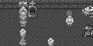 | 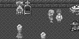 |

## New Hero (新英雄坛说)

- Content: `LAVA1 新英雄坛说/非pac/Hero.lav`.
- Validation gap: the short batch replay only reached the long introductory
  dialogue and could not establish that the map accepted input.
- Validation: advance 7,200 frames through the startup sequence into the village,
  then compare separate up/down branches with an equal-duration idle replay.
  Up moves the player; down moves the player and scrolls the village map.
  The existing core and resource fixes suffice; this adds a gameplay regression
  rather than changing the game or emulator behavior.

| Village | Map after down input |
| --- | --- |
| 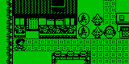 | 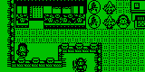 |

## Tokimeki (心跳回忆)

- Content: `LAVA2 心跳回忆/心跳回忆.lav`.
- Validation gap: the initial short replay remained in the story; a later room
  capture alone did not prove the activity controls worked.
- Validation: advance into the room, change the selected bottom icon with Right,
  open the club/work menu, select its ESC item with Enter to return to the room,
  and open Help (guest key 25 / F5) to display the icon descriptions. The menu's
  ESC item is selected with Enter; the physical Escape key does not close it.
  Several study activities update attributes without replacing the room image.
  No additional emulator behavior changes were needed for this workflow.

| Room | Club/work menu | Help |
| --- | --- | --- |
| 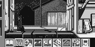 |  | 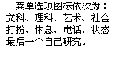 |

## Gamble (先赌为快)

- Content: `LAVA1 先赌为快/先赌★为快.lav`.
- Problem: the board's device-specific heart, snail, and other icons use F8–FD
  codes outside GB2312. The existing font rejected these pairs and interpreted
  subsequent bytes as unrelated Chinese characters, making the board unreadable.
- Fix: add the 527 built-in 16×16 NC/TC device icon glyphs and decode their
  documented two-byte range. The unchanged bitmap asset comes from the MIT-licensed
  WQX toolbox; its pinned source and retained license are in the assets directory.
- Validation: register a local account through 新手上路, acknowledge its restart
  request, reload the actual account file, and log in through 再续赌缘. The full
  board now displays its icons. Q adds a bet, Enter advances the round, the result
  prompt appears, and another bet can be placed afterward. The core regression
  checks the heart bitmap and the following ASCII character's position.

| Before | Correct board | Completed round |
| --- | --- | --- |
| 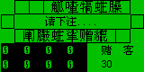 | 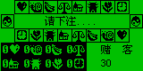 | 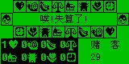 |

## Shushan (蜀山群侠传)

- Content: `LAVA1 蜀山群侠传/蜀山注册.lav` and `蜀山群侠传.lav`.
- Validation gap: the main game needs a local character account created by its
  separate registration program. Sending generic menu keys without that account
  never verified actual gameplay.
- Validation: follow the bundled manual, create an account and confirm with Y,
  transfer the registration program's actual `M-lava.dat` file, then log in with
  the main game after its splash finishes. Advance the story to the first map,
  compare upward movement with an idle branch, and open/close F3 character status.
  This verifies the existing shared file workflow without synthesizing a character
  save or changing the game binary.

| First map | Character status |
| --- | --- |
| 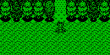 | 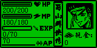 |

## My World corpus variant (我的世界～霸王屎)

- Content: `LAVA1 我的世界~霸王屎/我的世界.lav`.
- Validation gap: the generic direction sequence selected Exit from the main menu;
  an early halt therefore did not determine whether the game itself was playable.
- Validation: wait for the introductory animation, start a new character, enter a
  name, and confirm the character setup. The program loads `mine_SC.dat` and enters
  its tile map. Up input changes the player's rendered position compared with an
  equal-duration idle replay. No emulator behavior change was needed for this path.

| Map | After movement |
| --- | --- |
| 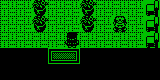 | 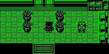 |

## Holiday Island (假日神秘岛)

- Content: `LAVA1 假日神秘岛/假日神秘岛 abcdef.lav`.
- Validation gap: the earlier replay sampled the lengthy opening sequence, during
  which the candidate movement keys did not affect the scene.
- Validation: advance 18,000 frames into the island map. Right input triggers the
  nearby conversation; further right presses finish it and walk along the path.
  A subsequent left branch changes the player/camera position relative to an
  equal-duration idle replay. Map tiles, characters, and dialogue render correctly.
  This closes the sampling gap without changing the program's original intro.

| Island map | Conversation | After walking along the path |
| --- | --- | --- |
| 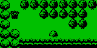 | 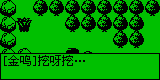 | 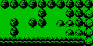 |

## Crazy Ball updated corpus version (疯狂弹球)

- Content: `LAVA1 疯狂弹球/疯狂弹球.pac` and `非pac/crazyball.lav`.
- Problem: the loose program could display its setup screens but failed to load
  `/CBMap/stagepack.dat`, reporting a stage-pack error instead of starting play.
- Fix: the matching-package loader supplies the missing CBMap files from the PAC,
  whose embedded program is byte-for-byte identical to the loose LAV.
- Validation: both entry points complete the initial player/control setup and
  display the first stage. Enter launches the ball; it hits bricks and scores.
  Left input changes the paddle position relative to an idle clone executing
  the same number of frames. This is a separate version from `LAVA1 Crazy_ball`.

| Missing stage pack | Loose LAV after loading | Paddle after left input |
| --- | --- | --- |
| 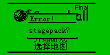 | 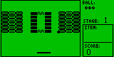 | 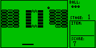 |

## Planting Gold (种金币)

- Content: `LAVA1 种金币/种金币.lav`.
- Validation gap: a small final-frame thumbnail showed the stage chooser rather
  than the playing board, leaving its coin controls unverified.
- Validation: dismiss the logo, choose level one, and use D (the documented WASD
  controls) to move a coin and increment the step counter. F1 replays the level;
  after its wipe transition, the entire board and zero step count exactly match
  the initial state. No additional emulator behavior changes were required.

| Level one | Coin after D |
| --- | --- |
| 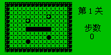 | 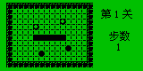 |

## Sky & Land (幕天席地 1.1)

- Content: `LAVA1 幕天席地1.1/幕天席地.lav`.
- Validation gap: the generic replay entered existing-account login without first
  creating a character, so its missing-account message did not validate gameplay.
- Validation: hold Enter briefly to leave the animated credit/title screens,
  choose a new game, confirm, and enter a local account and password. Up moves
  the character against an idle replay. F5 (guest key 25) opens the system menu;
  saving writes an 88-byte `LavaData/lava.sls` character file. Start a new emulator,
  provide that actual file, and log in: the saved map viewport and character
  position are restored exactly. The independently scrolling footer is excluded
  from the map comparison. No additional emulator behavior changes were needed.

| Map | System menu | Reloaded character |
| --- | --- | --- |
| 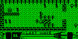 | 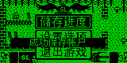 |  |

## Star Legend (星剑传奇)

- Content: `LAVA1 星剑传奇/未打包的[星剑传奇]/星剑注册.lav` and
  `星剑传奇.lav`; the PAC starts its embedded registration program.
- Validation gap: generic input stopped at account setup rather than proving
  that a registered character could enter the game. Both account and password
  must exceed five characters; the confirmation explicitly requires Y.
- Validation: enter a six-character account/password, confirm with Y, select a
  character, and enter a name. Registration writes a real 194-byte
  `LavaData/S-lavaxx.dat`. A fresh main-game instance reads that file, accepts
  the credentials, and displays the character summary. Enter opens the map;
  Up moves the character relative to an equal-duration idle replay. The PAC
  registration flow also reaches the success screen and writes the same file.
  No additional emulator behavior changes were required.

| Registration | Loaded character | Map movement |
| --- | --- | --- |
| 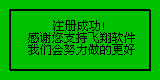 | 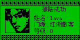 | 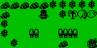 |

## Flat Cube (平面魔方)

- Content: `LAVA1 平面魔方/平面魔方.pac` and `非pac/平面魔方.lav`.
- Validation gap: the default menu selection opens instructions, so repeated
  Enter input never established whether the puzzle itself worked.
- Validation: Right then Enter starts the challenge. Direction keys select a
  tile; M then Right shifts a row and increments the move count. C, Right, Enter
  exchanges two tiles and reduces the exchange allowance from three to two.
  Esc opens the exit confirmation, and Y returns to the main menu. Both entry
  points render the full 5-by-5 icon grid and perform these operations. No
  additional emulator behavior changes were required.

| Starting board | Row shifted | Tiles exchanged |
| --- | --- | --- |
|  | 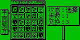 | 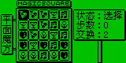 |

## Rocket Car (火箭车)

- Content: `LAVA1 火箭车/火箭车.lav`.
- Problem: menus and sprites rendered, but most track traffic disappeared once
  the initial screen scrolled away. The program accesses `_GRAPH` directly;
  address zero was returned without actually mapping the packed front buffer.
- Fix: lazily map GVmaker 1.0's 160-by-80 monochrome front/back buffers at
  addresses 0 and 1600. Keep guest assignments, memory-copy calls, and drawing
  calls coherent. Track RAM writes and synchronize small point/rectangle updates
  by region so repeated cursor drawing does not copy the entire screen.
  The layout is corroborated by
  [GVmakerSE RamManager](https://github.com/arucil/GVmakerSE/blob/f87166975bebfb3672c69de89838765a7106dde0/src/main/java/eastsun/jgvm/module/RamManager.java)
  and [its packed screen buffers](https://github.com/arucil/GVmakerSE/blob/f87166975bebfb3672c69de89838765a7106dde0/src/main/java/eastsun/jgvm/module/DefaultScreenModel.java).
  Save-state version 4 preserves activation and continues to load versions 2/3.
  Larger/color displays retain their existing unsupported direct-buffer behavior.
- Validation: start play and advance beyond the initial traffic. The track
  continues to render; Up changes the player position against an idle branch.
  Esc opens the score/name screen; entering a driver name returns to the title.
  Unit tests cover direct writes, drawing across packed-byte boundaries, bulk
  copies, and save-state restoration.

| Before | Track after the fix | Steering |
| --- | --- | --- |
|  | 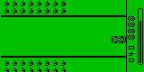 | 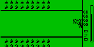 |

## Lazy YY Milk Battle (Lazy YY 牛奶大战)

- Content: the loose LAV and PAC in `LAVA1 Lazy YY牛奶大战/Ver1.2`, and the
  PAC in `Ver1.5 For TC800 Only`.
- Validation gap: the generic input sequence did not use the game's feeding
  keys. The empty dashed slots are the item inventory, not an account prompt.
  Version 1.2 creates `CatUser.dat` automatically when needed.
- Validation: enter challenge mode and start the first stage. Version 1.2 uses
  G/J to feed left/right; version 1.5 uses Left/Right. Feeding changes the
  milk/target state relative to an idle branch; the grey version's remaining
  target count drops from 150 to 149. Space pauses each version and the scene
  remains identical over another 60 frames. Space resumes 1.2; Enter selects
  Continue in 1.5's pause menu. Esc returns to the menu. Monochrome and grey
  sprites, counters, and menus render correctly. No additional emulator behavior
  changes were required.

| Monochrome play | Monochrome pause | Grey feeding | Grey pause menu |
| --- | --- | --- | --- |
| 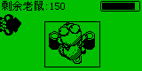 | 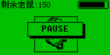 | 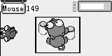 | 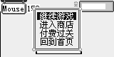 |
